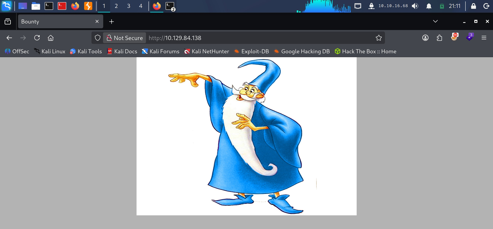
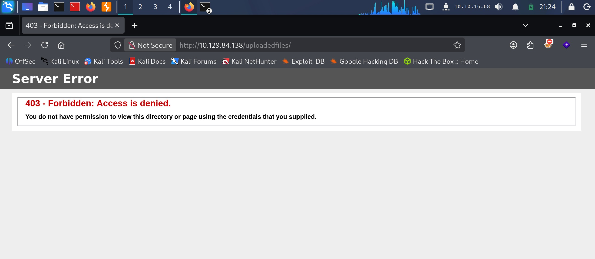
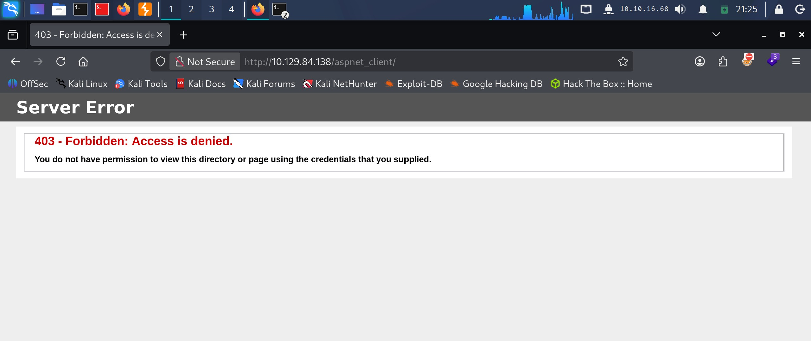

# Bounty - Easy

Target IP: **10.129.84.138**

## User Flag

Initial scan: ```sudo nmap -sC -sV -p- 10.129.84.138 -v```

Output shows port 80 open, hosting a web server.

```
PORT   STATE SERVICE VERSION
80/tcp open  http    Microsoft IIS httpd 7.5
|_http-title: Bounty
|_http-server-header: Microsoft-IIS/7.5
| http-methods: 
|   Supported Methods: OPTIONS TRACE GET HEAD POST
|_  Potentially risky methods: TRACE
Service Info: OS: Windows; CPE: cpe:/o:microsoft:windows
```

Let's navigate to it.

The website just displays a single image.



We get a single hit from directory enumeration, ```/uploadedfiles```. Definitely seems lucrative.

```
┌──(y㉿peacebreaker)-[~]
└─$ ffuf -w /usr/share/wordlists/dirbuster/directory-list-2.3-small.txt -u http://10.129.84.138/FUZZ -ic -ac      

        /'___\  /'___\           /'___\       
       /\ \__/ /\ \__/  __  __  /\ \__/       
       \ \ ,__\\ \ ,__\/\ \/\ \ \ \ ,__\      
        \ \ \_/ \ \ \_/\ \ \_\ \ \ \ \_/      
         \ \_\   \ \_\  \ \____/  \ \_\       
          \/_/    \/_/   \/___/    \/_/       

       v2.1.0-dev
________________________________________________

 :: Method           : GET
 :: URL              : http://10.129.84.138/FUZZ
 :: Wordlist         : FUZZ: /usr/share/wordlists/dirbuster/directory-list-2.3-small.txt
 :: Follow redirects : false
 :: Calibration      : true
 :: Timeout          : 10
 :: Threads          : 40
 :: Matcher          : Response status: 200-299,301,302,307,401,403,405,500
________________________________________________

                        [Status: 200, Size: 630, Words: 25, Lines: 32, Duration: 26ms]
UploadedFiles           [Status: 301, Size: 158, Words: 9, Lines: 2, Duration: 69ms]
uploadedFiles           [Status: 301, Size: 158, Words: 9, Lines: 2, Duration: 40ms]
                        [Status: 200, Size: 630, Words: 25, Lines: 32, Duration: 44ms]
uploadedfiles           [Status: 301, Size: 158, Words: 9, Lines: 2, Duration: 28ms]
:: Progress: [87651/87651] :: Job [1/1] :: 766 req/sec :: Duration: [0:01:33] :: Errors: 0 ::
```

However, we are restricted.



Scanning with another wordlist gets us another hit, ```/aspnet_client```.

```
┌──(y㉿peacebreaker)-[~]
└─$ ffuf -w /usr/share/wordlists/SecLists/Discovery/Web-Content/common.txt -u http://10.129.84.138/FUZZ -ic -ac 

        /'___\  /'___\           /'___\       
       /\ \__/ /\ \__/  __  __  /\ \__/       
       \ \ ,__\\ \ ,__\/\ \/\ \ \ \ ,__\      
        \ \ \_/ \ \ \_/\ \ \_\ \ \ \ \_/      
         \ \_\   \ \_\  \ \____/  \ \_\       
          \/_/    \/_/   \/___/    \/_/       

       v2.1.0-dev
________________________________________________

 :: Method           : GET
 :: URL              : http://10.129.84.138/FUZZ
 :: Wordlist         : FUZZ: /usr/share/wordlists/SecLists/Discovery/Web-Content/common.txt
 :: Follow redirects : false
 :: Calibration      : true
 :: Timeout          : 10
 :: Threads          : 40
 :: Matcher          : Response status: 200-299,301,302,307,401,403,405,500
________________________________________________

aspnet_client           [Status: 301, Size: 158, Words: 9, Lines: 2, Duration: 28ms]
uploadedfiles           [Status: 301, Size: 158, Words: 9, Lines: 2, Duration: 25ms]
:: Progress: [4752/4752] :: Job [1/1] :: 1587 req/sec :: Duration: [0:00:03] :: Errors: 0 ::
```

We are also restricted here.



However, the existence of ```/aspnet_client``` tells me that ASP.NET is being used. Thus, we could scan again, but this time by adding the ```.aspx``` extension.

Doing so, we find something interesting.

```
┌──(y㉿peacebreaker)-[~]
└─$ ffuf -w /usr/share/wordlists/dirbuster/directory-list-2.3-small.txt -u http://10.129.84.138/FUZZ -e .aspx -ic -ac

        /'___\  /'___\           /'___\       
       /\ \__/ /\ \__/  __  __  /\ \__/       
       \ \ ,__\\ \ ,__\/\ \/\ \ \ \ ,__\      
        \ \ \_/ \ \ \_/\ \ \_\ \ \ \ \_/      
         \ \_\   \ \_\  \ \____/  \ \_\       
          \/_/    \/_/   \/___/    \/_/       

       v2.1.0-dev
________________________________________________

 :: Method           : GET
 :: URL              : http://10.129.84.138/FUZZ
 :: Wordlist         : FUZZ: /usr/share/wordlists/dirbuster/directory-list-2.3-small.txt
 :: Extensions       : .aspx 
 :: Follow redirects : false
 :: Calibration      : true
 :: Timeout          : 10
 :: Threads          : 40
 :: Matcher          : Response status: 200-299,301,302,307,401,403,405,500
________________________________________________

                        [Status: 200, Size: 630, Words: 25, Lines: 32, Duration: 394ms]
transfer.aspx           [Status: 200, Size: 941, Words: 89, Lines: 22, Duration: 168ms]
```

Let's navigate to ```transfer.aspx```.

## Root Flag

## Contact

Email: <johnyang4406@gmail.com>, <john_s_yang@brown.edu>

LinkedIn: <https://www.linkedin.com/in/john-yang-747726292/>

HackTheBox: <https://profile.hackthebox.com/profile/019c423f-9b9b-708f-8b31-55983b89dddd?utm_medium=copy_url/>
