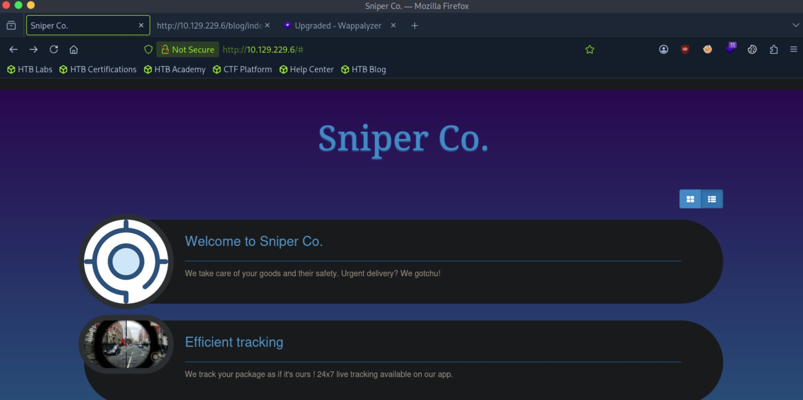
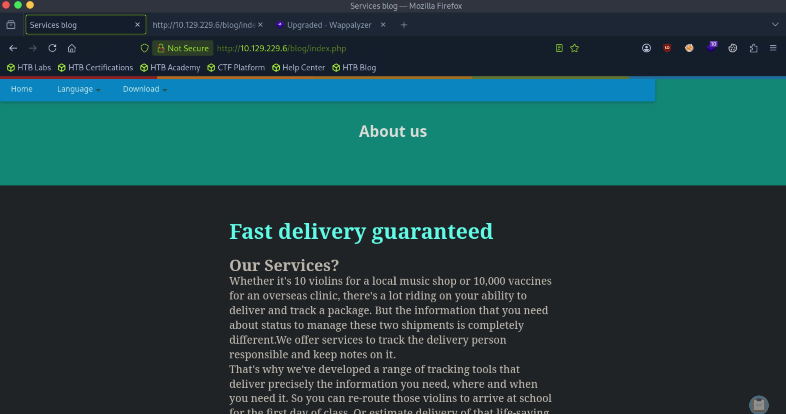
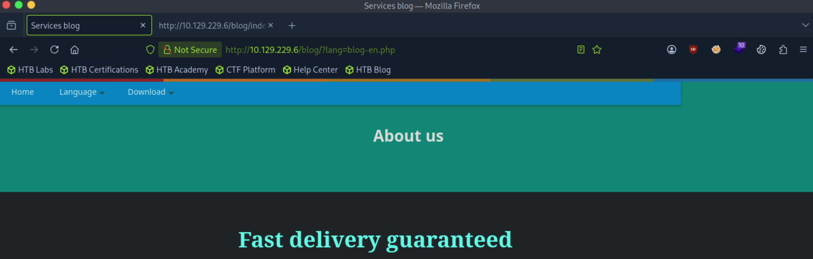
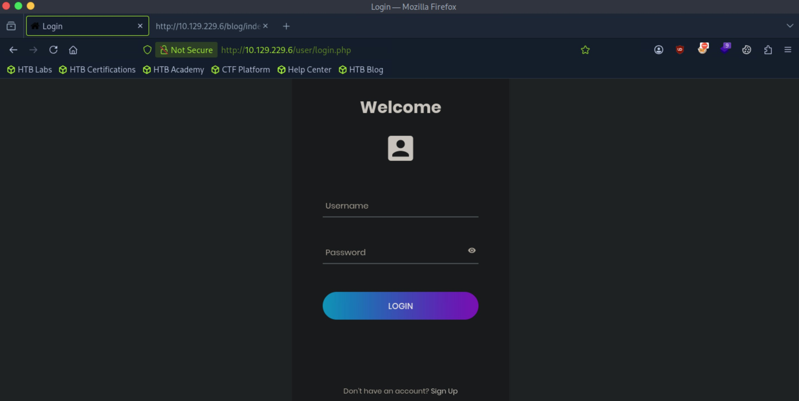

# Sniper - Medium

Target IP: **10.129.229.6**

## User Flag

Initial scan: ```sudo nmap -sC -sV -p- 10.129.229.6 -v```

Output shows RPC and SMB running on the target machine.

```
Not shown: 65531 filtered tcp ports (no-response)
PORT      STATE SERVICE       VERSION
135/tcp   open  msrpc         Microsoft Windows RPC
139/tcp   open  netbios-ssn   Microsoft Windows netbios-ssn
445/tcp   open  microsoft-ds?
49667/tcp open  msrpc         Microsoft Windows RPC
Service Info: OS: Windows; CPE: cpe:/o:microsoft:windows
```

Null sessions are not allowed.

```
┌─[us-dedivip-5]─[10.10.15.194]─[htb-mp-3199654@htb-4t2lnegjae]─[~]
└──╼ [★]$ smbclient -N -L //10.129.229.6
session setup failed: NT_STATUS_ACCESS_DENIED
```

Same for RPC...

```
┌─[us-dedivip-5]─[10.10.15.194]─[htb-mp-3199654@htb-4t2lnegjae]─[~]
└──╼ [★]$ rpcclient -N -U '' 10.129.229.6
Cannot connect to server.  Error was NT_STATUS_ACCESS_DENIED
```

Let's scan again, this seems unusual.

The first scan somehow missed port 80.

```
Discovered open port 80/tcp on 10.129.229.6
```

Let's navigate to it.



Clicking on one of the options brings us to ```/blog```.



There is a languages dropdown that lets us select the display language. This is done by sending a GET request with a paramter that loads a php file. This could be vulnerable to LFI.



There is also a login page.



The question now is what file to try getting from the potential LFI. Assuming that the log in page is for some management portal, if we can steal a PHPSESSID for a previous user, it might be useful.


## Root Flag

## Contact

Email: <johnyang4406@gmail.com>, <john_s_yang@brown.edu>

LinkedIn: <https://www.linkedin.com/in/john-yang-747726292/>

HackTheBox: <https://profile.hackthebox.com/profile/019c423f-9b9b-708f-8b31-55983b89dddd?utm_medium=copy_url/>
